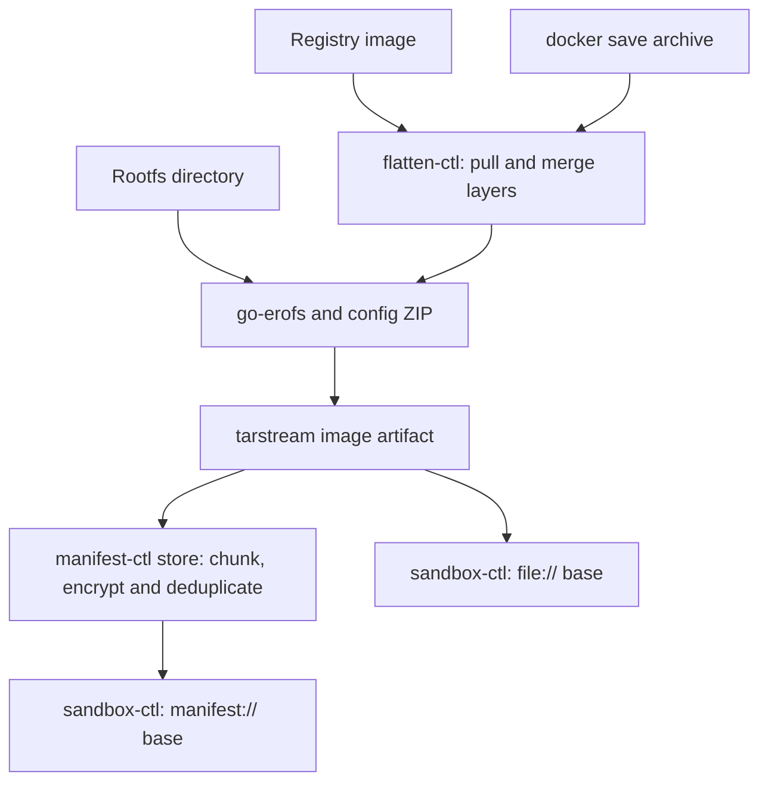

[English](flatten-cli.md) | [简体中文](flatten-cli_zh.md)

# flatten-ctl: prepare, inspect and manage image artifacts

Use this guide for the complete CLI, remote-image and local-directory workflows, output inspection, pull-cache maintenance and workload checks. The Runtime release unit publishes `flatten-ctl`; Accelerator owns the [shared preparation contract](https://github.com/kuasar-sandbox/accelerator/blob/main/docs/image-preparation.md) and [generic artifact formats](https://github.com/kuasar-sandbox/accelerator/blob/main/docs/artifacts.md).

Merge the layers of an OCI/Docker image into one EROFS filesystem payload, packaged as a **tarstream image artifact** for `manifest-ctl` or the sandbox's read-only `boot.root.base`. A normal `.img` export contains a payload named `image` plus a digest marker; it is not a bare filesystem suitable for direct `mount -t erofs`. Platform readers unwrap it. For a direct filesystem mount, first extract the `image` payload ([`flatten-ctl tar` — tar extraction and single-file sparse streams](#flatten-ctl-tar--tar-extraction-and-single-file-sparse-streams), [Byte layout](https://github.com/kuasar-sandbox/accelerator/blob/main/docs/image-preparation.md#byte-layout)).

`flatten-ctl` emphasizes **determinism**: the same immutable source, runtime configuration, tool versions and build settings are intended to produce identical payload bytes, keeping downstream chunk deduplication and manifest content keys stable. The payload **embeds the OCI runtime configuration** in a trailing ZIP, so sandbox startup obtains Entrypoint, Env, WorkingDir and other launch settings without a separate index file.

## Overview

### Why flatten images

Container images contain several tar layers. A container runtime normally merges them with overlayfs, fuse-overlay or another filesystem mechanism. For the sandbox image path, layers are **merged offline into one EROFS payload**:

- The guest receives a read-only base through vhost-user-blk; it does not assemble the original container layer stack. A writable sandbox can still combine this base with an ext4 upper layer using guest overlayfs.
- Sandboxes can share immutable backing data through the host data/cache paths. The amount of sharing depends on that path and the workload; flattening alone does not guarantee a particular memory-density gain.
- EROFS is read-only and immutable, matching the manifest layer's chunk and content-key addressing.

### Inputs and output

Choose one of three inputs:

- **Remote registry image:** a reference such as `nginx:1.27` or `gcr.io/ns/app@sha256:...`. `flatten-ctl` pulls and flattens it directly ([Remote pulling, local caching and Referrers writeback](#remote-pulling-local-caching-and-referrers-writeback)). `FLATTEN_REGISTRY_*` environment variables supply credentials, and an explicit OCI-layout cache can be shared across processes. Without `cache.dir`, layers stream directly.
- **Docker archive:** a tar stream produced by `docker save`, supplied on stdin or from a local file.
- **Already-flattened rootfs directory:** if the positional argument is a local directory, the Go planner reads it in place without a staging-tree copy or source mutation ([`flatten-ctl export`](#flatten-ctl-export)). This still reads source data and writes the output.

Arbitrary OCI-layout directories are not accepted as OCI image sources; see [Unsupported or deferred features](https://github.com/kuasar-sandbox/accelerator/blob/main/docs/image-preparation.md#unsupported-or-deferred-features).

The output is **one tarstream artifact**: an `image` payload containing `EROFS + trailing ZIP`, followed by the platform digest marker ([Image format](https://github.com/kuasar-sandbox/accelerator/blob/main/docs/image-preparation.md#image-payload-and-runtime-configuration)). The ZIP contains the projected OCI runtime configuration. Registry and docker-archive layers feed the same flattening sink; equivalent uncompressed layers and runtime configuration, built with the same tools/settings, produce the same EROFS payload. Directory export is also deterministic for an unchanged tree and configuration: the Go planner fixes output timestamps at zero without modifying the tree. Artifact reproducibility additionally includes the authoritative sparse map and wrapper encoding.

Flattening itself does not sign, encrypt or content-address the data. Optional `--upload` invokes the next manifest-ingest stage, which handles encryption and deduplication; see [manifest.md](https://github.com/kuasar-sandbox/accelerator/blob/main/docs/transfer.md). Do not infer an image-signature verification step from manifest integrity or encryption.

### Position in the system



## Command-line interface

The CLI does not provide the `flatten-ctl verify` duplicate-export comparison command. Determinism is checked through unit tests and reproducible Manifest keys.

There are seven subcommands: `export` creates an image artifact with optional upload; `referer` provides atomic OCI Referrers lookup/put operations; `info` inspects a local artifact or `manifest://` reference; `cache` inspects or reclaims the pull cache; `config` prints or validates flatten configuration; `tar` extracts archives or packages one file; and `mountpoint` creates a self bind mount for in-guest export.

| Subcommand | Purpose |
|---|---|
| `export` | Registry image, docker-archive or rootfs directory → deterministic EROFS in a **tarstream image artifact** (`image` entry, conventional `.img` suffix); `--upload` also ingests it into the store and prints the manifest key. |
| `referer` | `lookup` checks for a reusable manifest ID associated with the source image; `put` writes a host-uploaded manifest ID to the source repository's OCI Referrers ([Remote pulling, local caching and Referrers writeback](#remote-pulling-local-caching-and-referrers-writeback)). |
| `info` | Read the payload's EROFS superblock and trailing OCI configuration ZIP through the artifact envelope. |
| `cache` | `cache info` reports occupancy; `cache gc` reclaims by LRU to the requested limit ([`flatten-ctl cache` — inspect and reclaim the pull cache](#flatten-ctl-cache--inspect-and-reclaim-the-pull-cache)). |
| `config` | Print normalized, validated configuration from `--config`/`FLATTEN_CONFIG`, or a `--template` skeleton; `-o <file>` writes a file instead of stdout. |
| `tar` | General tar extraction with exact declared-hole handling, and single-file packaging ([`flatten-ctl tar` — tar extraction and single-file sparse streams](#flatten-ctl-tar--tar-extraction-and-single-file-sparse-streams)). |
| `mountpoint` | `mountpoint <dir>` performs MkdirAll and a self bind mount, letting `export --skip-mounts` exclude it. Use it for scratch/output when a guest exports its own rootfs, preventing self-inclusion. Linux only; mounting requires the corresponding privilege. |

`export` uses a **positional input argument**. It first recognizes a local directory; directory input rejects the registry/archive forcing flags. Otherwise the default classification is:

```text
1. Omitted or "-"              → stdin docker-archive
2. "docker-archive:<path>"     → local archive, with the prefix removed
3. os.Stat finds a local file  → local docker-archive (./app.tar or /abs/x.tar)
4. Otherwise                  → remote reference parsed by name.ParseReference
```

`--registry` / `--archive` force the non-directory source interpretation when a filename resembles `repo:tag`; the two flags are mutually exclusive. `info` requires a positional artifact path or `manifest://<hex>`. Place positional arguments **after flags**, because Go's standard flag parser stops at the first non-flag argument.

Registry/archive export preserves ownership and permissions ([Layout and metadata policy](https://github.com/kuasar-sandbox/accelerator/blob/main/docs/image-preparation.md#layout-and-metadata-policy)), so it requires root or `CAP_CHOWN`, checked before expensive pull/extraction. Directory export only needs sufficient tree access because it does not chown the source; exporting a complete rootfs normally requires root. `referer`, `info`, `cache` and `config` do not require elevated privileges.

Progress and diagnostics go to stderr. Stdout carries requested results: the artifact stream, manifest key, or resolved digest with `--print-digest`. Keep these output modes separate in scripts: the current CLI can append a manifest key after an artifact for `--upload --output -`, and `--upload --print-digest` produces multiple stdout values. Use a named `--output` or upload without artifact stdout when capturing a key.

`export` / `cache gc` accept `--no-progress`. Streaming export reports preparation stages as `flatten: ...`; upload reports `upload: ...` with percentage and rate. The complete-download `remote.Pull` API retains its separate layer-count progress callback. Byte-progress updates are throttled to two seconds.

Directory export excludes regular files attached to stdout or stderr, including aliases inside the source, before planning or writing progress. The open file identity is used; procfs path resolution is unnecessary. Pipes remain streamed directly. Explicit output paths, scratch and these redirected files share the same selection for planning, reads and final validation.

### `flatten-ctl export`

```text
flatten-ctl export [flags] <ref|path|->

  <ref|path|->            Registry reference, docker-archive or rootfs directory;
                          omitted or '-' means stdin docker-archive.
  --output <path|->       Image-artifact output (tarstream, payload image, usually .img).
                          '-' writes stdout and refuses a terminal. Required without
                          --upload; optional with --upload (temporary artifact discarded).
  --upload                Ingest the payload into the store and print its manifest key.
  --manifest-config <p>   Manifest YAML, overriding MANIFEST_CONFIG; needed for --upload.
  --config <p>            Flatten YAML, overriding FLATTEN_CONFIG: tmpdir/platform/
                          tls/cache/referer (Remote pulling, local caching and Referrers writeback).
  --platform <os/arch>    Override the pull platform (os/arch[/variant]).
  --tmpdir <dir>          Override scratch parent; created if missing. For in-guest root
                          export, use a mountpoint-created directory, so --skip-mounts
                          excludes scratch, including planner temporary files.
  --insecure              Registry source: allow plain HTTP; TLS verification is controlled
                          separately by tls.* in the configuration.
  --no-progress           Disable stderr progress.

  # Remote registry source (Remote pulling, local caching and Referrers writeback)
  --print-digest          Print resolved source repo@sha256:... to stdout;
                          mutually exclusive with --output -.
  --registry / --archive  Force registry / local-archive interpretation.
  # Rootfs-directory source (see below)
  --skip <rel>            Exclude the node and subtree relative to rootfs
                          (relative source-path semantics); repeatable.
  --skip-mounts           Exclude mountpoints strictly below rootfs using mountinfo.
  --runtime-config <p>    OCI image config or projected config.json; detected by top-level
                          keys. Omitted means an empty runtime configuration.
```

Typical usage:

```bash
# Remote registry image → one image artifact
flatten-ctl export --output nginx.img nginx:1.27

# Upload directly; stdout is the manifest key. Credentials use the environment.
export FLATTEN_REGISTRY_USERNAME=robot FLATTEN_REGISTRY_PASSWORD=…
flatten-ctl export --upload --manifest-config manifest.yaml --config flatten.yaml \
    registry.example.com/team/app@sha256:… > app.key

# docker save pipeline; omitted input means stdin
docker save myapp:v1 | flatten-ctl export --output my-app.img

# Local docker-archive; input follows flags
flatten-ctl export --output my-app.img ./my-app.tar

# Referrers: on a hit the host can reuse the manifest; after a miss, export/store,
# then write the resulting manifest ID back.
flatten-ctl referer lookup --json --owner "$OWNER" --config flatten.yaml \
    registry.example.com/team/app:v1
flatten-ctl export --output app.img --config flatten.yaml registry.example.com/team/app:v1
APP_KEY=$(manifest-ctl store --manifest-config manifest.yaml app.img)
flatten-ctl referer put --owner "$OWNER" --manifest-id "$APP_KEY" --config flatten.yaml \
    registry.example.com/team/app@sha256:…

# If /tmp is too small, set tmpdir: /var/tmp in flatten.yaml.
flatten-ctl export --output big.img --config flatten.yaml ./big.tar
```

**Rootfs-directory source:** the Go planner reads the directory in place, without staging or changing source metadata. The planner fixes output timestamps at zero. Ownership preservation needs read access rather than chown capability; run as root to read a complete rootfs. `--skip` and `--skip-mounts` remove the **entire node**, including the excluded directory itself. The caller must stop all writers before export. One fixed selection excludes owned scratch, plan files, pending output, the destination and their discovered aliases; planning, reading and final validation use that same selection. An excluded mountpoint is useful for scratch and output when exporting a guest root. Exporting `/` requires `--skip-mounts` to avoid traversing /proc and /sys. Directory input rejects `--platform`, `--print-digest`, `--registry` and `--archive`.

```bash
# Export a machine/guest root; first create excluded scratch/output (mount privilege required)
flatten-ctl mountpoint /run/flatten-export
flatten-ctl export --skip-mounts --tmpdir /run/flatten-export \
    --runtime-config config.json --output /run/flatten-export/host.img /

# Export a prepared rootfs, excluding its cache; reuse an old image's projection
flatten-ctl info --json old.img | jq .config > rc.json
flatten-ctl export --skip var/cache --runtime-config rc.json -output new.img /srv/rootfs

# Directory → EROFS → store; stdout contains the manifest key
flatten-ctl export --skip-mounts --upload --manifest-config m.yaml /srv/rootfs
```

#### Temporary files and failure handling

The default Registry export retains one private rootfs and bounded Plan metadata.
It streams the existing artifact to any writer, including non-seekable stdout,
without storing the whole compressed image, a mkfs data blob, or a raw image.
Scratch uses `--tmpdir`, configuration `tmpdir`, then `$TMPDIR` or `/tmp`.

| Resource | Lifetime and failure behavior |
|---|---|
| Private rootfs and Plan/layout | Owned by `PreparedImage` until output ends. Close waits for active work and releases its files and FDs. A failed layer invalidates the entire private rootfs; a retry starts fresh from the pinned input. |
| Docker-save input | A seekable file is indexed in place. Non-seekable input retains one bounded outer-archive spool, removed after all layers verify, before planning. Inner layer tars are not extracted separately. |
| Final artifact P | Stdout-only export streams directly. Upload/re-read retains one necessary P; cleanup is attempted after completion or error. Once ingest succeeds and its key is written, a later cleanup failure is a stderr warning and does not invalidate the completed upload. |
| Named `--output` | Written to a sibling pending file. Writer close, source validation, prepared-resource cleanup and requested upload must succeed before atomic rename. Pre-commit failure preserves an existing destination; after rename, empty-stage cleanup failure is a stderr warning and does not invalidate the committed file. |
| Explicit persistent cache | Verified completed blobs survive export cleanup. Pending writes belong to their writer; cancellation joins prefetch before removing its pending files. GC is a separate bounded-cache operation ([`flatten-ctl cache` — inspect and reclaim the pull cache](#flatten-ctl-cache--inspect-and-reclaim-the-pull-cache)). |
| Caller directory, input archive, unrelated files and scratch parent | Never removed by owned-resource cleanup. |

New files use `0666` subject to the caller's umask; replacing an ordinary file preserves its UID, GID, rwx permission bits and POSIX access ACL. Failure to preserve these leaves the previous file untouched. Permissions and ACL are restored while the temporary file is still owned by the caller, before assigning the destination UID/GID; a caller with `CAP_CHOWN` does not need `CAP_FOWNER` for this transfer. Output artifacts do not retain setuid/setgid execution bits or other extended attributes. Atomic replacement also requires permission to replace the directory entry: in a sticky parent, the caller must own the directory or destination, or hold `CAP_FOWNER`. A detected lack of this permission fails before image preparation and leaves the old file unchanged; writable file contents alone are insufficient. A destination that is itself a file mount cannot be atomically replaced: when the kernel supplies mount IDs, it is rejected before preparation. Files inside a mounted directory remain supported. Kernels without mount-ID support retain the final rename check. There is no in-place overwrite fallback. Temporary artifacts stay in a private directory with owner access independent of the file umask, retaining setgid directory inheritance for the new file's GID even when the caller is not a member of that group and umask requires directory access repair; writing, re-reading and uploading use the reserved file descriptor. A replaced temporary object is rejected before commit. Named destinations must be regular files or absent: devices, FIFOs, directories and symlinks are rejected before preparation and checked again before commit. Privileged export on Linux 6.1 can restore staging access without procfs. On that kernel, an unprivileged caller whose umask removes directory access needs `/proc` for the descriptor fallback; if unavailable, export fails and preserves the previous output.

A staging entry whose private ownership cannot be verified is left untouched when export fails, even if that leaves an empty directory. Cleanup must not remove an unverified entry.

The first SIGINT/SIGTERM requests cancellation. If stdout remains blocked, a subsequent signal restores normal process termination; forced termination cannot run deferred cleanup.

Cancellation closes owned input bodies, waits for layer application and planning/output work to stop, and only then removes scratch. Broken stdout pipes unwind the
same resources and return an error. SIGKILL cannot run cleanup; export does not
provide a global stale-file sweeper. `--upload --output -` keeps its existing
stdout convention of artifact bytes followed by the manifest key.

Lifecycle regressions use the actual Go generator and per-invocation write/close/upload fault substitutes:

```bash
GOFLAGS=-p=2 GOMAXPROCS=2 go test -race ./cmd/flatten-ctl
```

They check atomic output, planner budget failure, cleanup before ingest, preserved
user files, broken pipes and consistency between raw and artifact APIs, without
requiring mkfs. Independent fsck, kernel mounts and actual Guest content/metadata
checks retain the [E2E procedures](../test/e2e/README.md).

### `flatten-ctl info` — inspect an image

```text
flatten-ctl info [--json] [--manifest-config <path>] <path|manifest://hex>

  <path|manifest://hex>          Required local image-artifact path or manifest reference.
  --json                         Machine-readable JSON (default: human-readable).
  --manifest-config <path>       Manifest YAML; needed for manifest:// input,
                                with MANIFEST_CONFIG as the environment fallback.
```

The reader unwraps a local tarstream artifact or opens a manifest stream, reads the EROFS superblock, then decodes the trailing OCI runtime configuration ZIP. The manifest fetch path reads the required chunks for the superblock and ZIP instead of materializing the complete image.

Example human-readable output:

```text
$ flatten-ctl info my-app.img
EROFS image size:  1.2 GiB (1287651328 bytes)
Architecture:      amd64
Os:                linux
User:              app
Entrypoint:        ["/usr/bin/foo"]
Cmd:               ["--config","/etc/foo.yaml"]
WorkingDir:        /app
Env (3):
  PATH=/usr/local/sbin:/usr/local/bin:/usr/sbin:/usr/bin:/sbin:/bin
  HOME=/root
  LANG=C.UTF-8
ExposedPorts:      8080/tcp
Labels:
  com.example.version=1.2.3
```

Example JSON:

```json
{
  "erofs_size": 1287651328,
  "config": {
    "Architecture": "amd64",
    "Os": "linux",
    "User": "app",
    "Env": ["PATH=...", "HOME=/root", "LANG=C.UTF-8"],
    "Entrypoint": ["/usr/bin/foo"],
    "Cmd": ["--config", "/etc/foo.yaml"],
    "WorkingDir": "/app",
    "ExposedPorts": {"8080/tcp": {}},
    "Labels": {"com.example.version": "1.2.3"}
  }
}
```

If the payload has no ZIP trailer, `config` is `null`, and human-readable output says `(no OCI config trailer)`. A legacy bare EROFS file still needs the platform envelope for the current local `info` path.

Useful pipelines:

```bash
# Read the projected config through the artifact envelope
flatten-ctl info --json my-app.img | jq .config

# Select just Entrypoint
flatten-ctl info --json my-app.img | jq '.config.Entrypoint'
```

To use a ZIP tool directly, extract the raw `image` payload first ([Byte layout](https://github.com/kuasar-sandbox/accelerator/blob/main/docs/image-preparation.md#byte-layout)).

### Remote pulling, local caching and Referrers writeback

For a registry input ([Command-line interface](#command-line-interface)), `flatten-ctl` uses [go-containerregistry] to pull and flatten directly, without `docker save`. Registry behavior comes from **`--config` YAML** or `FLATTEN_CONFIG`; credentials stay outside the file:

```yaml
tmpdir: ""                     # Per-run scratch parent; empty = $TMPDIR or /tmp
platform: linux/amd64          # Empty = linux/$GOARCH; --platform overrides
insecure: false                # Allow plain HTTP; does not disable TLS verification
pull_jobs: 4                   # Legacy remote.Pull download concurrency
tls:                           # HTTPS verification for registry and CDN redirects
  ca_cert: ""                  # Extra trusted PEM CA bundle; may contain several certs
  insecure_skip_verify: false  # Disable certificate verification; prefer ca_cert
cache:
  dir: ""                      # Persistent OCI layout; empty = direct streaming
  max_size: 10GiB              # LRU limit; "0" = unlimited, except explicit cache gc
  in_flight_bytes: 256MiB      # Pending compressed bytes; current layer first
  required: false             # Oversize layers bypass; true rejects instead
referer:
  validity: 720h               # Optional expiry interval written by referer put
```

Conversion records use the fixed artifact type defined by the shared library contract linked below.

**Credentials, with anonymous fallback:** use `FLATTEN_REGISTRY_TOKEN` for Bearer authentication, which takes precedence, or `FLATTEN_REGISTRY_USERNAME` plus `FLATTEN_REGISTRY_PASSWORD` for Basic authentication. With neither, public images are pulled anonymously. Secrets use environment variables rather than argv or configuration files, matching orchestrator's delivery of tenant pull credentials through the build sandbox's exec environment; see [deployment.md](https://github.com/kuasar-sandbox/kuasar-sandbox/blob/main/docs/deployment.md#build-deployment).

**TLS (`tls.*`):** applies to all HTTPS requests, including registry APIs and CDN blob redirects. An intercepting proxy may re-sign either with a private CA that the system trust store does not accept. `ca_cert` appends a PEM CA bundle to the system roots. `insecure_skip_verify` disables certificate verification entirely and is an explicit fallback when the CA cannot be supplied. It is independent of `insecure`, which only permits a plain-HTTP registry and does not change HTTPS verification.

**Local cache:** set `cache.dir` to retain layers. `cache.required=true` rejects a layer that exceeds the in-flight budget; otherwise it streams directly. `max_size` is an LRU reclamation target. Reuse requires successful verification. The full candidate-publication, lease and GC contract is in [layer caching and conversion records](https://github.com/kuasar-sandbox/accelerator/blob/main/docs/image-preparation.md#layer-caching-and-conversion-records).

**Multiple architectures:** a registry reference can resolve to a manifest index. `platform` selects its concrete image before flattening. `Architecture` and `Os` are copied into config.json ([config.json schema](https://github.com/kuasar-sandbox/accelerator/blob/main/docs/image-preparation.md#configjson-schema)); flattening itself does not validate that the resulting application can execute on the selected sandbox.

**Determinism:** tags are mutable, including `:latest`; pin `@sha256:` for a reproducible source. `export` reports the resolved `repo@sha256:...` on stderr unless `--no-progress` is set; `--print-digest` also writes it to stdout. A digest pins source bytes, while complete output reproducibility additionally requires the same configuration, toolchain and build settings ([Sources of determinism](https://github.com/kuasar-sandbox/accelerator/blob/main/docs/image-preparation.md#sources-of-determinism)). A tag is only as stable as its current target.

#### Atomic Referrers operations (`referer lookup` / `referer put`)

The resulting manifest ID, the content key returned by ingest such as `--upload`, can be written through the **OCI Referrers API** to the **source image's repository**, providing a registry-side, owner-scoped reuse record. `flatten-ctl` exposes only lookup and put primitives. The caller, such as `node-ctl run-builder`, decides whether to skip export, when to upload, and whether writeback failure fails the build.

```text
flatten-ctl referer lookup --json --owner <owner-token> [--config <p>] [--platform <p>] [--insecure] <ref>
flatten-ctl referer put --owner <owner-token> --manifest-id <64hex> [--validity <dur>] [--config <p>] [--insecure] <subject>
```

`lookup` resolves the source to the platform image digest `D` and probes the OCI 1.1 Referrers API. Output:

```json
{"conversion_semantics":"umoci-go-erofs-no-xattr-v1","supported":true,"subject":"repo/app@sha256:...","hit":true,"manifest_id":"..."}
```

- `supported=false`: the registry does not support Referrers; the caller chooses fallback or failure.
- `supported=true, hit=false`: the API exists, but there is no correctly formatted, unexpired record matching the owner. The caller continues export and host-side upload.
- `supported=true, hit=true`: the host can validate and reuse `manifest_id`, avoiding pull/flatten.

Lookup and writeback both use the actual generator's conversion policy. Missing
or mismatched `conversion` annotations are misses; original layer caches and
explicit old artifact references remain usable. Builder integration passes
`--conversion-semantics` to lookup/export/put, so an old or incompatible Guest tool
fails rather than labeling an old conversion as current. This policy does not
enter the artifact content identity and is independent of the internal Plan schema.

Invalid or expired records return a miss; the newest valid import wins. Exact timestamp-admission rules are defined by the [conversion-record contract](https://github.com/kuasar-sandbox/accelerator/blob/main/docs/image-preparation.md#layer-caching-and-conversion-records).

`put` creates a referrer artifact: an OCI image manifest with subject `D`, the artifact type carried by the config media type, and `owner`/`id`/`valid_at` annotations. It pushes that artifact to the source repository. Push permission is required; the caller decides how failure affects the build.

[Exact annotation schema and admission rules](https://github.com/kuasar-sandbox/accelerator/blob/main/docs/image-preparation.md#layer-caching-and-conversion-records) are maintained with the Accelerator shared library; the CLI applies them to lookup results and put operations.

The host normally computes the owner token as `HMAC-SHA256(key = tenant MANIFEST_KEY, msg = referer.key)`, then passes `<hmac-hex> <referer_desc>`. The guest `referer` command receives only `--owner`; it neither needs nor should receive `MANIFEST_KEY` for these lookup/put operations.

**Prerequisites and exposure:** OCI requires the referrer and subject to share a repository, so `referer put` needs **push access to the source repository**. This suits a tenant-owned registry; writing to a read-only upstream fails. A referrer contains timestamps and changes between writes, while those timestamps are not part of the flattened payload or its manifest ID. For a public base-image repository, readers can see owner token, ID and time. HMAC protects the key and the ID is opaque, but the fact that a particular owner imported that image at a particular time is visible.

[go-containerregistry]: https://github.com/google/go-containerregistry

### `flatten-ctl cache` — inspect and reclaim the pull cache

```text
flatten-ctl cache info [--config <p>] [--cache-dir <D>]
flatten-ctl cache gc   [--config <p>] [--cache-dir <D>] [--cache-max-size <S>] [--no-progress]
```

`cache` manages a **persistent** cache with explicit `cache.dir`. Default streaming export creates no whole-image compressed-layer cache and needs no separate GC. `cache info` reports directory, blob count, occupancy and limit. `cache gc` takes flock and reclaims by LRU to the configured or overridden `--cache-max-size` limit; explicit GC with `"0"` empties it except for entries in the grace period. `--cache-dir` overrides the configuration's directory. A long-running installation can schedule GC periodically; export also performs reclamation after preparation. The grace period and concurrent writes mean this is a reclamation policy, not an instantaneous filesystem quota.

### `flatten-ctl tar` — tar extraction and single-file sparse streams

Both directions use **pure Go and require no tar executable**:

```text
flatten-ctl tar extract [-f tarfile] [--chown u:g] [--chmod 755] [--dense] [rules...]
flatten-ctl tar stream  [-f tarfile] [--size N] [name-in-tar[:source]]
```

The cross-platform sparse-data rule is strict: **zero-valued data and holes are different**. Holes come only from authoritative filesystem metadata such as SEEK_HOLE or a tar sparse map, never from scanning bytes for zeroes. `--dense` is an explicit extraction request to materialize declared holes as allocated zeroes; ordinary sparse processing does not make that conversion.

**`extract`** handles a general tar stream in one pass, using the standard decoder without staging a pipeline on disk. Regular members are written densely: zero bytes within data remain allocated. Sparse members are detected through PAX sparse 1.0 records or the old GNU `S` type flag, with three paths:

- **`-f` file input:** relocate the member by **entry ordinal** on a second handle through tarstream to recover the sparse map hidden by the standard reader. Punch only declared holes. The standard-reader side seeks past the body, avoiding reading its data twice. This works around the sparse-map API limitation tracked in [Go issue 22735](https://github.com/golang/go/issues/22735).
- **General stdin input:** the standard decoder has consumed the map and staging is forbidden, so extraction reports a **hard error with guidance** instead of silently materializing a 32 GiB sparse member densely.
- **`--dense`:** explicitly disable sparse handling and write standard-library logical bytes densely, including allocated zeroes for declared holes.

Convenient cases use a direct tarstream view. With **no rules and `-f` pointing to a platform artifact** (one payload and a digest marker), the payload is automatically extracted with its declared holes: `tar extract -f image.img`. A **single explicit file rule**, `member[:output-file]`, can preserve holes even from stdin when the destination is a file path, not stdout, a directory or the archive root. If that member is actually a directory, file input falls back to general extraction, while stdin reports guidance. Members containing `..` are skipped with a warning; writes through symlinks are errors. If several rules match, the most specific wins.

Rule syntax is `path-in-tar[:destination]`:

| Form | Meaning |
|---|---|
| `p` | Same internal and external path. |
| `in:out` | Write member `in` to path `out`. |
| `in:-` | Stream member contents to stdout; at most one rule. Hardlink members have no body and produce no bytes. |
| `dir/` | Match the directory and all descendants. |
| `dir/:out[/]` | Rename the directory prefix. |
| `dir/:` | Extract into the current directory. |
| `:dir/` | Map the whole archive root into `dir/`. |

Without rules, extract all entries into the current directory. `--chown` and `--chmod` override ownership or permissions for each written entry; `--no-chown` skips ownership restoration. `--chown` accepts `uid:gid`; numeric values are used directly, while names are resolved against the extraction target's `/etc/passwd` and `/etc/group`, as in Docker `COPY --chown=name`. With CGO disabled, the file-based lookup does not use NSS. A username without a group uses that user's primary group; numeric `1000` maps to `1000:1000`. The node-ctl COPY step uses `extract --dense --chown` to unpack the context tar into guest rootfs; see [Target-aware execution and publication](https://github.com/kuasar-sandbox/orchestrator/blob/main/docs/node-build.md#execution-and-publication).

**`stream`** wraps **one file** as a tarstream: a sparse payload plus `.kuasar.digest.<hex>` marker metadata, implemented by [accelerator/pkg/tarstream](https://github.com/kuasar-sandbox/accelerator/tree/main/pkg/tarstream). The writer computes the digest while writing the payload, without a second data read. File-source holes come from filesystem metadata (SEEK_HOLE). Stdin **requires `--size N`**, because the tar header precedes data and must contain the size. It streams directly without disk staging and is encoded densely: a one-shot stream has no authoritative hole map, and content is not scanned to invent one. `--size` is only valid for stdin; file size comes from the filesystem.

Argument syntax is `name-in-tar[:source]`:

| Form | Meaning |
|---|---|
| Omitted or `-` | Equivalent to `-:-`: member name `-`, bytes from stdin. |
| `path/to/file` | Equivalent to `file:path/to/file`; use the basename as member name. |
| `:source` | Equivalent to `-:source`. |
| `name:-` | Explicit member name, bytes from stdin. |
| `name:source` | Both are explicit. |

The result is valid tar, readable by `extract`, GNU tar and `archive/tar`. Platform extraction treats the marker as reserved metadata and does not write it out. Declared holes occupy map bytes rather than their logical size in the stream.

```bash
# Sparse snapshot disk → tarstream → restore; transfer data plus metadata, not holes
flatten-ctl tar stream -f snap.tar /var/lib/sandbox/disks/overlay.img
flatten-ctl tar extract -f snap.tar "overlay.img:/restore/overlay.img"

# Pipeline input has an explicit length and needs no intermediate disk file
gen-disk | flatten-ctl tar stream --size $((16<<20)) disk.img:- | flatten-ctl tar extract disk.img:-

# Programmatic sparse maps and random access: accelerator/pkg/tarstream
```

Programmatic sparse/tarstream entry points and completion rules are defined in [Accelerator artifacts](https://github.com/kuasar-sandbox/accelerator/blob/main/docs/artifacts.md#programmatic-tarstream-entry-points).

## Understand and consume the output

A normal exported `.img` is a tarstream artifact with an `image` payload, not a raw mountable filesystem. The payload contains a single-device, uncompressed EROFS image followed by the projected OCI runtime-config ZIP. Use `info` to inspect that projection and `tar extract` to obtain logical image bytes before direct filesystem inspection. Final EROFS output does not preserve xattrs, file capabilities, ACLs or security labels. Image-layer roots are normalized to mode `0755`, UID/GID `0:0`; directory input preserves its source root metadata. Source ownership, permissions, links and data still need the documented privileges and stable input.

The precise [layout, config schema, deterministic identity and completion rules](https://github.com/kuasar-sandbox/accelerator/blob/main/docs/image-preparation.md#image-payload-and-runtime-configuration) are maintained with the shared library. A successful payload stream is insufficient: the complete carrier and producer/ingester completion must both succeed before reuse or Referrers writeback. The CLI procedures and failure-handling examples above remain the operational entry point.

### How sandbox startup uses config.json

Before starting the application, `sandbox-ctl run` reads the trailing ZIP through the `boot.root.base` payload view and uses the projection as a LaunchSpec fallback. Explicit `sandbox.yaml` `launch.*` settings take precedence. Image Env is merged below overrides, and Volumes contribute mounts. With a suitable image Entrypoint/Cmd, `launch.exec` can be omitted. The host consumer implementation is [image-default merging](https://github.com/kuasar-sandbox/sandboxer/blob/main/pkg/sandbox/imageconf.go).

## Decide whether your workload needs adaptation

Start with a digest-pinned image for the destination's native architecture. Test
its actual entrypoint, user, writable paths and dependencies, not just a shell.
The [runtime bundle](runtime-bundle.md) supplies guest init and the
[selected guest kernel](vmlinux.md) supplies kernel capabilities; an OCI image
cannot install capabilities absent from that kernel by carrying a host module.

| Workload requirement | Decision and acceptance probe |
|---|---|
| Ordinary userspace service | Inspect `flatten-ctl info --json app.img` for User, Entrypoint/Cmd, Env and WorkingDir; run as that user and verify executable paths, DNS and writable upper-layer paths. Explicit launch settings override image defaults ([How sandbox startup uses config.json](#how-sandbox-startup-uses-configjson)). |
| File capabilities, SELinux labels or other xattrs | This flatten path omits xattrs ([Layout and metadata policy](https://github.com/kuasar-sandbox/accelerator/blob/main/docs/image-preparation.md#layout-and-metadata-policy)). Rebuild/adapt the application or validate a separate supported deployment; do not assume preserved capability bits or labels. Test the privileged operation itself. |
| Device access, kernel module, TUN/bridge or a nested container network | Compare against the selected kernel configuration. The preset has no loadable modules and omits several device/network stacks; a successful image export proves none of these features. A custom kernel needs the kernel guide's ABI/VMM and boot/restore validation. |
| OCI metadata-driven behavior | Preserved metadata is not proof of consumer behavior. Check image-default merging and explicit sandbox mounts/launch policy; do not assume Docker networking, Healthcheck orchestration or OnBuild execution. Supply and test an explicit build readiness command. |
| Stateful or externally connected service | Verify a file and application state before/after pause/resume and test reconnecting external connections. Snapshotting local process state does not checkpoint an external database or renew remote leases. |

In a disposable sandbox, run the representative request, exercise a denied
operation, pause/resume, and compare command/file results. If startup fails,
distinguish missing image files/permissions from missing kernel support before
changing launch policy. Keep the original image digest and logs; kill the test
sandbox through its owner and retire its artifacts only after reference review.
Do not interpret successful flattening as workload compatibility certification.

## Related contracts

- [Accelerator transfer](https://github.com/kuasar-sandbox/accelerator/blob/main/docs/transfer.md): ingest the image into content-addressed storage; chunk deduplication shares repeated content across images.
- [host image-default merging](https://github.com/kuasar-sandbox/sandboxer/blob/main/pkg/sandbox/imageconf.go): how startup uses the embedded OCI runtime configuration.
- [sandboxer/docs/sandbox.md](https://github.com/kuasar-sandbox/sandboxer/blob/main/docs/runtime.md) `boot.root.base`: select a flattened image as the read-only base.
- [Native-build guide](../native-deps/README.md): install host erofs-utils; build the CLI with `make flatten-ctl`. mkfs is a host packaging/test tool; the CLI has no runtime dependency on it.
- [Project system overview](https://github.com/kuasar-sandbox/kuasar-sandbox/blob/main/docs/architecture.md): flattening's role and goals.
