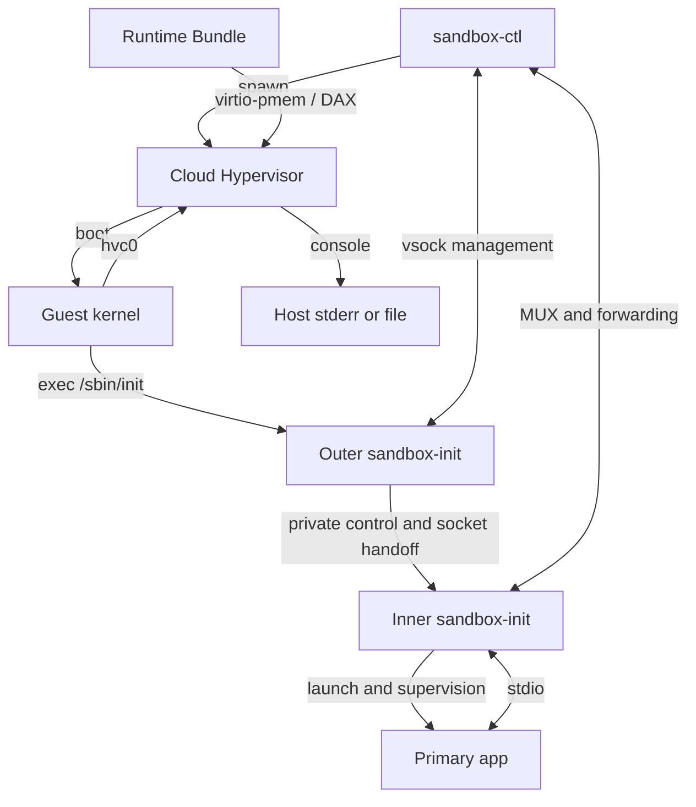

[English](guest-abi.md) | [简体中文](guest-abi_zh.md)

# Guest ABI: boot, applications and host protocols

`sandbox-init`, built in this repository, owns the Guest PID 1 implementation
and the host/Guest ABI. Read the application contract first when preparing a
workload; follow the boot phases when changing initialization; use the protocol
sections when implementing a host peer. These are three views of the same Guest
boundary, not separate independently maintained specifications.

This repository builds and packages PID 1, supplies the shared Go protocol packages,
and maintains this wire contract together with the sandboxer host peer. Host workflows belong to [Runtime](https://github.com/kuasar-sandbox/sandboxer/blob/main/docs/runtime.md), host field defaults to
[configuration](https://github.com/kuasar-sandbox/sandboxer/blob/main/docs/configuration.md), and interpreted usage/Budget to
[resources](https://github.com/kuasar-sandbox/sandboxer/blob/main/docs/resources.md).

The binary is built from `cmd/sandbox-init` and installed as `/sbin/init` in the outer runtime. [Guest-runtime packaging](runtime-bundle.md) defines the image inventory, versions and builds.

<a id="goals"></a>

## Design goals

| Goal | Implementation |
|---|---|
| Fast startup | One static Go binary supplies outer Guest PID 1 and inner PID 1; no systemd / dracut / busybox startup chain |
| Verifiable startup state | A fixed sandbox-init version; explicit launch, quiesce, restore and attach handshakes and state barriers |
| Sharing across sandboxes | virtio-pmem + DAX lets sandboxes share file-backed read-only pages through the host page cache |
| One VM, one primary app | Default private PID mode uses clone(NEWPID\|NEWNS), making the app PID 1 in its namespace; shared PID mode is also available |
| Observable lifecycle | Application start/exit notifications and explicit quiesce/restore exchanges use vsock; host VMM shutdown is a separate path ([Signal handling](#signals)) |
| Separate app I/O | Application stdin/stdout/stderr, or a pseudoterminal, is forwarded over vsock separately from kernel dmesg |

<a id="system-boundary"></a>

## Position in the system



The Runtime Bundle is a shared read-only host backing file. The Guest kernel
mounts it and executes `/sbin/init`. The outer instance assembles and switches
the workload root, applies its mounts/files/network, and starts an inner
instance of the same executable. The inner instance runs initialization and
supervises user processes. The primary is PID 1 in its own namespace in private
mode; the inner instance is the visible PID 1 in shared mode.

The host endpoint is `RunRoot/PathID/vsock.sock`. `RunRoot` defaults to
`/run/sandbox`; `PathID` defaults to `SandboxID` but can be selected independently
([host paths](https://github.com/kuasar-sandbox/sandboxer/blob/main/docs/runtime.md#run)). Launch, ping and application
started/exited notifications use the control paths defined below; the launch
connection upgrades to MUX for application stdio. Kernel hvc0 output uses the
separate CH console path. When an app exits without restart, init notifies the
host through the outer instance, which powers off; CH exits and its host owner
observes that exit.

<a id="guest-processes"></a>

### Guest management and process execution

Both instances come from the Runtime's `sandbox-init` binary. The outer starts
the inner once, before any user `init` command. Their responsibilities are:

| Instance | Process and cgroup scope | Responsibilities |
| --- | --- | --- |
| Outer `sandbox-init` | Guest PID 1, outside `/sandbox` | Host listener and lifecycle facts; root and disk assembly, autofs and storage operations; network/clock updates; raw usage and `mem_report`; recursive freeze/thaw and Guest poweroff |
| Inner `sandbox-init` | PID 1 of a child PID namespace, inside `/sandbox` | Serial `init`; primary and plugin supervision; orphan reaping; exec and forwarding sessions; application stdio and MUX |

The outer accepts the existing Host protocol and passes execution connections
to the inner through a private Unix socket. Descriptor transfer preserves the
connection and unread bytes; the outer releases its copy without shutting down
the inner's socket. This private protocol is an implementation detail shared by
the two instances, not another Host API. If a sent request times out before its
result is known, or the private channel breaks, the Guest fails rather than
replaying an operation that may already have started. The inner is not restarted
independently.

The outer remains runnable while `/sandbox`, including the inner, is frozen.
All inner-owned session cleanup therefore completes before freeze; restore
thaws the tree before waiting for inner readiness. Storage and autofs stay in
the outer so they can service filesystem operations from the inner and its
children. The user PID namespace does not expose the outer instance.

<a id="non-goals"></a>

## Non-goals

- **No container runtime:** the platform manages sandbox lifecycles directly,
  without introducing runc / crun / podman.
- **No Guest usage aggregation:** raw on-request usage observations have no
  Guest ticker, totals, areas, peaks or historical replay ([Raw usage observations](#usage-observations)).
- **No systemd / OpenRC:** sandbox-init implements process supervision.
- **No busybox / util-linux dependency for init operations:** mounting, directory
  creation, chdir, chroot, reboot and openpty use Go syscall interfaces.
  The runtime also carries the separately built guest payload tools listed below.
- **No distribution rootfs supplied by the outer runtime image:** the workload
  image supplies its `/etc`, `/usr` and other rootfs content. sandbox-runtime
  supplies init, staging mountpoints and `/opt/sandbox-runtime`.
- **No stdio on ordinary management short connections:** each operation uses
  its own connection ([Management operations](#management-operations)). Launch, restore, attach and exec upgrade their
  connections to a long-lived MUX after the handshake ([MUX sub-protocol](#mux-wire)). At most one
  primary-app MUX exists at a time, created by launch and renewed by
  restore/attach. Each exec session has a separate, independently concurrent
  MUX lasting for that command ([Exec sessions (`sandbox-ctl exec`)](#exec-sessions)).

<a id="runtime-prerequisites"></a>

## Runtime image consumption prerequisites

The [Runtime Bundle specification](runtime-bundle.md) owns complete packaging, file inventory, versioning and build rules. PID 1 relies on these consumption boundaries:

- `/sbin/init` must be sandbox-init for the guest architecture; this repository builds it with `make sandbox-init`.
- Runtime supplies the early-mount and data-disk staging directories. Phase 1a constructs the actual user rootfs below; the outer runtime is not a distribution `/etc`, `/usr` or shared-library environment.
- `/opt/sandbox-runtime/` is the reserved read-only guest-payload root. Phase 1a bind-mounts it into the same path of the user rootfs, hiding existing image contents there; applications must respect the application-environment contract.
- virtio-pmem/DAX reuses the same backing file’s read-only pages, not each guest’s private writable RAM. Init and payload executables must match the target architecture.

See the [Native guide](../native-deps/README.md) for production of the bundle and host/target mkfs selection. This specification continues to define the complete host/guest handshake, mount ordering and ABI.

<a id="application-contract"></a>

## Application contract


<a id="launch-spec"></a>

### Launch configuration (LaunchSpec)

The host merges the OCI runtime config.json embedded in the ZIP trailer of
boot.root.base with sandbox.yaml's launch section: YAML overrides take priority,
with environment merging. It sends the resulting LaunchSpec over launch.
Host run flags --tty / --stdin / --stdout / --stderr and their -from/-to
variants determine stdio ([sandbox lifecycle](https://github.com/kuasar-sandbox/sandboxer/blob/main/docs/runtime.md)).
A single ext4 root has no image config and needs an explicit executable or
placeholder ([Phase 1: base runtime, wait for launch, workload root and switch-root](#base-and-root)).

This is an annotated JSON example; comments are explanatory, not literal JSON:

```jsonc
{
  "initial_launch_token": "<host-launch-token>", // operation identity, not portable policy
  "exec": "/usr/bin/foo",
  "args": ["arg1", "arg2"],
  "env": {"PATH": "...", "HOME": "/root"},
  "workdir": "/",
  "restart": "never",                    // never|on-failure|always; in-place restart with backoff
  "cgroup_control": false,               // false: processes see /; true: empty delegated root, /init
  "ext4_discard": "auto",                // auto (or omitted): discard; manual: nodiscard
  "placeholder": false,                  // true: no external exec; host rejects explicit launch.exec,
                                        // ignores image command and forces restart=always
  "share_pid": false,                    // true: inherit inner PID/mount namespaces (pid_namespace=shared)
  "user": "0:0",                         // uid:gid or name:group, guest /etc/passwd; empty -> root
  "stop_signal": 15,                     // signal number, resolved host-side; 0 -> SIGTERM
  "stop_grace_sec": 10,                  // guest PID 1's grace period; 0 -> default 10 s
  "network": {
    "interface": "eth0", "ip_cidr": "169.254.1.1/31",
    "mtu": 1500, "nexthop": "", "hostname": "my-sandbox"
  },
  "mounts": [
    {"target": "/tmp", "type": "tmpfs", "options": "nosuid,nodev,mode=1777"},
    {"target": "/var/log", "type": "empty"}
  ],
  "files": [
    {"path": "/etc/resolv.conf", "mode": "0644", "owner": "0:0", "content": "nameserver ..."}
  ],
  "init": [
    {"exec": "/bin/sh", "args": ["-c", "..."], "env": {}, "workdir": "/", "user": "0:0", "timeout_ms": 0}
  ],
  "plugins": [
    {"exec": "/usr/bin/sidecar", "args": [], "env": {}, "workdir": "/", "user": "0:0", "restart": "always"}
  ],
  "stdio": {
    "tty": true,                         // true: PTY; false: pipe mode
    "winsize": {"cols": 80, "rows": 24},  // initial PTY dimensions
    "stdin": false,                      // pipe: enable stdin, otherwise app fd 0 uses /dev/null
    "stdout": true,                      // pipe: enable stdout
    "stderr": true                       // pipe: enable stderr
  }
}
```

See [Phase 2: apply the spec, wire stdio and start the app](#apply-and-launch) for mounts/files/init application. Empty volumes are established from
their raw ext4 source before switch-root ([Phase 1: base runtime, wait for launch, workload root and switch-root](#base-and-root)). Disk mount specs additionally
carry resolved disk_index/disk_overlay/disk_devs ([Phase 1: base runtime, wait for launch, workload root and switch-root](#base-and-root)).
`ext4_discard` is resolved from host `resources.diff_cow.discard`, not from the
YAML `launch` object; its [capability and mount contract](#guest-block-discard)
applies before root and data-disk assembly.
FileSpec also supports read_only; omission leaves its bind writable.
These tmpfs-backed files avoid direct writable-disk injection, but processes
can copy them to disk and their memory may be captured; see the lifecycle
document's persistent/ephemeral disclosure boundaries.
The wire NetworkSpec key is **ip_cidr**, not the host YAML key ip.
`start_timeout` is absent from LaunchSpec because it controls only the
host's launch_ack wait ([Failure semantics](#failures)).

<a id="application-environment"></a>

### The application environment

- **PID 1:** in default `pid_namespace=private`, the primary is PID 1 of its
  own namespace. In shared mode, the inner `sandbox-init` is PID 1 and reaps
  orphans. Init commands and plugins use the inner PID namespace; native exec
  joins the primary's namespaces. The outer management instance is not visible.
- **Cgroup namespace:** real `/sys/fs/cgroup/sandbox` is the namespace/freezer
  root. With `cgroup_control=false`, the inner and all directly managed processes
  live there and see `0::/`. With `true`, this root is empty and its controllers
  are delegated; those processes live in `/sandbox/init` and see `0::/init`.
  Init, primary, plugins and exec inherit the inner's cgroup namespace and
  use the same placement rule. See the
  [complete topology and delegation rules](#application-cgroups).
- **Mount namespace:** init commands, plugins and the shared-mode primary use
  the inner's mount namespace and user root view (overlay or single ext4).
  Only a private-mode primary receives a new mount namespace, with a new proc
  mount matching its PID namespace. Native exec joins the primary's actual
  mount namespace.
- **Network:** with a configured network source, eth0 is virtio-net with a host
  TAP backend and cold-start IP configuration from init. Without a network
  source, no virtio-net is attached; loopback and vsock control still work.
  Restore network replacement is best-effort ([Management operations](#management-operations)).
- **/dev:** devtmpfs supplies null/random/urandom and other device nodes;
  /dev/pts uses devpts.
- **/run and /run/shm:** automatically mounted tmpfs, without declarations.
- **/opt/sandbox-runtime, reserved:** read-only bind of the runtime-bundled guest
  payload, hiding image content at that path. Apps may execute tools such as
  /opt/sandbox-runtime/bin/envd but should not store their own files there.
- **Declared mounts/files:** tmpfs and empty volumes are installed, with empty
  volumes hiding image content; injected files are bound at their targets
  before app startup and are unwritable if read_only is set.
- **Identity:** launch.user, default root; non-root execution has already
  applied setgroups/setgid/setuid.
- **Stdio:** in tty mode fd 0/1/2 share one PTY slave, isatty=true, with controlling
  terminal, job control and SIGWINCH; stdout/stderr are merged. Pipe mode uses
  the declared pipes, isatty=false, with /dev/null for absent stdin.
  These are not /dev/console or /dev/hvc0; primary output and kernel logs remain
  separate.
- **Vsock:** CID 3 and port 5000 are reserved by platform convention.
  This contract does not prohibit a privileged guest process from creating
  AF_VSOCK sockets; do not treat the reservation as a security boundary.
- **Balloon:** managed by the platform without an app protocol requirement. Memory availability, reclaim effects and timing can still be observable to applications. The current platform device model does not enable virtio-mem hotplug; see [VMM limitations](https://github.com/kuasar-sandbox/sandboxer/blob/main/docs/vmm.md#limitations).

<a id="exit"></a>

### Exit semantics

- **restart: never:** app exit → bounded MUX drain → app_exited notification →
  POWER_OFF → CH exit → sandbox-ctl exit and sandbox destruction.
  The reported app exit status or fatal signal determines sandbox-ctl's exit
  status when that notification is received; notification failure limits
  propagation ([Failure semantics](#failures)).
- **restart: always:** app exit triggers an in-place refork and rewireApp ([Phase 3: supervisor](#supervision)).
  The VM stays alive and the same stdio MUX survives.
- **restart: on-failure:** nonzero or signaled exit restarts in place; clean exit
  follows never's notification/poweroff path.

An in-place restart forks within the existing guest lifecycle rather than
repeating the complete sandbox boot. Backoff is 10 ms→60 s, reset after 60 s
uptime. Shutdown suppresses further restarts, while a quiesce window delays
them until thaw ([Phase 3: supervisor](#supervision)).

<a id="signals"></a>

### Signal handling

- sandbox-ctl sends quiesce / restore / attach / ping over vsock. These messages
  do not directly signal the primary app.
- **Host shutdown and guest-app shutdown are separate.** On host SIGTERM/SIGINT,
  sandbox-ctl's lifecycle first cancels pre-spawn/controller work. With CH
  running, its shutdown path attempts ordered `vmm.shutdown` through the CH
  API after the memory.high preparation, falls back to SIGTERM to CH if needed,
  and escalates to SIGKILL after a 5 s shutdown grace; a second signal escalates
  immediately. This does not promise delivery of SIGTERM to guest PID 1 or
  completion of the app's stop grace. See
  [lifecycle shutdown](https://github.com/kuasar-sandbox/sandboxer/blob/main/pkg/sandbox/lifecycle.go) and
  [run signal handling](https://github.com/kuasar-sandbox/sandboxer/blob/main/pkg/sandbox/run_signal.go).
- **If outer Guest PID 1 receives SIGTERM/SIGINT**, it requests shutdown of
  the inner, thawing the tree if needed. Before inner readiness it terminates
  startup. With a running primary, the inner suppresses restarts, forwards
  `launch.stop_signal` (default SIGTERM) and waits `stop_grace_sec` (default
  10 s, from Host `launch.stop_grace_period`), killing the primary on timeout.
  The same primary-stop path applies when the inner itself receives these
  signals. The outer owns final poweroff. These settings govern the Guest
  path; they are not a guaranteed Host VMM teardown handshake.
- In tty mode the host terminal is raw. Keyboard Ctrl-C (0x03) travels as a byte
  over the PTY stream, and the guest terminal line discipline turns it into
  SIGINT for the application. Host sandbox termination or terminal escape uses
  the separate lifecycle controls ([sandbox lifecycle](https://github.com/kuasar-sandbox/sandboxer/blob/main/docs/runtime.md)).
- The proposed quiesce.signal hook ([Quiesce handling](#quiesce)) is not implemented.

<a id="initialization"></a>

## The three sandbox-init phases


<a id="base-and-root"></a>

### Phase 1: base runtime, wait for launch, workload root and switch-root

Base initialization is workload-independent. It mounts only proc/sysfs/devtmpfs,
starts loopback and the reverse control dispatcher, then announces
`hello{phase:"runtime_ready"}`. The dispatcher answers ping and shutdown while
waiting; workload-only exec/connect/quiesce/attach/restore are rejected. A listening
socket alone is not this readiness barrier. `shutdown` replies `ack` before
termination. Once the inner publishes the primary, the outer dispatcher routes
execution connections to its supervisor and stdio bridge while retaining
Guest management operations.

The launch request drives all workload root assembly. Waiting for it has no
launch execution deadline; the host starts that deadline after publishing launch.
The handshake completes before process-wide chroot. Go threads share CLONE_FS;
the base control path uses sockets and does not access workload paths while root
switching occurs.

```
A. Base runtime:
   - bind/listen AF_VSOCK :5000
   - mount proc/sysfs/devtmpfs on /proc /sys /dev
     Skip /dev EBUSY when CONFIG_DEVTMPFS_MOUNT=y mounted it already.
   - raw netlink RTM_NEWLINK(lo, IFF_UP); failure is fatal
     Kernel supplies 127.0.0.1/8 and ::1/128; no RTM_NEWADDR.
   - start reverse management dispatcher
B. connect(CID=2:5000), send hello{phase:"runtime_ready"}, wait for launch
   No workload device is mounted or consumed in A/B.
C. Only after launch (and host publication of every block backend):
   1. Wait for /dev/vda and /dev/vdb: stat polling, 10 s timeout.
   2. mount -t erofs -o ro /dev/vda /overlay/lower
      mount -t ext4 -o discard /dev/vdb /overlay/upper  # auto; manual uses nodiscard
   3. Create /overlay/upper/{upperdir,workdir} if absent.
   4. mount -t overlay overlay -o lowerdir=/overlay/lower,
        upperdir=/overlay/upper/upperdir,workdir=/overlay/upper/workdir /sysroot
   5. mkdir -p /sysroot/opt/sandbox-runtime
      mount --bind /opt/sandbox-runtime /sysroot/opt/sandbox-runtime
      The read-only pmem payload bind moves with the new root subtree.

D. Spec-dependent work before switch-root (empty volumes need the raw ext4 source):
   mount -t tmpfs tmpfs /sysroot/run -o nosuid,nodev
   mount -t tmpfs tmpfs /sysroot/run/shm -o nosuid,nodev,mode=1777
     Automatic roots precede volume binds so mounts below them remain visible.
   for each mounts[].type == empty:
     mkdir /overlay/upper/volumes/<i>
       Raw ext4, alongside upperdir and separate from the overlay write layer.
     mkdir -p /sysroot/<target>
     mount --bind /overlay/upper/volumes/<i> /sysroot/<target>
       The empty directory hides image content at the target.

E. switch-root:
   MS_MOVE /proc /sys /dev -> /sysroot/{proc,sys,dev}
   chdir(/sysroot) -> MS_MOVE . / -> chroot(.)
   MS_MOVE carries the whole subtree: proc/sys/dev, C5's payload bind,
   and D's volume binds all become part of the new /.

F. Basic mounts after switch-root:
   mount -t cgroup2 -o nsdelegate cgroup2 /sys/fs/cgroup; verify nsdelegate
   mkdir /sys/fs/cgroup/sandbox         # user cgroup namespace and freezer root
   With launch.cgroup_control=true, also create /sys/fs/cgroup/sandbox/init
     and strictly enable the Guest-root controllers. The inner bootstrap
     completes /sandbox delegation before any user command (User cgroup namespace and controller topology).
   mount -t devpts devpts /dev/pts -o newinstance,ptmxmode=0666
                                        # needed by tty-mode openpty
```

All operations use syscall interfaces such as
`golang.org/x/sys/unix.Mount` and `unix.Chroot`, without external programs.

`/dev/vda`, the blk0 base, is the application's read-only EROFS image;
`/dev/vdb`, the blk1 overlay ext4, is the write layer. The merged
`/sysroot` becomes the final guest rootfs and then the new `/`.
Initially the kernel mounts the init-bearing `sandbox-runtime.bundle` through
virtio-pmem at `/` using `root=/dev/pmem0 ... rootflags=dax=always`.
Phase 1 replaces that view with the overlay, retaining
`/opt/sandbox-runtime` through the bind carried into the new root.

**Readiness and root ownership:** Linux may probe the fixed unbound disks during
boot and receive IOERR. Base initialization never mounts them. The first workload
mount follows Launch's all-device publication. The host starts pings at
`runtime_ready`, and launch_ack/app_started retain their existing meanings;
app_started does not prove execve success or application health. Existing memory
snapshots use restore/attach, not this cold handshake.

**Initial Launch confirmation:** runtime-ready hello advertises
`initial_launch_state_v1`. A new Host checks this capability before applying
Launch; rebuild both sandbox-init and its sandbox-runtime Bundle when upgrading
the Guest baseline. A Host upgrade cannot replace init in an existing snapshot.
An ordinary restore attaches to its existing application; a restored prewarm
runtime that will accept a new Launch must already contain a compatible init.

The supported prewarm boundary is a live `runtime_ready` instance followed by
Launch. The current SDK rejects Snapshot/Export before running, and a Guest
without a workload rejects restore/attach/quiesce. Persisted prewarm-memory
restore followed by a new Launch is not an implemented API. If such a state is
provided by another lifecycle, the new Launch still requires the compatible
Guest capability; this does not make an old snapshot's init upgradeable.

The Host supplies a unique `initial_launch_token` in LaunchSpec. Guest records
a mutex-protected snapshot for that token: `pending` before workload preparation,
`started` at the existing initial primary publication boundary, `failed` on a
hard startup error, or terminal `exited` when termination is accepted. The
snapshot includes the initial PID or failure/exit details. PID presence and a
reachable Ping are not startup evidence. Normal primary restart preserves the
completed initial state and the existing supervision semantics.

The existing `app_started` fast notification and Ping/Pong both carry
`initial_launch_state`; `app_exited` carries the terminal snapshot. The Host
uses one confirmation gate for these facts, checking the current token,
ACK/MUX barriers, cancellation, permanent errors and VM exit. Pending, obsolete
tokens and repeated facts cannot commit. The existing Pinger publishes only
lightweight facts; no additional Guest sender or polling loop is introduced.
Management connections reach EOF and leave the connection join before user
callbacks. Successful commit signals the Launch waiter before callbacks run.

`timeouts.app_start` is Host policy: omitted, empty or zero means no extra
post-ACK deadline; a positive duration opts into an overall post-ACK deadline.
Negative/invalid values are errors. This does not change `launch.start_timeout`,
`app_notify` exchange limits, cancellation, fatal startup errors or VM exit.
`PingFatalThreshold` remains zero by default; explicitly enabling a positive
threshold may terminate a runtime while a dependency is still recovering.
Portable E/S artifacts do not carry this Host policy.

**Volume sources and relocation:** an `empty` volume's source is
`/overlay/upper/volumes/<i>` on raw ext4, separate from `upperdir/` but on the
same vdb and in the same disk capture. Its bind is installed under sysroot.
`MS_MOVE /sysroot → /` carries it with the whole subtree, just like
proc/sys/dev and the runtime payload bind; no separate move is needed.
After switch-root hides `/overlay/upper`, the bind retains an ext4 inode
reference, leaving volume content accessible at its target without exposing
the raw ext4 layout.

**Payload relocation and version pinning:** C5 binds the pmem payload root
under sysroot before switch-root. E carries it into `/`; the bind's pmem inode
reference keeps it alive after the old mount loses pathname reachability.
The inner inherits this read-only mount when its execution environment is
created. Init commands, plugins and the shared-mode primary use that same
mount namespace; a private-mode primary inherits the mount into its own
namespace. Because the payload is part of `sandbox-runtime.bundle`, changing
it changes that artifact's identity. Restore checks the runtime footer identity
against E/C0 and requires the corresponding runtime artifact to be remapped;
this is not a full payload
re-hash on every restore (see [sandbox lifecycle](https://github.com/kuasar-sandbox/sandboxer/blob/main/docs/runtime.md)). With the trusted,
matching artifact, restored sandboxes retain the same payload version.
The payload shares the runtime artifact's lifecycle and cannot be independently
hot-patched; an independently versioned payload would need a separate read-only
EROFS device ([Extension points](#extensions)).

**Single-disk mode** omits `boot.root.overlay`. The host creates no blk1,
passes one writable `--disk` for the root ext4 CoW device, and adds
`sandbox.root.layout=single` to the kernel command line. Phase 1a reads
`/proc/cmdline` after mounting proc to record the layout during base initialization.
Device assembly waits for the launch spec and uses its ext4 discard policy.
This path waits only for `/dev/vda` and mounts it as ext4 with the selected option
(`discard` by default) directly at
`/sysroot`: no lower/upper staging, overlayfs or vdb. Payload binding,
switch-root and phase 1b's basic mounts remain the same. `empty` volume sources
move to `/sysroot/.sandbox-volumes/<i>` on the writable root itself, then bind
over their targets and move with the subtree. The single root disk is writable
ext4, with no EROFS image or embedded config.json, so host validation requires
`launch.exec` unless `launch.placeholder` is enabled.

**Data disks, `boot.disks[]`:** besides the root, at most
`MaxDataDisks=8` disks are supported. Each uses the same single-disk diff or
two-device overlay rules as `boot.root`, including `base_from_refs`.
The host prepares them through the same PrepareDiff / CoW / reader machinery.

```
Device order = CH --disk order = guest /dev/vd[a,b,c,...]:
  root (1 device or 2 for overlay)
    -> boot.disks[0] (1/2) -> boot.disks[1] (1/2) -> ...
Example: overlay root (vda=base, vdb=upper), single data disk (vdc),
         overlay data disk (vdd=base, vde=upper).

The host resolves mounts[].source (name) -> ordinal -> concrete /dev/vdX
into MountSpec.DiskIndex / DiskOverlay / DiskDevs. The name is not on the wire.
Device positions depend on boot.disks[] order, not mounts[] order.
```

`applyVolumeMounts` assembles these mounts **before switch-root**, using the
same prepare-source → bind-under-sysroot → move-subtree sequence as empty
volumes. Staging mountpoints are prebuilt into the runtime EROFS image:
`/sysdisks/disk-{0..7}{,-lower,-upper}`, 24 empty directories whose count must
match `config.MaxDataDisks`. Missing directories are fatal; rebuild the
mismatched runtime image or reduce the disk count.

The following mount examples use the default `auto` policy; `manual` replaces
`discard` with `nodiscard` on the writable ext4 mounts.

```
Single data disk N:
  mount ext4 -o discard /dev/vdX -> /sysdisks/disk-N
Overlay data disk N:
  erofs ro -> /sysdisks/disk-N-lower
  ext4 rw,discard -> /sysdisks/disk-N-upper
  overlayfs(lower, upper/upperdir, upper/workdir) -> /sysdisks/disk-N
Both:
  bind /sysdisks/disk-N/<subpath> -> /sysroot<target> (once per mapping)
```

A disk ordinal may appear in several mount entries. `subpath` is relative to
that disk's filesystem root. An empty value selects the entire root. Previously
saved artifacts may spell the root as `.`. A declared slot's source directories
must be disjoint. The Guest resolves destination aliases and checks each slot
target against all other effective mounts before mounting. Each missing source directory is created on the private
writable disk. Existing symbolic links, non-directories and submounts fail source
resolution. Hosts require `disk_mount_projection_v1` in the runtime-ready
Hello for a non-root subpath or repeated ordinal.

For a single-device `disk_slot`, the runtime-ready Hello advertises
`disk_slot_v1` when the kernel exposes autofs. Each destination gets an autofs
v5 direct trigger. An access opens the block device and attempts to mount its
filesystem. For dynamic slots on a VMM
without capacity-change notifications, mounting also requires the
[Guest kernel to refresh the disk capacity on access](vmlinux.md).
An empty slot fails the access and leaves the trigger installed.
Once media is present, the first successful access mounts the disk, projects the
requested directory, and continues the lookup. All targets on the same disk
share the mounted filesystem. The application cgroup cannot open the raw slot
device, including through another device node. A memory snapshot retains the
autofs descriptors and mounted projections. The host restores the captured disk
view before resuming the Guest.

The `/sysdisks` subtree becomes invisible after switch-root, but binds and
overlayfs lower/upper references keep its mounts alive, just as for the root
overlay and payload bind. **Restore** resumes the memory snapshot with guest
mounts already established; the host recreates and serves devices in the same
order. Explicit active diff bindings in restore host YAML's `boot.disks[]`
must match Sandbox E's count and order; restore prohibits replaying
`mounts[]`. **Capture** takes each writable diff, root and data disks, at the
same pause/quiesce point, creates Sandbox E with the complete disk graph,
then creates memory Snapshot S. S's `snapshot.cfg` references E through
`sandbox_ref` and records memory `from_refs`. Local flatten-merge operates
separately on E's disk layers and S's memory layers.

At these controlled root/data assembly points, usage retains one private
CLOEXEC filesystem handle per writable disk, before switch-root hides staging
paths. Single mode pins ext4 itself; overlay mode pins the raw upper, not the
merged root. Bind/empty volumes do not add sources. Handles survive memory
restore, never enter app exec, and close with init; an in-flight uncancelable
read retains its original handle/slot until it finishes ([Raw usage observations](#usage-observations)).

<a id="guest-block-discard"></a>

#### Guest block DISCARD

`LaunchSpec.ext4_discard` selects the mount option on all four managed writable
ext4 paths: the single root, the overlay root's upper, single data disks and
overlay data disks' uppers. Omission or `auto` selects `discard`; `manual` selects
explicit `nodiscard`. The host derives this value from
[`resources.diff_cow.discard`](https://github.com/kuasar-sandbox/sandboxer/blob/main/docs/configuration.md#diff-cow-policy). Empty/bind
volumes inherit their underlying filesystem; read-only EROFS mounts retain
their existing options.

Updated Guest runtimes advertise `hello.ext4_discard_v1=true`. The host requires
that capability before sending a manual-mode launch, so an older Guest cannot
silently ignore an opt-out. Auto mode remains compatible with older Guests and
retains their runtime's mount defaults; an updated Guest defaults an omitted
wire field to auto. The selected policy also applies when Launch follows a live
`runtime_ready` prewarm: workload disks have not been mounted yet.

With auto, filesystem release can notify the host without an application change
or a separate trim for each deletion. Manual disables those automatic requests
while keeping explicit trim and virtio-blk DISCARD available; reclaimable deleted
data can remain until trim is requested. Underlying ext4 filesystems perform
FITRIM; an overlayfs view is not a substitute trim target for its hidden upper.
Auto deletion or manual trim can incur additional work, and filesystem release,
host reclamation and disk-export savings need not happen when unlink returns;
the [storage contract](https://github.com/kuasar-sandbox/sandboxer/blob/main/docs/block-storage.md#discard-and-reclamation) defines those
boundaries and protects retained history.

Selecting manual requires a runtime bundle containing the updated `sandbox-init`
through `boot.runtime`, followed by cold boot. Replacing the host executable
alone does not update the embedded init. Ordinary cold start and `run --from`
apply the current host selection. Existing running instances and memory restores
retain their established mounts; restore does not remount them and rejects any
explicit `resources.diff_cow.discard` input. Omit that field on restore; the host
projection `config --mode restore` removes it while retaining cache budgets.
No disk or snapshot format migration is required. Enabling auto does not
automatically trim all previously free space.

New writable virtio-blk devices expose `VIRTIO_BLK_F_DISCARD`; read-only devices
do not. The fixed configuration is `MaxDiscSeg=1`, `DiscSecAln=8` (4096 bytes),
and `MaxDiscSec=8192` (4 MiB). Capabilities are fixed when the server is created;
binding a pooled backend must match them. Restored devices retain their captured
feature negotiation: an old snapshot does not acquire the new feature on resume.

The request contains exactly one 16-byte range, possibly split across readable
descriptors. The host validates flags, original sector bounds and overflow before
rounding inward to complete 4 KiB pages. Unsupported flags and WRITE_ZEROES return
UNSUPP; malformed/beyond-capacity requests return IOERR. A successful DISCARD
publishes logical Zero: subsequent reads return zero, including over nonzero
lower data. Uncovered edge pages retain their original contents. With v4, ACK
normally means Zero was accepted into the existing bounded dirty cache, like
WriteAt; quota pressure can instead complete one page synchronously without a
new reservation. Backend payload-mapping removal can follow during writeback.
Internal Drain, named Checkpoint and normal Close wait for that writeback, not
for all GC. After initial publication, active export can already emit pending
Zero without another Drain; fresh disks still await `WaitMaterialized`, including
its initial drain. Single-layer v3 retains synchronous removal in 64-page batches.
Neither path promises whole-range atomicity or stable-storage durability.
Ordinary writes of zero bytes still allocate Data. Guest FLUSH keeps the existing
non-durable contract.

Validate new runtime cold boots with both root/data topologies for omitted,
explicit auto and manual policy. Inspect actual ext4 mount options without a
manual remount, and verify device DISCARD remains advertised in every mode.
Auto filesystem release should reach Guest DISCARD; manual deletion must leave
a synchronized nonzero raw extent intact until explicit `fstrim` zeros it.
Memory restore with omitted policy must retain captured manual mounts. Retain nonzero
lower bytes, check zero reads after discard, Checkpoint/export and restore, and
verify after Drain or Checkpoint that the corresponding upper ranges have no
active payload. Before that boundary, use a paused-writeback test to verify both
Zero reads and sparse-export Zero classification. A successful trim byte count
alone does not prove these properties.

<a id="apply-and-launch"></a>

### Phase 2: prepare the environment and launch through the inner init

The outer applies network configuration, declared tmpfs mounts and injected
files after switch-root. Empty volumes were installed before switch-root.
Files are staged on tmpfs, bound at their targets with the requested ownership,
mode and optional read-only setting, then detached from staging. Cold-start
network, mount and file failures are fatal; restore's best-effort clock/network
updates are a separate contract.

The outer then creates the inner with new PID and mount namespaces, atomically
inside real `/sandbox` through `clone3(CLONE_INTO_CGROUP)`. Before re-exec, the
fork child creates a cgroup namespace rooted at that group. The inner mounts
its own `/proc` and scoped cgroup2 view, completes the delegation setup below,
and reports readiness. This bootstrap belongs to the environment, independently
of the selected primary executable or placeholder.

The inner receives LaunchSpec and the original hello/launch connection. It
performs these operations in order:

1. Run `init` commands sequentially in the inner PID/mount/cgroup environment, with
   their configured environment, working directory and user. Output goes to
   the console. Nonzero exit or timeout fails launch. Timeout kills the current
   command; it does not introduce process-group or descendant termination.
   During this serial phase one waiter collects both the current command's
   status and adopted orphan exits, before the ordinary supervisor takes over.
   Primary, plugin and exec creation cannot overlap this initialization phase.
2. Prepare primary stdio: a PTY with the requested size, or the declared pipes
   with `/dev/null` for absent stdin. Send `launch_ack` on the same connection
   that carried Launch, and wait for the Host's `ack` before starting its MUX.
3. Create the primary in the final cgroup target, using the same path for its
   initial start and later restarts. Shared mode inherits the inner's PID,
   mount and cgroup namespaces. Private mode adds PID and mount namespaces
   and mounts a matching `/proc`, while retaining the inner's cgroup namespace
   and scoped cgroup2 mount. The helper completes any required namespace/mount
   setup before applying credentials and executing the selected program.
4. Hold the primary at its pre-exec gate while the outer reads its pidfd to
   obtain the PID visible in the Guest's initial PID namespace. Register the
   primary with the inner supervisor before releasing the helper. The Host
   continues to receive this outer-visible primary PID, not the inner init's
   PID or the primary's namespace-local PID.
5. After helper completion, start the configured plugins, publish the inner
   supervisor and send the primary-start fact to the outer. The outer owns
   `initial_launch_state`, sends `app_started`, and starts memory reporting.
   The inner enters normal supervision and accepts execution sessions.

`launch_ack` therefore still follows **all initialization**, before primary
creation. It confirms the environment/stdio barrier, not successful primary
exec or application health. The helper reports explicit setup/exec errors, but
an empty EOF can also result from abrupt helper death; `app_started` retains
its existing publication semantics. See [`executor.go`](../cmd/sandbox-init/executor.go)
and [`child.go`](../cmd/sandbox-init/child.go).

A placeholder follows the same setup and primary lifecycle, then waits for
SIGTERM/SIGINT instead of executing an external program. The Host still forces
`restart=always`; killing the placeholder from exec restarts it in place.
It is not the inner init, and replacing it does not repeat environment
bootstrap or `init` commands.

Primary and one-shot `init` commands receive a default PATH only when their
entire environment map is empty. Plugins and native exec start with a default
PATH and overlay supplied entries, including an explicitly empty PATH.
The bridge's primary-side fds are replaced by generation on restart; the MUX
session survives, with the bounded output drain described in [Phase 3](#supervision).

<a id="application-cgroups"></a>

#### User cgroup namespace and controller topology

Real `/sys/fs/cgroup/sandbox` is both the **user cgroup namespace root** and the
**recursive capture freezer root**. The outer remains at the Guest-global root;
the inner, `init` commands, primary, plugins, exec helpers/commands and their
descendants all belong below `/sandbox`. Capture operates on this whole tree.

`launch.cgroup_control` defaults to `false` and selects placement/delegation
within that same environment:

| Real Guest path | Path in the user cgroup mount | `false` | `true` |
| --- | --- | --- | --- |
| `/sys/fs/cgroup` | Outside the scoped mount | Outer `sandbox-init` | Outer `sandbox-init` |
| `/sys/fs/cgroup/sandbox` | `/sys/fs/cgroup` | Inner and all directly managed processes; `/proc/self/cgroup` is `0::/` | No direct processes; advertised controllers enabled and verified for children |
| `/sys/fs/cgroup/sandbox/init` | `/sys/fs/cgroup/init` | Not created by the runtime | Inner and all directly managed processes; `/proc/self/cgroup` is `0::/init` |
| `/sys/fs/cgroup/sandbox/<user-group>` | `/sys/fs/cgroup/<user-group>` | No controller-delegation guarantee | User-created groups may be siblings of `/init` or have their own descendants; they remain in the same freezer tree |

`/init` means the default group for processes managed by the inner init. It
contains the inner itself and includes one-shot `init` commands while they run;
it is not a separate group for those commands. All process types use the same
`cgroup_control` setting. User managers may organize their own descendants
without changing the platform's recursive freezer root.

The outer mounts cgroup2 with `nsdelegate` in the Guest's initial namespace and
verifies the option. The inner's scoped mount hides ancestor groups. Linux
then treats its cgroup namespace as a delegation boundary: writes to namespace
root files are limited to the kernel's delegatable interfaces, and migration
cannot cross the namespace's reachable subtree. Resource-controller settings
at that root remain controlled by the outer. See the kernel's
[cgroup v2 delegation contract](https://docs.kernel.org/admin-guide/cgroup-v2.html#delegation).
This provides a cgroup management boundary, not a general security boundary
against a privileged Guest.

With `cgroup_control=true`, the outer strictly enables and verifies the
Guest-global root's advertised controllers. The inner first moves itself from
`/sandbox` to `/sandbox/init` through its scoped `/init/cgroup.procs`; no user
code has run yet. The outer verifies `/sandbox` is empty, enables and reads
back its advertised controllers, then releases the inner. This is the only
bootstrap migration. With `false`, the inner remains in `/sandbox`; root
controller propagation is best-effort and a delegated child layout is not
promised. `nsdelegate`, scoped mounts and recursive freeze apply in both modes.

After bootstrap, the inner pins its scoped target directory. Every managed
launch inherits the inner's cgroup namespace and uses
`clone3(CLONE_INTO_CGROUP)` to be born in the final target. Children reuse the
prepared scoped cgroup2 mount; they do not join another cgroup namespace or
remount cgroup2. The initial primary has no special placement path, and there
is no post-Start migration of user processes. Required namespace or cgroup
setup failures abort launch; no fallback runs a process outside the freezer
tree. Internal descriptors are CLOEXEC and passed to helpers only through
explicit slots; user programs do not inherit them.

**PID and mount views:** `launch.pid_namespace=private` keeps the primary as
PID 1 of its own namespace; native exec joins that primary's PID and mount
namespaces. With `shared`, the visible PID 1 is the inner init and it adopts
orphaned descendants. Init commands and plugins run in the inner PID namespace
in both modes. A private
primary cannot see them; a shared primary can. Shared `/proc/1/root` and
`/proc/1/cgroup` now describe the inner's root and scoped cgroup placement,
rather than the outer management process.

The runtime creates these process contexts:

| Process | PID namespace | Mount namespace | Cgroup namespace |
| --- | --- | --- | --- |
| Inner init, init commands and plugins | Inner | Inner | Inner |
| Shared-mode primary | Inner | Inner | Inner |
| Private-mode primary | New, primary is PID 1 | New, with matching `/proc` | Inner |
| Native exec | Primary's actual namespace | Primary's actual namespace | Inner |

**Plugins:** after primary startup, the inner launches configured plugins as
its own children. In both primary PID modes they inherit the inner's PID,
mount and cgroup namespaces, user rootfs and network, and are born in the
final cgroup target.
Plugin startup and restart use this already prepared environment without
creating another mount namespace or remounting `/proc` or cgroup2.
Each has independent `never`, `on-failure` or `always` supervision (default
`always`), using the common backoff. Output remains on the console and
env/workdir/user remain configurable. Plugin exit does not decide the sandbox
lifecycle; the primary's exit and `launch.restart` retain that role.

**Credentials and process groups:** sharing namespaces does not override the
declared user, environment, working directory or stdio of any command.
Primary/plugin helpers apply those settings before executing the program;
private primary mount setup still precedes dropping credentials. Init commands
inherit the prepared inner namespaces and can apply `SysProcAttr.Credential`
directly. Image `/etc/passwd` remains authoritative for named users. Namespace
sharing also does not require a shared process group or terminal session:
autofs-related process-group separation and PTY session setup still apply.

**Shared mounts and propagation:** init commands, plugins and the shared-mode
primary use one mount table. Mounts and unmounts performed there are visible
to the inner and all processes using that namespace, including native exec
in shared mode. A plugin or shared primary exiting or restarting does not
undo its mounts; they remain until explicitly unmounted or the environment
is destroyed. Programs that create mounts must account for that lifetime.

The outer's shared mount tree propagates into the inner's shared/slave tree:
the inner receives managed disk mounts from the outer, and its shared mounts
can propagate into a private primary's slave mount tree. A private primary
therefore receives upstream mount changes while keeping its own `/proc` and
local mount changes separate. Slave propagation prevents the inner's mount
changes from propagating back to the outer, and prevents a private primary's
mount changes from propagating back to the inner. These are the propagation
relationships prepared by the runtime; a program can explicitly create its
own namespace or change propagation inside its environment. All processes
share the Guest network namespace. Restore preserves captured mount state
without replaying files, mounts or init commands.

#### Compatibility and memory restore

Host messages, primary/placeholder behavior, exit notifications, restart
policy and cold-only initialization retain their existing contract. Observable
changes are the Guest-global path `/app` becoming `/sandbox`, init commands
joining the user execution environment, and shared PID mode exposing the inner
instead of outer PID 1. Scripts that inspected global paths or outer management
processes must account for that change; ordinary scoped membership remains
`/` or `/init` according to `cgroup_control`. Plugins and shared-mode primaries
also share the inner's mount namespace rather than receiving a private copy.
Their mount changes are consequently visible across that environment and
survive process exit or restart. Programs that previously relied on per-process
mount isolation or automatic mount cleanup must manage those requirements
explicitly.

Cold start constructs this model from the selected Runtime. A memory Snapshot
S preserves both instances, their namespace/cgroup topology and private
channel. Restore requires the Runtime backing artifact recorded by its E/C0
identity and resumes that captured implementation; replacing the Host or a
Runtime file cannot upgrade init inside an existing S. Adopt a new Runtime
through cold start and create replacement artifacts through the normal E/S
workflow. This refactor does not change the E/S format or replay Launch during
memory restore.

<a id="supervision"></a>

### Phase 3: supervisor

This loop runs in the inner PID 1. It performs an initial reap sweep when taking
over from serial init, so orphan exits at that phase boundary are collected.
The outer separately waits for the inner and owns Host notification/poweroff.

```
loop:
  signal.Notify(sigchld, sigterm, sigint)
  select:
    sigchld:
      pid, status = waitpid(-1, WNOHANG)             // one reaper for all children
      if pid == app_pid(atomic):                    // primary application
        if !shutting_down && wantRestart(launch.restart, status):
          go restartApp(backoff)                   // asynchronous; reaper continues
        else:
          app_exit_then_reboot(status)             // never / clean on-failure exit
      elif pluginReg.onExit(pid, status):           // plugin policy + restart backoff
        // handled
      else:
        execReg.deliver(pid, status)                // exec child, or silently reaped orphan
    sigterm/sigint:                                 // signals received by inner PID 1
      shutting_down = true                         // prevent pending restart forks
      send spec.stop_signal to app_pid             // default SIGTERM
      wait spec.stop_grace_sec (default 10 s); SIGKILL on timeout
      app_exit_then_reboot(status)

restartApp(backoff):
  sleep(backoff)                                   // reaper still handles plugin/exec exits
  return if shutting_down; wait while quiescing
  rewireApp:
    wait for every old app->host pump to reach EOF and write its final bytes to MUX
    after 2 s without EOF (e.g. an inherited writer), force-close old fds and continue
    install new-generation fds; pumps use the unchanged MUX streams
  phase2ForkApp:
    store new app_pid before releasing the helper
    helper inherits inner cgroup namespace and is born in final target with CLONE_INTO_CGROUP
    shared: inherit inner PID/mount namespaces
    private: create PID/mount namespaces and a matching /proc
    -> app_started{newpid}
  // host run connection survives and receives the new instance's output

app_exit_then_reboot(status):
  mark bridge shutdown, let output pumps consume natural EOF and emit stream EOFs
  after stream EOFs, send MUX_CLOSE and wait for MUX_CLOSE_ACK on the same connection
  drain, ACK and transport close share one 2 s budget; force shutdown on expiry
  close remaining app ends after the drain
  send terminal status over the private channel to the outer
  outer: host:5000 -> app_exited{code, term_signal} -> bounded ack wait -> close
  outer: reboot(LINUX_REBOOT_CMD_POWER_OFF)
  # Power off even without Host ack; POWER_OFF lets CH exit cleanly with status 0.
```

**Backoff** is shared by apps and plugins in `supervise.go`: start at 10 ms,
double after each failed/short-lived run, cap at 60 s, and reset to 10 ms after
60 s of uptime. **Atomic app_pid:** the restart path registers the new PID before
releasing its helper, so the reaper does not misclassify its exit as plugin/exec.
**Snapshot gate:** quiesce sets quiescing and prevents new supervised forks while
plugins freeze with the app cgroup. Restore/attach reopens gates only after a
successful thaw; restartApp waits through that window. With restart=always,
app exit does not reboot the VM.

Generation drain covers app→host output only, without a stdin barrier. Output
ordering is retained within each MUX stream and a generation switch emits no
stream EOF, subject to the bounded forced-close fallback. Input arriving while
the app is between generations can be dropped. If shutdown catches a newly
installed generation, pumps consume that existing generation but do not wait
for a future one.

For terminal shutdown, successful transport writes alone do not prove that the
host received output before POWER_OFF. The same-MUX ACK orders host receipt of
all preceding DATA/EOF frames before reboot; host bridge cleanup then drains
its buffered output. This is not a sink fsync guarantee, and a transport failure
or forced shutdown timeout can still discard remaining output.

The terminal path uses **POWER_OFF, not RESTART**. When policy says the sandbox
has ended, CH should exit cleanly. RESTART would invoke CH's in-place VM reboot
and reconnect vhost-user-blk backends, which accept only one connection for this
single-VM lifecycle; failed reconnection makes CH exit unsuccessfully.

**The reverse listener runs in the outer**, independently of the inner
supervisor. It handles ping, restore, quiesce and attach, and hands exec/connect
connections to the inner ([Management operations](#management-operations)).
It remains across cold start, capture/restore and MUX replacement until Guest
poweroff. Unexpected inner exit or private-channel loss fails the Guest without
inventing a successful primary exit or replaying initialization.

**The mem_report goroutine** also runs in the outer. It samples
`/proc/meminfo` immediately after the launch barrier, then every 5 s by default.
Each observation carries an epoch and strictly increasing seq. Before
restore_ack, restore creates a new report epoch and clears the old pending
observation. Quiesce takes the same stream lock, drains an in-flight
guest→host exchange and pauses sampling before freeze. This is a capture
barrier: S must not retain a held reporter mutex waiting on an old host's vsock.
After thaw, restore resumes the new epoch; attach used for same-VM resume or
failed-capture recovery resumes the original epoch.

Reports contain MemAvailable plus diagnostic MemTotal, MemFree, Cached,
AnonPages and SReclaimable. They do not read or report balloon current.
Host Capacity must not be derived from MemTotal. The host combines the report
with CH `vm.info` to compute the sandbox-local Budget.

A failed send retains exactly the same epoch/seq/payload for the next ticker.
Only a successful ACK clears pending and permits another sample. EAGAIN,
timeout or a lost ACK does not permanently leave reporting in progress.
See [sandbox lifecycle](https://github.com/kuasar-sandbox/sandboxer/blob/main/docs/runtime.md) [Memory terms](https://github.com/kuasar-sandbox/sandboxer/blob/main/docs/resources.md#memory-terms) / [Balloon](https://github.com/kuasar-sandbox/sandboxer/blob/main/docs/resources.md#balloon-controller).

`mem_report` remains the existing resource-control exchange. Usage does not
reuse its retained payload, cadence or ACK queue: the Host requests new raw
usage observations over a separate connection ([Raw usage observations](#usage-observations)).

<a id="quiesce"></a>

### Quiesce handling

Quiesce prepares a consistent Guest memory/filesystem capture point before
Host `/vm.pause`. It also removes execution and forwarding sessions whose
Host peer will not exist after restore. The inner is part of the frozen tree,
so all cleanup that requires its goroutines must finish **before** freeze.

The operation has the following ordering:

1. **Host closes admission.** It gates new exec/forward requests and pauses
   its ping ticker. Usage admission is paused before the Host memory barrier.
   Admitted pings must reach the Guest EOF transport barrier; a drained failed
   probe still follows its health/fatal policy, and does not replace the
   required `quiesced` response. This drain has its own bounded quiesce budget,
   even when ordinary ping waiting is unbounded.
2. **Outer pauses raw usage and requests inner drain.** Usage generation
   advances, and its old connection is closed/joined; blocked source reads
   retain their original slots without holding locks while waiting on a Host.
   Outer execution admission closes before the private quiesce request.
3. **Inner completes execution cleanup.** It closes primary-restart and plugin
   launch admission and joins admitted launches; rejects new execution
   sessions; kills in-flight exec helpers and joins their full fork/MUX/socket
   cleanup. It closes forwarding targets and reverse connections, and clears
   cached accept listeners to wake parked `Accept` calls. All admitted session
   handlers, including setup before registration and final socket cleanup,
   must finish. It then closes the primary MUX through the bounded
   `MUX_CLOSE`/`MUX_CLOSE_ACK` handshake, with hard-close fallback, and leaves
   output pumps parked for a later attach. Only then does it reply to the outer.
4. **Outer drains reports and freezes the whole user environment.** After
   inner drain succeeds, `mem_report` is paused and any in-flight exchange is
   joined. The outer writes `/sys/fs/cgroup/sandbox/cgroup.freeze=1` and waits
   for `cgroup.events` to report `frozen 1`. This includes the inner PID 1,
   managed processes and user-created descendants. No step after this point
   waits for an inner handler or an application-specific freeze endpoint.
5. **Outer prepares filesystems.** It calls `sync(2)` after confirmed freeze,
   preventing new user dirty pages after sync. Unless `skip_drop_caches` is
   true, it writes `3` to `/proc/sys/vm/drop_caches`. This is Guest filesystem
   preparation; it does not define Host physical-disk durability.
6. **Outer confirms and closes.** It sends
   `quiesced{drop_caches_result}`, then closes that management connection with
   bounded linger. The Host requires this response, control EOF and its own
   admitted exec/forward-handler drains before `/vm.pause` and capture.

This ordering leaves the outer listener, storage/autofs and control state
outside the frozen subtree. The private outer/inner channel stays in memory
with both endpoints and no unresolved quiesce request. It is not a Host vsock
session that must be discarded. MUX/forward registries, bounded close handling
and CH's restore transport reset jointly establish the external-session
boundary; a single SO_LINGER return does not prove that all kernel socket
state has disappeared.

**Cache policy:** sync precedes optional drop because only clean cache is
discarded. Dropping page/dentry/inode cache can reduce captured resident memory
at the cost of cold reads after restore. The default skips the write; use
`--drop-caches=true` to request it. Freeze and sync still occur when cache
dropping is skipped. `quiesced.drop_caches_result` reports `skipped`,
`succeeded` or `failed`. Its absence means an older Guest with an unknown
result; if skipping was requested, the Host warns and continues because an
older Guest may have dropped caches under its original protocol. The result
does not guarantee retention against memory pressure or balloon reclaim.

**Errors and guarantees:** execution/report drain or freeze-confirmation
failure prevents `quiesced`. An already-sent private request whose result
cannot be established closes that channel and terminates the Guest, avoiding
late session operations after a later lifecycle transition. Cache-drop
open/write failure is logged and reported as `failed`, without failing capture;
`sync(2)` has no returned error value in this path. Primary MUX close has a
bounded ACK wait and hard-close fallback, and forwarding closes concurrently
within the quiesce budget. These are not unbounded socket-removal guarantees;
CH handles residual connected-socket state on restore
([MUX graceful-close handshake](#mux-close)).

Without `quiesced`, or if the Host's EOF/handler barriers fail, capture fails.
The Host attempts same-VM resume/reattach recovery and continues only if it
succeeds; otherwise it terminates the failed recovery. See
[Failure semantics](#failures) and the
[sandbox lifecycle](https://github.com/kuasar-sandbox/sandboxer/blob/main/docs/runtime.md).

**Extensions, not implemented:**

| Action | Proposal |
| --- | --- |
| App-level quiesce hook | A proposed opt-in `quiesce.signal`, empty by default, would signal the app and wait a fixed window, proposed default 100 ms. Without completion ACK this does not establish application consistency; an unhandled signal can terminate the app. |
| Reset `/tmp` tmpfs | Add a phase-1 tmpfs mount at `/tmp`, then MNT_DETACH and remount at quiesce. |
| Close application-owned outbound connections | Requires an application protocol; managed forwarding teardown does not close arbitrary application fds. |

Quiesce does not close the outer vsock listener, terminate or signal the primary,
reset the RNG, or clean application logs. Recursive cgroup freezing, rather
than SIGTERM or stdout backpressure, stops user execution. Restore-time RNG
reseeding remains unimplemented.

<a id="stdio"></a>

### Application stdio and console wiring

sandbox-init creates the application's stdin/stdout/stderr or pseudoterminal
inside the guest, then bridges it bidirectionally over MUX streams ([MUX sub-protocol](#mux-wire)).
The primary app does not inherit init's console fds, which point at
`/dev/hvc0`; its output is separated from kernel dmesg in both directions.

**The two modes are mutually exclusive**, selected by stdio in the launch
protocol ([Management wire format and fields](#management-wire) / [Launch configuration (LaunchSpec)](#launch-spec)):

| Mode | Guest setup | App view | MUX streams |
|---|---|---|---|
| tty | openpty; setsid + TIOCSCTTY(slave); slave → fd 0/1/2; initial TIOCSWINSZ from spec | A real pseudoterminal, isatty=true, job control and SIGWINCH | Bidirectional PTY plus control frames |
| pipe | A pipe/socketpair per enabled channel; child ends → fd 0/1/2; absent stdin → /dev/null | Ordinary pipes, isatty=false | Enabled stdin host→guest and stdout/stderr guest→host, plus control frames |

Init retains the PTY master or its pipe ends and runs bridge goroutines.
SET_WINSIZE causes TIOCSWINSZ on the PTY master, and the kernel sends SIGWINCH
to the app's foreground process group.

**Backpressure:** if the host stops consuming output, for example a Ctrl-S
terminal, a blocked output destination or an absent MUX, credit is exhausted,
the guest pump stops draining, kernel pipe/PTY buffers fill and app writes
block. There is no intentional rolling-buffer/drop policy for normal output
backpressure. This is not an end-to-end losslessness guarantee across transport
failure, forced drain timeouts or the restart input gap ([Phase 3: supervisor](#supervision) / [MUX sub-protocol](#mux-wire)).

**Kernel dmesg** travels separately through virtio-console `/dev/hvc0`.
CH writes it to the stdout pipe provided by sandbox-ctl, which discards it,
writes it to stderr or writes it to a file according to `--console`
([sandbox lifecycle](https://github.com/kuasar-sandbox/sandboxer/blob/main/docs/runtime.md) [`sandbox-ctl run`](https://github.com/kuasar-sandbox/sandboxer/blob/main/docs/runtime.md#run) / [CH command-line boundary](https://github.com/kuasar-sandbox/sandboxer/blob/main/docs/vmm.md#vmm-command-line)).
`--serial off` disables the 8250 UART.

<a id="exec-sessions"></a>

### Exec sessions (`sandbox-ctl exec`)

`sandbox-ctl exec`, whose host CLI and ctl.sock are specified in
[sandbox lifecycle](https://github.com/kuasar-sandbox/sandboxer/blob/main/docs/runtime.md) [`sandbox-ctl exec`](https://github.com/kuasar-sandbox/sandboxer/blob/main/docs/runtime.md#exec) / [`ctl.sock` protocol](https://github.com/kuasar-sandbox/sandboxer/blob/main/docs/runtime.md#control-protocol), starts a temporary command inside
an already running sandbox. It is a sibling of the app, without replacing it
or restarting the VM. The host sends exec{spec} over the reverse channel.
The guest prepares stdio, starts the command and replies exec_ack; that
connection then becomes this command's independent MUX. Each exec has its own
handler goroutine, and multiple sessions can run concurrently.

**Joining app namespaces and cgroup:** commands join the primary's actual mount
and PID namespaces so ps, /proc and PID-addressed signals refer to its process
tree and filesystem view, analogous to docker exec. They inherit the inner's
cgroup namespace and are born in its pinned final cgroup target, even if the
primary later moves itself into a user-created group.
setns(CLONE_NEWPID) affects only subsequently forked children, and mount-namespace
setns is thread-local. Performing those operations directly in long-lived,
multithreaded sandbox-init would be unsafe.

The inner `sandbox-init` creates `exec-join` with
`clone3(CLONE_INTO_CGROUP)` against the pinned final target, registers its PID,
then releases its private handshake. This helper retains the inherited cgroup
namespace and selects the primary PID namespace for its future child.
That child re-execs as `exec-child-joined`, joins the primary mount namespace,
reuses its proc/scoped cgroup2 mounts, and resolves the image user before exec.
Private PID mode requires both helpers: joining the primary mount namespace
first would hide `exec-join` from that `/proc`, preventing it from starting
its child through `/proc/self/exe`.

After mount join, `exec-child-joined` waits at a ready gate. `exec-join` then
joins the same mount namespace, releases final exec after success, and
waits/reaps to forward the exit code. A join failure prevents the command from
running without changing either long-lived `sandbox-init` instance's namespaces.

Both `exec-join` and the command inherit the final cgroup target from birth,
`/sandbox` or `/sandbox/init`, seen as `0::/` or `0::/init`.
There is no separate exec cgroup or later cgroup.procs placement.

**Exit and reaping:** after command exit, the guest sends EOF on all session
stdout/stderr/PTY streams, then EXIT_STATUS (exit code, or 128+signal), then
the MUX_CLOSE handshake ([MUX graceful-close handshake](#mux-close)). The host obtains the exit code from the explicit
frame instead of relying on transport close. Exec completion never reboots
the sandbox. Primary exit follows its own restart policy ([Phase 3: supervisor](#supervision)).
The sole reaper routes non-primary child exits to their exec session rather
than treating them as primary exit.

**Capture interaction:** before setup `exec-child-joined` sets a parent-death
signal. If dropping credentials can clear it, it resets the signal afterward
and uses a nonblocking EOF check on its private handshake socket to ensure the
original exec-join still lives before final exec. Killing that helper therefore
also kills the command tied to it. A mid-session MUX failure, including a lost
host exec client, causes the guest to SIGKILL that exec command.

At quiesce, the host first gates new requests and closes/joins registered exec
handlers. The guest then rejects new exec, kills in-flight exec helpers, closes
lingered session sockets and waits for the full fork/MUX/session cleanup.
Killing only the child is not a freeze barrier: unreleased process-wide fork
state or half-closed vsock state could otherwise enter S.
Resume/restore reopens admission only after thaw ([Management operations](#management-operations)).
An exec interrupted by capture is not automatically rerun.

<a id="forward-sessions"></a>

### Connect port-forward sessions (`sandbox-ctl run --connect`)

Repeatable `--connect` pairs a host-local endpoint LOCAL with a guest endpoint.
**All four forms behave identically on the host:** listen on LOCAL, and for
each accepted local connection send connect{ConnectSpec} over a new reverse
connection. After connect_ack that connection becomes the forward's independent
long-lived fwd channel ([Connect forwarding frame sub-protocol (fwd)](#forward-wire)), preserving TCP half-close.
The modes differ only in how the guest obtains its target connection:

| Form | Guest target action | Use |
|---|---|---|
| `LOCAL:host:port` | TCP Dial | Host client → already-listening guest TCP service |
| `LOCAL:/path`, `LOCAL:@n` | Unix Dial | Host client → already-listening guest UDS service |
| `LOCAL::host:port` | TCP Listen + Accept | Host client ↔ a guest TCP client that connects inward |
| `LOCAL::/path`, `LOCAL::@n` | Unix Listen + Accept | Host client ↔ a guest UDS client that connects inward |

**Syntax:** LOCAL ends at the first colon and cannot contain one itself.
It is either `fd=N`, an inherited already-listening socket wrapped with
net.FileListener before closing the original fd to avoid leaking it into CH,
or a UDS path. `@name` denotes abstract Unix addressing; stale filesystem
socket nodes are removed for non-abstract paths. A colon immediately after
the delimiter selects accept mode; otherwise the mode is dial.
A TARGET beginning with `/` or `@` is Unix, absolute or abstract.
Otherwise it is TCP host:port parsed by net.SplitHostPort, including
`[::1]:port`. Relative Unix paths are unsupported.
One local connection maps 1:1 to one reverse-vsock connection and one target
connection. Concurrent forwards remain independent, like exec sessions.

**Dial mode, `LOCAL:TARGET`:** on connect the guest dials network/address with
a 5 s limit, below proto.DeadlineConnect. Success returns connect_ack.
The host's DeadlineConnect covers the complete handshake.

```
Local client       sandbox-ctl run (host)        CH proxy       sandbox-init        Target
    | connect          |                                          |
    |----------------->| accept(UDS/fd)                           |
    |                  | DialRaw + "CONNECT 5000\n"                |
    |                  |-------------------------->| accept :5000 |
    |                  | connect{address:"127.0.0.1:49983"} ------->| net.Dial(tcp,address)
    |                  |                            |              |------------>| :49983
    |                  |<-------------- connect_ack (or error) ----|<------------|
    |<================== fwd frames (Connect forwarding frame sub-protocol (fwd)), TCP half-close ======================>|
```

**Accept mode, `LOCAL::TARGET`:** the guest lazily listens on address, caching
the listener by (network,address), and accepts one connection.
It sends connect_ack only after a guest client connects and Accept returns.
Accept can wait indefinitely. After sending connect, the host clears the
handshake deadline and parks waiting for ACK. It registers that pre-relay
reverse connection in Forwarder.pending so capture/shutdown can drain it.
The guest registers the parked session in connReg with no relay yet, promoting
it once Accept returns.

```
Local client       sandbox-ctl run (host)        CH proxy       sandbox-init        Guest client
    | connect          |                                          | lazy cached Listen(address)
    |----------------->| accept(UDS/fd)                           |
    |                  | DialRaw + "CONNECT 5000\n"                |
    |                  |-------------------------->| accept :5000 |
    |                  | connect{accept:true,address:"/run/up.sock"} -> Accept <-| connect
    |                  | (park without deadline)                  | connB ready |
    |                  |<---------------- connect_ack (or error) --|             |
    |<===================== fwd frames (Connect forwarding frame sub-protocol (fwd)), TCP half-close ==================>|
```

**Host leads the first pairing:** an accept-mode listener is bound only when
the first host connect{accept} reaches the guest, then remains until quiesce.
The host must therefore arrive first for the first pairing. Later the cached
listener's backlog can accommodate a guest client arriving first.
A guest client connecting before listener creation gets ECONNREFUSED.

**Why frame the data channel:** generic forwarding must preserve
shutdown(SHUT_WR): a peer that finished sending can still receive.
CH's userspace hybrid-vsock byte pump does not translate transport SHUT_WR
across the UDS↔vsock boundary; even peer closure may surface only on later I/O.
A raw byte relay relying on transport closure would lose half-close semantics.
Fwd instead encodes EOF/RST as in-band frame types that the proxy transports as
opaque bytes. This preserves explicit half-close on a functioning channel;
it is not a guarantee against transport errors. A forward has only one logical
stream, so no stream IDs or application-level windows are needed; kernel vsock
buffer backpressure supplies flow control.

**Capture interaction:** forwards and the primary MUX are torn down by the inner
before freeze ([Quiesce handling](#quiesce)),
because a captured live forward has no peer after restore.
The guest gates new connects and closes target/vsock pairs using bounded
SO_LINGER for the latter. Accept mode also closes cached listeners, waking
parked Accept calls whose sessions are already registered, then clears the
cache. These listeners are not retained in S and are rebuilt lazily after
resume. The host gates new forwarding before quiesce and drains active relays
plus pending dial/accept reverse connections at the control/EOF barrier.
Resume/restore/attach reopens admission after thaw, including the guest listener
cache. Host forwarding listeners survive same-process quiesce; a separate
restore process must recreate/take ownership through equivalent `--connect`
arguments.

<a id="control-and-mux"></a>

## Vsock control plane and console MUX protocol


<a id="connections"></a>

### Connection classes

```
(1) Management connection: a fresh connection for an operation's handshake.
    Ordinary operations finish request/response and close; no keepalive or multiplexing.
    hello/launch, app_started, app_exited, ping, mem_report, quiesce,
    restore, attach, exec, connect, shutdown                        (Management operations / Management wire format and fields)
    Wire: [4B LE length][JSON].
    Launch has its explicit four-message handshake; upgrade operations retain the conn.

(2) MUX connection: one session's stdin/stdout/stderr, or a PTY.
    A launch / restore / attach / exec connection remains open after its ACK exchange
    and switches to framed mode                                    (MUX sub-protocol / MUX graceful-close handshake).
    Primary app: at most one, created by launch and replaced by restore/attach.
    Each exec: an independent command-lifetime MUX; 0..N concurrent (Exec sessions (sandbox-ctl exec)).
    Wire: [stream:u8][type:u8][len:u16 BE][payload], per-stream flow control.

(3) Forward connection: one local connection paired with a guest endpoint.
    A connect handshake dials, or accepts for LOCAL::TARGET, then retains the
    connection after connect_ack as a fwd relay                     (Connect port-forward sessions (sandbox-ctl run --connect) / Connect forwarding frame sub-protocol (fwd)).
    One per accepted local --connect connection; 0..N concurrent.
    Wire: [type:u8][len:u16 BE][payload], half-close, no application window.

(4) Usage connection: one reusable Host-initiated management connection.
    Sequential usage_request/usage_response only; one round in flight.
    Wire: unchanged [4B LE length][JSON]; no MUX or history replay (Raw usage observations).
```

Management operations are not multiplexed over the primary MUX.
Even while it is active, quiesce, app_exited and other operations use separate
connections and can proceed concurrently. A MUX carries only its session's
stdio/PTY and related control frames. Each exec has an independent MUX,
concurrent with the primary and other exec sessions.
Connect also upgrades its handshake connection, but uses the thinner,
single-stream fwd protocol, with no application window.

<a id="channels"></a>

### Channels and addressing

Both directions use **port 5000**, with endpoints distinguished by direction:

```
                         sandbox-ctl (host)                       sandbox-init (guest)
guest -> host:           listen <vsock-base>_5000 UDS  <- CH <-   AF_VSOCK dial CID=2:5000
host -> guest:           dial <vsock-base> UDS         -> CH ->   AF_VSOCK listen :5000
                         write "CONNECT 5000\n"
                         drain "OK <port>\n"
Example <vsock-base>:    /run/sandbox/<path-id>/vsock.sock
```

- **Guest→host:** guest connect(SockaddrVM{CID=2, Port=5000}); host accepts on
  `<vsock-base>_5000`. Carries hello/launch, whose connection upgrades to MUX,
  and app_started / app_exited / mem_report.
- **Host→guest:** host connects to the base UDS and its first write is ASCII
  `CONNECT 5000\n`, the CH hybrid-vsock preamble. CH returns
  `OK <port>\n`; the host must drain that line before reading protocol payload.
  CH proxies remaining bytes to the guest port-5000 listener. Carries ping,
  quiesce, shutdown, restore/attach, per-command exec MUX and connect fwd sessions.
- The directions have independent addressing. Host→guest ping and
  guest→host app_started can run simultaneously on separate new connections.

<a id="management-operations"></a>

### Management operations

Each operation has its own connection and explicit exchange. Ordinary operations
have one request and response; cold launch has the four-message sequence below.
The last column describes whether the connection closes or upgrades.

| Operation | Dial direction | Sequence | After ACK | Purpose |
|---|---|---|---|---|
| Cold start | guest→host | `hello` → `launch{spec}` → `launch_ack{stdio}` → `ack` | MUX | Guest announces readiness; host supplies LaunchSpec; guest applies it and prepares stdio before launch_ack. |
| App start notification | guest→host | `app_started{pid}` → `ack` | Close | The primary passed the helper handshake and reached the startup publication boundary; this is not independent proof of execve success or application health. |
| App exit notification | guest→host | `app_exited{code,term_signal}` → `ack` | Close | Terminal primary exit; guest waits for ACK up to its budget before powering off. Host uses this for its exit status. |
| Shutdown request | host→guest | `shutdown` → `ack` | Close | Only a successful ACK write triggers termination. The outer stops startup if the inner is not ready; otherwise it thaws as needed and asks the inner to apply the primary stop-signal/grace policy. The outer powers off. ACK does not confirm completed shutdown. |
| Health probe | host→guest | `ping{id,t_send_ns}` → `pong{id,t_send_ns}` | Close | Host measures RTT, timeouts and failures ([Ping health probes](#health)). |
| Memory report | guest→host | `mem_report{mem_report:{epoch,seq,mem_*}}` → `mem_report_ack` | Close | Guest observation; host validates epoch/seq and combines it with CH vm.info in the sandbox-local controller. |
| Usage observation | host→guest | `usage_request{usage_request}` → `usage_response{usage_response}` | Reuse | New raw memory/filesystem reads only; Host alone accumulates ([Raw usage observations](#usage-observations)). |
| Before capture | host→guest | `quiesce{skip_drop_caches}` → `quiesced{drop_caches_result}` | Close | Inner session/restart drain, then outer report drain, recursive `/sandbox` freeze and filesystem prep ([Quiesce handling](#quiesce)); Host requires control EOF and its own handler barriers before pause. |
| After restore | host→guest | `restore{epoch,wallclock_ns,network?}` → `restore_ack{epoch,stdio,app_state}` | MUX | After vCPUs resume, guest advances the report epoch, thaws and reopens execution gates before ACK, then reconnects MUX and resumes reports. Host enables memory policy only after ACK/MUX setup. Clock/network updates are best-effort ([Timelines](#timelines)); launch/files/init/plugins are cold-only and not replayed. RNG reseeding is not implemented. |
| MUX replacement | host→guest | `attach{epoch}` → `attach_ack{epoch,stdio,app_state}` | MUX | Close/drop old MUX and attach the new connection. If the guest is still frozen, thaw it before reopening gates and sending ACK, including same-process resume and failed-capture recovery; otherwise skip thaw. Attach and VM resume are distinct operations. |
| Execute command | host→guest | `exec{spec}` → `exec_ack{stdio}` | Independent MUX | Start a sibling command and wire its stdio; on completion send EXIT_STATUS then close ([Exec sessions (`sandbox-ctl exec`)](#exec-sessions) / [MUX graceful-close handshake](#mux-close)). Sessions can run concurrently. |
| Port forward | host→guest | `connect{spec}` → `connect_ack` | Fwd relay | Dial the guest target, or Listen+Accept with spec.accept. Accept may park indefinitely without a host ACK deadline. Each forward is independent and is torn down for quiesce ([Connect port-forward sessions (`sandbox-ctl run --connect`)](#forward-sessions) / [Connect forwarding frame sub-protocol (fwd)](#forward-wire)). |
| Error | Either | `error{msg}` | Close | Human-readable rejection where the handler sends one; malformed framing/JSON can instead terminate the connection. |

The guest implements `shutdown`, but the current host lifecycle uses the CH
shutdown path described in [Signal handling](#signals), not this guest message.
Do not infer delivery of the guest stop signal from host VMM teardown.

Attach is an internal mechanism of the existing sandbox-ctl run lifecycle,
not an interface for another process to take over a session. The current
integration calls reattach from capture resume/recovery. The protocol permits
replacement after a broken MUX, but there is no general autonomous background
reconnect loop for every unexpected MUX error.

The current guest echoes the request epoch in restore_ack/attach_ack and
reports `app_state:"running"` in those handlers. The schema defines an exited
state, but the handlers do not currently derive a live exited state or return
structured `exited{code,term_signal}`. ACK follows successful thaw and execution-gate reopening; it is not an
application-health guarantee. Thaw failure sends no ACK and leaves the
launch/forward/report gates closed. ACK write failure leaves the completed
thaw and execution admission in place but does not resume a paused report
stream. The host still fails the handshake and owns retry or terminal cleanup.

The outer first thaws `/sandbox`, then asks the now-runnable inner to close any
old MUX and reopen its exec/forward/plugin/restart gates. Only after the inner
confirms readiness does the outer write the Host ACK and hand that connection
to the inner for MUX traffic. Waiting for inner readiness before thaw would
wait on a frozen process and cannot make progress. A thawed primary may block
on output while its pumps are parked; this does not delay the readiness ACK.
MUX frames follow ACK, and resource reports resume after the handoff. A failed
inner readiness exchange sends no Host ACK; uncertain private requests fail
the Guest rather than admitting a later operation on the same channel.

This stronger ACK barrier requires the updated guest init in the boot Runtime.
A host-only update does not replace PID 1 in an existing memory Snapshot.
Capture replacement snapshots from guests booted with the updated Runtime;
retained older snapshots keep their original guest behavior and remain
readable without a format migration.

<a id="management-wire"></a>

### Management wire format and fields

The format is **[4-byte little-endian uint32 length][JSON payload]**.
`pkg/guestabi/proto.MaxMessageBytes` is **1 MiB of JSON payload**, plus the 4-byte
prefix. This is distinct from the host ctl.sock exec request's 64 KiB JSON
limit ([sandbox lifecycle](https://github.com/kuasar-sandbox/sandboxer/blob/main/docs/runtime.md)).
Low message volume makes readable JSON sufficient without protobuf tooling.

The following is an annotated schema sketch, not executable JSON; each message
populates only fields relevant to its type. The complete types in
[`pkg/guestabi/proto/proto.go`](../pkg/guestabi/proto/proto.go) are authoritative.

```jsonc
{
  "type": "<one of Management operations>",
  "phase": "runtime_ready",            // cold hello: explicit base-ready barrier
  "initial_launch_state_v1": true,     // hello: supports token-bound startup facts
  "initial_launch_state": {           // pong/app_started/app_exited: initial state, not current PID
    "token": "<host-launch-token>",
    "state": "started",               // pending|started|failed|exited; error/code when applicable
    "pid": 4711
  },
  "ext4_discard_v1": true,             // hello: supports auto/manual writable ext4 policy
  "launch": { ... LaunchSpec ... },    // launch, including stdio (Launch configuration (LaunchSpec))
  "exec": { "argv": [...], "env": {}, "cwd": "", "user": "", "stdio": {} },
  "connect": { "network": "tcp", "address": "127.0.0.1:49983", "accept": false },
                                       // accept=true: guest Listen+Accept
  "stdio": { ... },                    // *_ack: actual enabled channels
  "app_state": "running",              // current restore/attach handlers always send running
  "pid": 4711,                         // app_started
  "code": 0, "term_signal": 0,          // app_exited; separate scalar fields
  "id": 42,                            // ping/pong: monotonically assigned host ID
  "t_send_ns": 1715000000000000000,     // host UnixNano wall-clock value, echoed unchanged
  "skip_drop_caches": true,            // quiesce: preserve caches after freeze+sync
  "drop_caches_result": "skipped",     // quiesced: skipped/succeeded/failed; absent -> unknown
  "epoch": 3,                          // restore/attach uint32 request epoch, echoed in ACK
  "wallclock_ns": 1715000000000000000, // restore: best-effort CLOCK_REALTIME update; absent on attach
  "network": {
    "ip_cidr": "169.254.4.1/31", "mtu": 1450, "nexthop": "",
    "hostname": "c1", "interface": "eth0"
  },                                  // restore: optional best-effort flush-and-replace
  "mem_report": {
    "epoch": 2, "seq": 17,             // independent uint64 observation epoch/sequence
    "mem_total_bytes": 8589934592,
    "mem_available_bytes": 4294967296,
    "mem_free_bytes": 1073741824,
    "cached_bytes": 2147483648,
    "anon_pages_bytes": 536870912,
    "s_reclaimable_bytes": 67108864
  },
  "msg": "<reason>"                    // error
}
```

The codec uses encoding/json plus the small internal wireio helper, without
heavy serialization dependencies. ReadMessage rejects zero-length, oversized,
truncated or malformed JSON payloads. It uses json.Unmarshal: it does not
generically reject unknown fields or validate all type-specific requirements.
The guest ping handler echoes even zero/missing id or timestamp; the host
pinger validates response type and its expected ID.
The restore/attach request epoch is echoed, not an implemented generic
duplicate-request filter; memory reporting has its own epoch/seq validation.

<a id="mux-wire"></a>

### MUX sub-protocol

**Upgrade:** launch / restore / attach / exec retain their connection after
the specified ACK exchange and interpret following bytes as MUX frames.
At most one primary MUX exists, originating from launch and replaced by
restore/attach. Each exec has a separate MUX, independently concurrent.
The following stream sets, frames, flow control and close handshake apply
to all of them.

**Frame layout:**

```
Byte offset: 0       1       2               4                       4+len
             +-------+-------+---------------+-----------------------+
             |stream | type  | len (u16 BE)  | payload (len bytes)   |
             | (u8)  | (u8)  |               |                       |
             +-------+-------+---------------+-----------------------+

stream: 0=CONTROL, 1=STDIN, 2=STDOUT, 3=STDERR, 4=PTY
type:   DATA=0, EOF=1, RESET=2, WINDOW_UPDATE=3,
        SET_WINSIZE=4, MUX_CLOSE=5, MUX_CLOSE_ACK=6, EXIT_STATUS=7
DATA/EOF/RESET/WINDOW_UPDATE use the relevant data stream ID (1..4).
SET_WINSIZE/MUX_CLOSE/MUX_CLOSE_ACK/EXIT_STATUS use CONTROL (0).
len:    u16 wire cap = 65535 bytes; local DATA writes split at 32 KiB.
WINDOW_UPDATE payload: u32 BE credit delta.
SET_WINSIZE payload: cols:u16 BE, rows:u16 BE.
EXIT_STATUS payload: u32 BE exit code (128+signal); used only by exec flows.
```

**Stream set = PTY XOR pipe**, declared by the relevant ACK's stdio:

- PTY: CONTROL(0) + PTY(4). Terminal stdout/stderr are merged; there is no
  separate stderr stream.
- Pipe: CONTROL(0) plus the enabled STDIN(1), STDOUT(2), STDERR(3).
  A data or window-update frame for an unnegotiated stream is a protocol error.

**Direction conventions:** the host/guest bridges use these directions.
The shared Session codec is symmetric and does not independently enforce
host-versus-guest roles.

| Stream/frame | Host→guest | Guest→host |
|---|---|---|
| STDIN(1) | DATA app input; EOF host input close | RESET refusal; WINDOW_UPDATE credit |
| STDOUT(2), STDERR(3) | RESET refusal; WINDOW_UPDATE credit | DATA; EOF on final stream close |
| PTY(4) | DATA keyboard bytes; WINDOW_UPDATE credit | DATA; EOF on final stream close; WINDOW_UPDATE credit |
| CONTROL(0) | SET_WINSIZE; MUX_CLOSE_ACK | MUX_CLOSE; EXIT_STATUS for exec |

**Flow control:** each data stream has its own receive window, default
64 KiB, also used as initial send credit. Sending N DATA bytes consumes N
credits. With no credit, that stream's writer waits; other stream writers
can proceed. Reads replenish credit with WINDOW_UPDATE carrying the **data
stream ID** and a u32 delta, currently after consuming at least half the window.
There is no connection-wide application window. Local DATA writes are split
at 32 KiB and constrained by available credit, limiting individual writes.
This does not promise strict round-robin fairness. Control frames bypass data
credit, but all frames share a serialized underlying socket write; blocked
transport I/O can therefore delay control frames too.

**Detached output blocks:** without a current MUX during quiesce or pending
reattach, guest output pumps wait, kernel pipe/PTY buffers eventually fill and
app writes block. There is no deliberate ring buffer or “N bytes dropped”
output policy. Pump-held unwritten bytes and kernel pipe bytes are bounded
and can survive memory capture until a new MUX drains them.
Do not infer that a dead MUX's internal stream buffers are migrated or that
bytes already written to a failed transport are replayed: transport failure
has no end-to-end delivery ACK. Forced generation/shutdown drain timeouts can
discard residual output, and stdin in a restart gap can be dropped ([Phase 3: supervisor](#supervision)).
The expected normal detached window is controlled and short; a caller that
never reattaches can leave output blocked indefinitely.

**Per-stream state rules:**

- Data/EOF/RESET/WINDOW_UPDATE on an invalid or unnegotiated data stream is
  a protocol error and tears down the whole MUX.
- DATA received after EOF or RESET is a protocol error, as is data exceeding
  the receive window.
- RESET marks the stream reset in both directions. The bridge determines
  local fd closure and resulting application EOF/SIGPIPE; the codec itself
  does not send an OS signal.
- A resource-level refusal can omit a stream during negotiation or RESET an
  enabled stream without tearing down other streams.
- EOF half-closes one direction: host EOF on stdin closes the app input writer;
  guest EOF on output denotes final close of that stream. Primary in-place
  restarts keep streams open rather than sending an EOF for every instance.

**SET_WINSIZE:** on host SIGWINCH, a CONTROL frame carries cols/rows.
The guest applies TIOCSWINSZ to the PTY master, causing a foreground-process-group
SIGWINCH. It matters only in PTY mode. The host sends initial size on entering
MUX, including after restore/attach.

<a id="mux-close"></a>

### MUX graceful-close handshake

The orderly-close protocol is a small application-layer FIN/FIN-ACK exchange,
followed by closing both sockets. **Guest initiates; host responds** in these
flows. Frames arriving while the guest awaits ACK are processed normally.
The host closes immediately after ACK; the guest then closes with bounded
SO_LINGER. Normal peer reset helps remove vsock state, but linger timeout or
socket-option failure must not be described as independently verified removal.

```
guest (sandbox-init)                                    host (sandbox-ctl)
  | -- MUX_CLOSE (CONTROL) ---------------------------> |
  |    stop new DATA writes                             |
  | <-- WINDOW_UPDATE / residual STDIN DATA may arrive  |
  | <-- MUX_CLOSE_ACK --------------------------------- | write ACK, immediately close
  |    ACK terminates the initiator read loop           | close -> transport reset
  |    close(MUX), with SO_LINGER bounded at 2 s         |
  |    normal reset completes teardown; timeout/error uses forced-close fallback
  v
listener remains; primary app remains alive (frozen during quiesce); no active MUX.
```

The host need not know the reason for closure: on MUX_CLOSE it writes ACK
through the serialized writer and closes. The current responder does not
implement an additional general application-buffer flush before ACK.

The guest treats MUX_CLOSE_ACK as terminal for its MUX read loop, then closes
in the calling flow. It must not issue another read after ACK: a raw vsock fd
can be reused by a newly accepted connection, and a stale reader could steal
the new connection's 4-byte proto length or MUX header.

MUX_CLOSE/ACK also seals the serialized writer: retained stream handles cannot
send later DATA, EOF, RESET, window updates or control frames. Buffered received
data remains drainable. Forced close interrupts transport I/O before joining
writers. Raw vsock Close rejects new I/O and socket-option changes, shuts down
in-flight reads/writes, then joins their fd ownership before releasing the
descriptor; usage I/O and EINTR retries share this ownership rule.

An unrecoverable header, payload or WINDOW_UPDATE write failure records the
first error and retires the whole session under the writer barrier. Transport
close happens after unlocking that barrier, so it cannot recursively wait on
itself. No EOF or control frame may follow an incomplete frame. Read, credit and
graceful-close waiters wake; repeated close callers observe the recorded error.
A failed credit update returns already consumed bytes together with its error;
normal graceful retirement still permits buffered data to drain.

Raw vsock I/O retries ENOMEM only without positive byte progress. The initial
policy is eight attempts with seven exponential waits of 1–64 ms: 127 ms of
planned delay, not a bound on syscall wall time. Usage-channel I/O applies this
policy within its existing absolute deadline; EINTR and ENOMEM do not renew it.
Each attempt rechecks descriptor
ownership. Backoff holds no admitted-I/O reference and wakes on Close; shutdown
can join syscalls without waiting on itself. Positive partial results are never
replayed. The current MUX suite, retirement regressions and init FD tests run
together with the partial-frame, credit-update and closing-retry regressions
under `go test -race ./pkg/guestabi/mux ./cmd/sandbox-init`.

**Why both close and linger matter:** a guest-only virtio-vsock close can leave
an 8 s deferred-removal state waiting for peer reset or timeout. Host close
after ACK supplies the peer teardown; guest SO_LINGER waits up to its configured
bound. Primary close waits at most 5 s for MUX_CLOSE_ACK and then forces close;
linger is 2 s, with setup failures logged. Exec MUX uses the same bounded
close approach, and its complete session drain precedes quiesced. The combined
host/guest barriers prevent admitted MUX, exec, forward and handshake handlers
from remaining live across pause; they are not an assertion that every kernel
socket remnant has been separately observed as removed.

That barrier alone cannot guarantee the guest kernel has no old connection
state. A short connection completed just before admission closed may already
have left its registry, and the final quiesced control connection closes only
after writing the response. CH restore recreates an empty Unix-vsock backend
rather than serializing its connection map. Platform CH patches enforce two
separate invariants: persist `local_port_last` to avoid reusing old tuples,
and prepublish `VIRTIO_VSOCK_EVENT_TRANSPORT_RESET` in the guest used event ring
at snapshot. Restore activation reissues the IRQ; Linux resets connected
sockets while CH gates backend RX until the guest event-queue kick acknowledges
processing. Listeners survive. The first restore REQUEST enters only after
that barrier. This removes reliance on sleeps for transport reset itself;
the separate bounded pre-request CONNECT retry still exists ([Failure semantics](#failures)).

**Four triggers use the same close handshake:**

1. Quiesce closes the primary MUX during inner execution cleanup, before the
   outer freezes `/sandbox` ([Quiesce handling](#quiesce)).
2. Exec completion sends EOF on all output/PTY streams, then EXIT_STATUS,
   then MUX_CLOSE. The host learns the exit code from EXIT_STATUS but continues
   to process MUX_CLOSE, sends ACK and closes locally before returning and
   restoring the terminal. This local protocol barrier does not depend on peer
   close propagating through CH's proxy, where it may surface only on later I/O.
3. Attach tries to gracefully close the old MUX before attach_ack on the new
   connection. A dead old transport errors or reaches the bounded close timeout
   and is hard-dropped. The new MUX uses fresh default per-stream windows
   (there is no separate window negotiation field), initial winsize is resent,
   pumps resume and retained unwritten app output can flow.
4. Terminal primary exit drains output and closes its MUX before app_exited and
   POWER_OFF. Drain, close ACK and transport cleanup share one 2 s budget;
   timeout forces closure. An in-place primary restart keeps the MUX open
   ([Phase 3](#supervision)).

**Unexpected transport loss** has no graceful exchange. The guest invalidates
the old session and its pumps wait for another attach/restore, with the listener
still active. The current host does not run a universal automatic reconnect loop;
capture resume/recovery explicitly invokes reattach, while other callers must
handle interrupted forwarding ([Management operations](#management-operations) / [Failure semantics](#failures)).

<a id="forward-wire"></a>

### Connect forwarding frame sub-protocol (fwd)

After connect_ack, the connection switches to shared `pkg/guestabi/fwd` framing and
splices the local and guest-target connections in both directions.
One vsock connection carries one logical forward: no stream ID or application
window, with flow control supplied by the underlying kernel buffers.

```
Frame: +--------+---------------+------------------------+
       | type   | len (u16 BE)  | payload (len bytes)    |
       | (u8)   |               |                        |
       +--------+---------------+------------------------+
Wire payload cap: 65535 bytes; local DATA writes split at 32 KiB.
DATA(0): payload bytes.
EOF (1): sender finished writing; peer calls CloseWrite()/SHUT_WR on its plain
         connection but may keep sending in the other direction.
RST (2): abort both directions.
```

As in [Connect port-forward sessions (`sandbox-ctl run --connect`)](#forward-sessions), CH does not translate SHUT_WR across its UDS↔vsock boundary.
The close event must therefore travel as in-band framed data.

**Half-close relay**, symmetric on host and guest: framed always means vsock;
plain means the local connection on the host and the target connection on the
guest.

```
plain -> framed: bytes -> DATA; clean EOF -> EOF frame; read error -> RST frame
framed -> plain: DATA -> plain write; EOF -> plain.CloseWrite(); RST/transport error -> abort
finish: close completely after both directions EOF; any abort closes both to unblock I/O
```

A peer can still receive after shutdown(SHUT_WR), until the other direction
also half-closes. Clean completion, internal error and external quiesce converge
through sync.Once, closing each underlying connection once. Double-closing a
guest raw fd could otherwise close an unrelated connection that reused its
number. Quiesce arms bounded SO_LINGER before guest vsock close; the wider
transport-reset contract remains [MUX graceful-close handshake](#mux-close).

<a id="timelines"></a>

### Timelines

Host→Guest connections still use the CH base UDS and `CONNECT 5000`/`OK`
exchange. CID 2 denotes the Host from inside the Guest. The diagrams separate
the two `sandbox-init` instances without adding any Host endpoint or message.

**Cold start:** the Host listens on `<base>_5000` before starting CH. The outer
mounts base facilities, brings up loopback and starts its dispatcher before
announcing readiness. It waits without mounting workload disks. The Host may
ping during that interval; the launch timeout starts when it sends Launch.

```mermaid
sequenceDiagram
    participant H as Host
    participant O as Outer sandbox-init
    participant I as Inner sandbox-init
    O->>H: hello runtime_ready
    H->>O: launch after all backends are published
    O->>O: Root, network, mounts and files
    O->>I: Bootstrap and hand off Launch connection
    I->>I: Serial init and stdio setup
    I->>H: launch_ack
    H->>I: ack
    Note over H,I: Same connection becomes primary MUX
    I->>I: Create primary and resolve outer-visible PID
    I->>O: Primary started
    O->>H: app_started
    H->>O: ack
    Note over O,I: Outer reports memory; inner supervises processes
```

TTY size and stdio use MUX after its handshake. Terminal primary exit drains
output in the inner; the outer sends `app_exited`, waits within its notification
budget, and powers off even if the Host ACK does not arrive. The VM then exits.

**Quiesce and capture:** all cleanup requiring inner execution precedes the
outer's recursive freeze.

```mermaid
sequenceDiagram
    participant H as Host
    participant O as Outer sandbox-init
    participant I as Inner sandbox-init
    H->>H: Gate exec and forwards; drain ping and usage
    H->>O: quiesce
    O->>O: Pause raw usage
    O->>I: Drain execution
    I->>I: Join launches, exec and forwarding sessions
    I->>H: MUX_CLOSE
    H->>I: MUX_CLOSE_ACK and close
    I->>O: Execution drained
    O->>O: Drain mem_report; freeze sandbox; await frozen 1
    O->>O: Sync; optionally drop caches
    O->>H: quiesced then control EOF
    H->>H: Join admitted handlers; pause and snapshot
```

S retains the outer listener and both private-channel endpoints; the inner and
its process tree are frozen, with no active Host MUX. CH persists
`local_port_last`, the prepublished `TRANSPORT_RESET` event in the used ring,
and reset-pending state. Bounded Guest close fallback and CH transport reset
have distinct responsibilities.

**Restore or same-VM attach:** a true restore first re-signals the snapshotted
`TRANSPORT_RESET` without consuming a new descriptor. Connected sockets reset
while the listener remains. CH gates backend RX until Guest event-queue
processing acknowledges the reset; a new REQUEST waits behind that gate.

Before thaw, restore applies best-effort wall clock and optional network
replacement, and advances the paused memory-report epoch. Attach preserves the
live epoch and thaws only if the tree remains frozen, including capture recovery
and same-VM resume. Both use this readiness ordering:

```mermaid
sequenceDiagram
    participant H as Host
    participant O as Outer sandbox-init
    participant I as Inner sandbox-init
    H->>O: restore or attach
    O->>O: Prepare observation state; thaw sandbox if needed
    O->>I: Resume execution
    I->>I: Close old MUX and reopen execution gates
    I->>O: Ready
    O->>H: restore_ack or attach_ack
    O->>I: Hand off acknowledged connection
    Note over H,I: MUX resumes, including TTY size and output pumps
    O->>H: Resume memory reports
    H->>H: Enable memory policy and restart ping
```

Frozen-state query, thaw or inner-readiness failure prevents ACK. Clock/network
failures are logged and remain best-effort. ACK follows execution readiness,
not application health, and never waits for the primary to consume stdio.
Host SafeTarget normalization and the observation epoch still follow ACK/MUX
establishment. Launch, files and init are not replayed.

The outer listener remains across capture; closing it would leave no receiver
for restore/attach. Transport reset does not close bind/listen sockets. CH
continues local port allocation from saved `local_port_last + 1`; resetting
transport state and preserving allocation continuity are separate obligations.

<a id="health"></a>

### Ping health probes

Ping measures guest-agent liveness and response latency, **not application
health**. The default fatal threshold is zero, so failures record statistics
without automatically killing the VM. A positive `--ping-fatal-threshold`
enables a lifecycle callback that sends SIGTERM to CH after that many consecutive
failed probes, followed by host shutdown escalation if necessary.
It requires a bounded `timeouts.ping`.

| Event | Ticker state |
|---|---|
| Host observes runtime_ready | Start; first probe runs immediately, including while the host waits to assign or prepare Launch |
| Successful restore ACK/MUX setup | Start/restart |
| Capture admission closes | Pause; drain admitted ping through guest EOF (response EOF without pong remains a health failure) within the independent 8 s capture budget; expiry cancels/joins and fails capture |
| Successful same-VM recovery/resume | Resume after the required barriers |
| CH exits | Stop |

**Parameters:**

| Parameter | Value | Meaning |
|---|---|---|
| interval | CLI uses the 1 s default; package PingerConfig can override it | Ticker cadence. A blocking probe can delay processing, so it is not a guarantee of exactly 1 s between starts. |
| timeout | sandbox.yaml timeouts.ping, default not forcibly bounded; production profile 200 ms | Probe dial/write/read/guest-EOF budget. Package defaults alone use proto.DeadlinePing=200 ms; the lifecycle supplies its configured behavior. A positive fatal threshold requires a bound. |

Ordinary probe timeout and capture drain budget are independent.
An unbounded ordinary wait must not make export/snapshot's barrier unbounded.

**Actual statistics surface:** `sandbox-ctl run --stats-json <path>` shutdown JSON exposes a `ping` object
with `attempts`, `success`, `timeout`, `dial_error`,
`rtt_avg_ns`, `rtt_max_ns`, `rtt_p50_ns`, `rtt_p95_ns` and
`rtt_p99_ns`, defined in
[`pkg/guestlink/launchclient.go`](https://github.com/kuasar-sandbox/sandboxer/blob/main/pkg/guestlink/launchclient.go).
Counts, average and max span the sandbox lifetime; percentiles use the last
256 successful samples. Names such as ping_attempts_total or ping_rtt_ms_p99
are not the fields exported by this implementation.

The wire `t_send_ns` is host UnixNano wall time, echoed by the guest.
RTT is computed using host `time.Since(tSend)`, retaining Go's monotonic
component, after the complete pong/guest-EOF exchange. It neither subtracts
the echoed wall-clock value nor requires guest clock synchronization.
Errors containing deadline / i/o timeout / timed out are classified as timeout;
other failures, including an unexpected pong type/ID, count as dial_error.
This is best-effort classification, not a typed network-error taxonomy.

<a id="failures"></a>

### Failure semantics

**Guest, sandbox-init:**

- Listener accept errors are logged without killing init.
- Unknown message types receive error{msg}; malformed length/JSON reads are
  logged and closed without a guaranteed error response. Validation is
  operation-specific, not blanket unknown-field rejection. Ping with a missing
  ID is echoed as zero rather than rejected.
- MUX protocol errors, including unnegotiated streams, DATA after EOF/RESET,
  receive-window overflow or malformed required payloads, tear down the MUX.
  Guest pumps can await an explicit attach/restore replacement.
- The terminal primary path attempts app_exited before POWER_OFF; a failed
  notification or missing ACK does not prevent poweroff.
- Exec during quiesce, with empty argv, or with startup failure is rejected.
  Mid-session transport loss kills the exec command tied to its namespace
  helper through the parent-death mechanism ([Exec sessions (`sandbox-ctl exec`)](#exec-sessions)).
- Restore clock/network failures log and continue. Restore/attach thaw failure
  leaves gates closed and sends no ACK ([Management operations](#management-operations)).
- Unexpected inner exit, private-channel loss or an unknown result after a
  private request was sent terminates the Guest. These operations are not
  replayed, and an inner crash does not create a successful primary-exit fact.
  An explicit operation error may instead reject that operation while keeping
  the private channel usable.

**Host, sandbox-ctl:**

- Failures are handled by the owning operation. Ping has the statistics and
  optional fatal threshold above; there is no universal corresponding
  `*_error_total` metric or “never kill on control failure” rule.
- Before sending restore, if CH accepted CONNECT but returns EOF/reset before
  OK, the host retries connection setup with 25 ms initial exponential backoff,
  capped at 200 ms. Each CONNECT/OK attempt is bounded at 2 s and by the remaining
  overall restore deadline; retryable failures can continue until that overall
  deadline or context cancellation. No restore payload has been sent at
  that stage. Once writing restore begins, any failure fails closed and the
  request is never replayed. Failure to obtain restore_ack terminates that
  restore through the CH VM shutdown path and returns an error.
- An unexpected MUX error can interrupt forwarding and leave app output
  backpressured. Current capture recovery/resume calls reattach explicitly;
  there is no general automatic reconnect loop or standalone takeover API.
- Missing quiesced or failure of the control-EOF/admitted-handler barriers
  aborts capture. The host attempts resume/reattach recovery; successful
  recovery leaves the same VM running, while failed recovery terminates it.
  “Capture failed” alone does not guarantee the VM continues.

Host items managed by sandbox.yaml `timeouts.*` use their configured value,
defaulting to no forced response deadline where documented; connection setup
still has its own bounds ([sandbox lifecycle](https://github.com/kuasar-sandbox/sandboxer/blob/main/docs/runtime.md)).
The retry implementation is [guestlink/pinger.go](https://github.com/kuasar-sandbox/sandboxer/blob/main/pkg/guestlink/pinger.go);
forward teardown uses [sandbox-init/connect.go](../cmd/sandbox-init/connect.go).
Other budgets are protocol constants or guest-side waits:

| Message | Deadline/budget | Notes |
|---|---|---|
| hello | Guest dial retry budget 5 s; host initial read uses timeouts.app_notify, default no forced deadline | Early host-listener absence is retried with exponential backoff. |
| launch_ack, host wait | launch.start_timeout; empty/0 means unbounded | ACK follows all spec setup, including potentially long init commands. Set a production bound if a stuck guest must not wait forever. The connection then becomes MUX. |
| app_started | Guest sets 200 ms socket I/O timeouts after dial; dial has a separate 5 s retry budget. Host read uses timeouts.app_notify. | This is not a single 200 ms total dial+exchange deadline; raw AF_VSOCK uses per-I/O socket timeouts. |
| app_exited | Same as app_started | Missing ACK does not prevent POWER_OFF. |
| ping | timeouts.ping, default no forced bound; production profile 200 ms; capture drain at most 8 s | Ordinary failure updates ping stats; capture expiry cancels/joins and fails capture. Fatal threshold requires a bounded probe. |
| quiesce | 8 s | Inner launch/exec/forward/MUX drain, outer report drain, recursive freeze, sync and optional cache drop must fit the capture protocol, in that order. |
| restore | timeouts.restore, default no forced response bound | Connection setup waits for guest acceptance; pre-request EOF/reset retries can continue through the total budget or context cancellation, with each CONNECT/OK attempt bounded at 2 s or the shorter remaining budget. No replay after request write. Demand paging can lengthen restoration; connection then becomes MUX. |
| attach | 5 s | Covers the replacement handshake; connection then becomes MUX. |
| exec | 10 s | Guest forks/execs and resolves PATH before ACK. Handshake only; clear deadline for MUX command execution. |
| connect | 10 s for dial-mode handshake, including guest target dial ≤5 s | Clear deadline for fwd. Accept mode clears the ACK deadline after request write and may wait indefinitely; the pending connection remains registered for cancellation/quiesce. |
| mem_report | Guest has a separate 5 s dial retry budget and a 4 s post-connect exchange deadline; host read uses timeouts.app_notify | Immediate sample after launch barrier, then every 5 s; failures retain the same payload for retry. |

<a id="usage-observations"></a>

### Raw usage observations

The Host uses a dedicated reusable connection through the same management
listener and length-prefixed JSON framing. This changes neither ordinary
short connections, ping, mem_report nor MUX. `pkg/guestabi/proto/usage.go` owns the
raw payload types; [Host usage metrics](https://github.com/kuasar-sandbox/sandboxer/blob/main/docs/resources.md#usage-metrics) owns units,
metric calculations, output and record formats.

Guest reads `/proc/zoneinfo` and `/proc/buddyinfo`, matching node/zone identities
and per-CPU pagesets. It returns `PresentPages`, `BuddyFreePages`,
`PCPFreePages`, `PageSize` and domain/status. Populated supported RAM zones
are DMA, DMA32 and Normal; Device/PMEM are excluded. Other populated domains
are unsupported, not guessed from `spanned` or host capacity.

Filesystem observations use the private CLOEXEC handles retained during [disk assembly](#base-and-root). Switch-root and restored mounts preserve these handles; application exec does not inherit them. Bind/empty volumes on the same disk do not add filesystem registrations. No arbitrary mount enumeration, NFS/FUSE query or `du` is performed.

```jsonc
{
  "type": "usage_request",
  "usage_request": {
    "run_epoch": "<host-run-identity>",
    "request_id": "17",
    "read_budget_ns": "250000000"
  }
}
{
  "type": "usage_response",
  "usage_response": {
    "run_epoch": "<same-host-run-identity>",
    "request_id": "17",
    "memory": {
      "status": "ok", "read_duration_ns": "<elapsed>",
      "domain": "<validated-node-zone-domain>",
      "present_pages": "<raw>", "buddy_free_pages": "<raw>",
      "pcp_free_pages": "<raw>", "page_size": "<raw>"
    },
    "filesystems": [{
      "disk": "root", "incarnation": "<pinned-filesystem-identity>",
      "status": "ok", "read_duration_ns": "<elapsed>",
      "blocks": "<raw>", "bfree": "<raw>", "block_size": "<raw>",
      "fragment_size": "<raw>", "fs_type": "<raw>"
    }]
  }
}
```

This is a schema sketch, not measured data. Disk identifiers are `root` and
`disk-0` through `disk-7` in managed disk order. There are at most nine
filesystem entries; duplicate/unknown identities are rejected by the Host.
Each item's status is `ok`, `busy`, `timeout`, `unsupported`, `invalid` or
`error`. Missing required fields cannot mean zero. A failed whole request
becomes Host Gauge missing; no previous raw payload is replayed.

One connection and request may be active at once. Each source has one
execution slot belonging to this Guest instance, not to a connection or
request. Source reads run independently and keep no mutex across filesystem
I/O. At the read deadline the response includes newly completed memory and
healthy disks; pending reads return timeout. Subsequent requests report busy
until that original syscall finishes. The old per-request result is discarded,
never republished with a new timestamp. Repeated reconnect/timeout cannot
create replacement workers or unbounded result queues.

The Host round deadline is `min(sample_interval, 1s)`, including dial,
handshake and every read/write. After connection setup it sends at most half
the remaining budget to Guest reads. Guest reserves another quarter of its
read budget for encoding/transmission, still inside the Host remainder.
Socket operations use the remaining absolute deadline rather than renewing
it for each partial Read/Write or EINTR. Idle reusable connections have no
handshake-derived timeout and wait for the next request or close/quiesce;
each received request establishes a new, bounded round. There is no keepalive
ticker. Host disconnect/deadline ends the exchange, not necessarily the raw
source syscall.

Run epoch and strictly increasing request ID remain valid across reconnects.
Guest rejects duplicate/older IDs or a different Host epoch until the restore
transition authorizes it. Host checks response type, epoch, ID, item identities
and durations and drops stale/late results. Guest sends elapsed read durations,
not timestamps to subtract from Host UTC. Host supplies the actual request
window and its monotonic midpoint.

Before freeze or restore, usage admission closes, generation advances and
the old connection is shut down and joined with a bounded budget. Source
slots are retained even if reads cannot be canceled. No captured worker holds
a mutex while waiting for the old Host, and closing a network FD is not
claimed to cancel statfs/proc. Restore/attach reopens raw usage admission
before thaw and ACK. Independent raw reads can run during thaw; the Host's
first post-ACK round sees an already eligible usage service. Same-VM attach keeps the Host epoch; true restore clears
the old epoch/ID boundary once, before ACK, never after accepting new IDs.
Exec/plugin/app gates reopen after successful thaw and before ACK; the
resource-controller mem_report gate waits until ACK/MUX setup. Failed ACK/thaw closes the usage gate it reopened
and invalidates/joins its connection within a bounded budget; it neither
stops an already-live usage stream on ordinary MUX reconnect nor rolls back
a successful retry or later lifecycle generation. A retry inherits an
unfinished reopening's rollback responsibility; if both attempts fail,
admission still closes. Source slots survive this rollback. This raw
protocol changes neither business filesystem synchronization nor the
existing resource controller.

<a id="extensions"></a>

## Extension points

| Extension | When needed | Affected contract |
|---|---|---|
| App quiesce hook | Best-effort app preparation signal before freeze. The proposal lacks a completion ACK and cannot serve as a custom consistency barrier. | [Quiesce handling](#quiesce) extension table |
| App stderr side channel | Pipe mode already separates stdout and stderr into distinct MUX streams and host sinks; no extra vsock channel is needed. PTY inherently merges them, so independent PTY stderr would require a different I/O contract. | [Application stdio and console wiring](#stdio) / [MUX sub-protocol](#mux-wire) |
| Custom vmlinux | Features absent from the platform kernel, such as particular nested userfaultfd or user/net namespace needs. The platform kernel already includes cgroup cpu/memory/io/pids, NFS v3/v4 and FUSE. | sandbox-ctl boot.kernel: file://...; verify the actual kernel feature/config contract |
| Custom sandbox-runtime | Special PID 1 or supervisor requirements, uncommon. | Preserve the guest ABI, architecture and artifact-identity requirements. A compatible read-only custom runtime can still share DAX pages; customization does not inherently disable sharing. |
| Independent payload device | Guest payloads such as envd need a release lifecycle independent of runtime. | Proposed [Runtime image consumption prerequisites](#runtime-prerequisites) / [Phase 1: base runtime, wait for launch, workload root and switch-root](#base-and-root) change: bind from a separate read-only EROFS device, adding a virtio disk and vhost backend. This is not current independent hot-patching support. |

<a id="related"></a>

## Related documentation

[Runtime: start, control, capture and restore](https://github.com/kuasar-sandbox/sandboxer/blob/main/docs/runtime.md) | [Sandbox configuration reference](https://github.com/kuasar-sandbox/sandboxer/blob/main/docs/configuration.md) | [Sandbox and Snapshot artifacts](https://github.com/kuasar-sandbox/sandboxer/blob/main/docs/artifacts.md) | [Guest memory and lazy restore](https://github.com/kuasar-sandbox/sandboxer/blob/main/docs/memory.md) | [Block storage: devices, writable state and checkpoints](https://github.com/kuasar-sandbox/sandboxer/blob/main/docs/block-storage.md) | [Resource control and usage accounting](https://github.com/kuasar-sandbox/sandboxer/blob/main/docs/resources.md) | [VMM integration and Cloud Hypervisor patches](https://github.com/kuasar-sandbox/sandboxer/blob/main/docs/vmm.md)

[Component entry](https://github.com/kuasar-sandbox/sandboxer/blob/main/README.md) · [Native builds and patch materials](https://github.com/kuasar-sandbox/sandboxer/blob/main/native-deps/README.md)


Hosts mark projections of a declared slot with `disk_slot_declared`, including
a slot already bound in a cold Sandbox artifact. `disk_slot` independently
requests autofs for an unbound slot and also identifies slots sent by older
hosts. Ordinary projections retain their original mount ordering.
