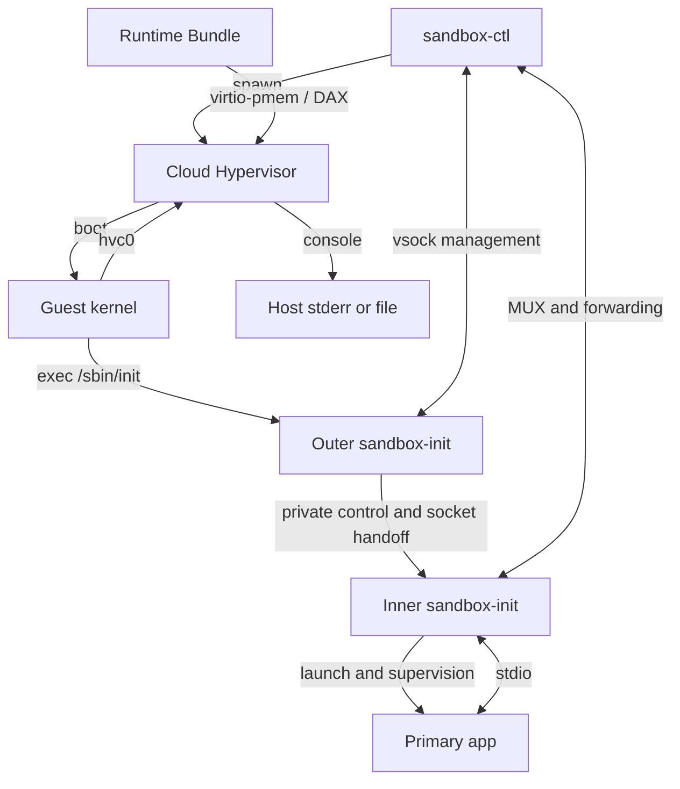
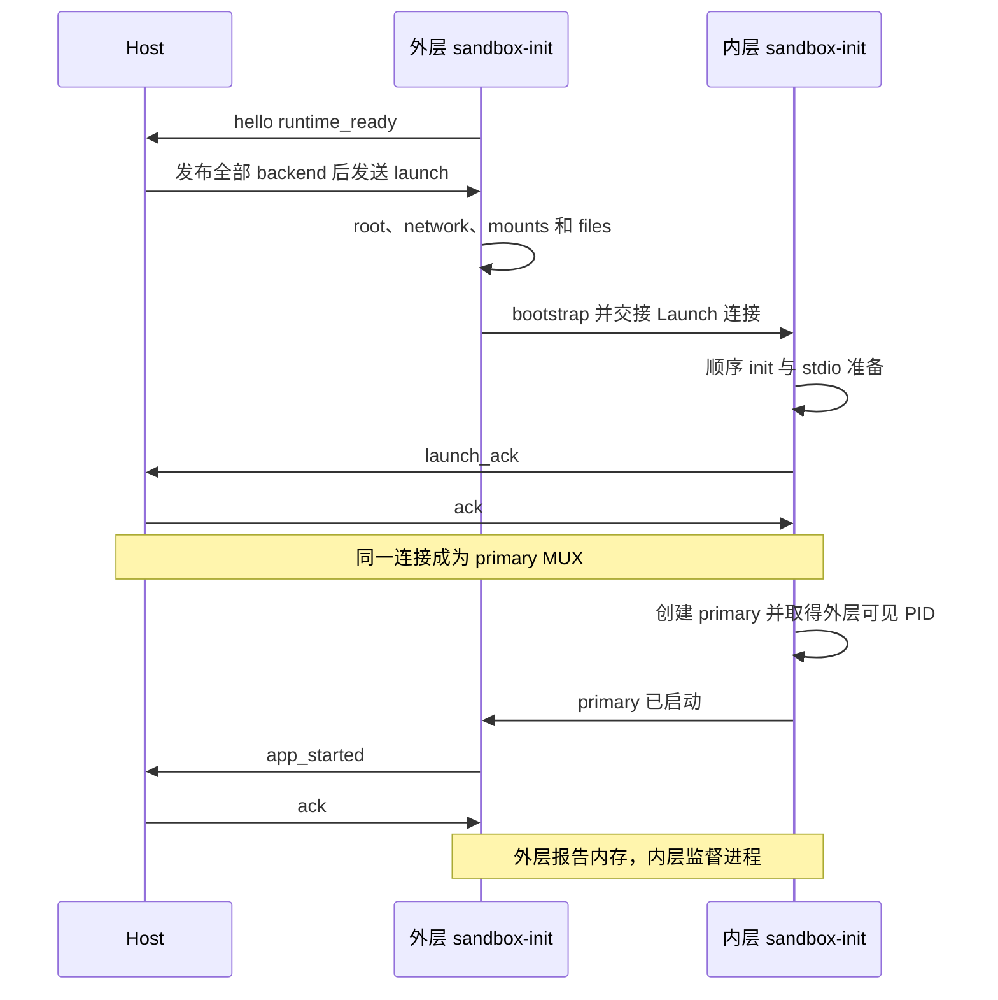
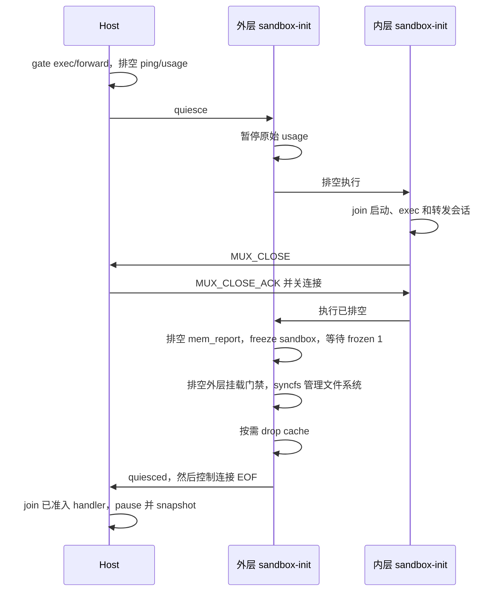
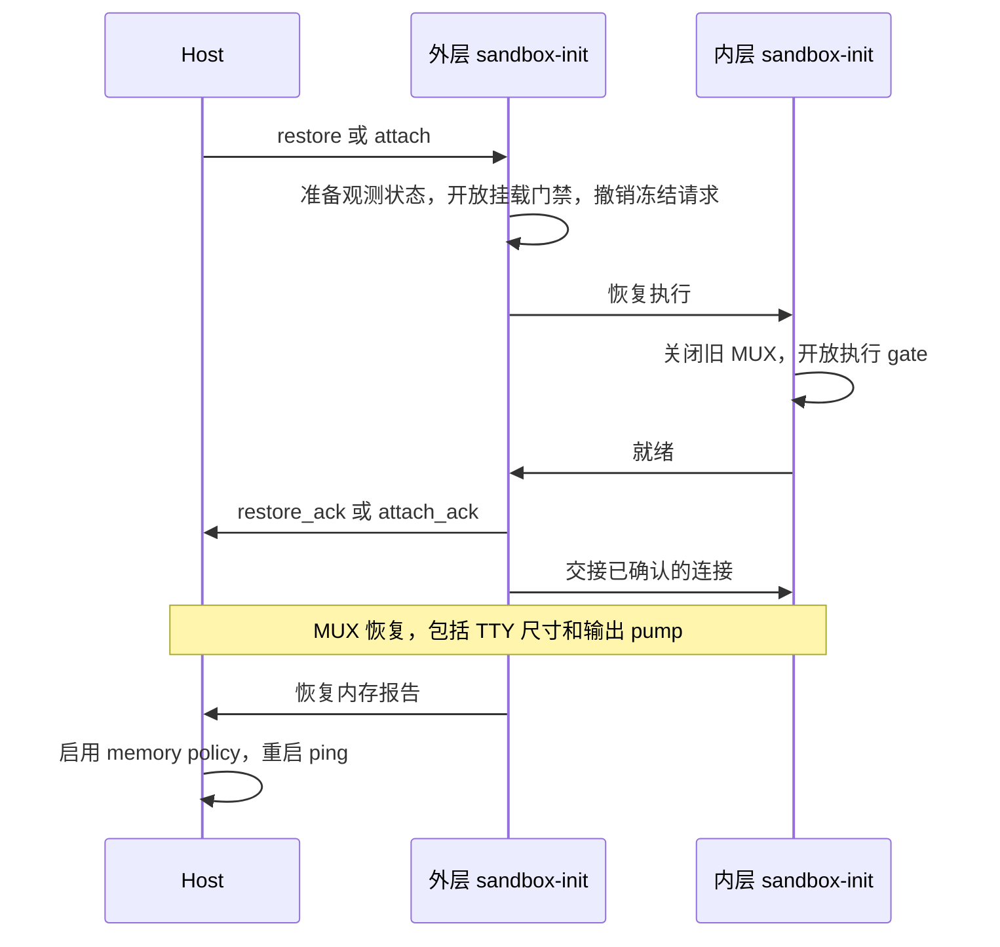

[English](guest-abi.md) | [简体中文](guest-abi_zh.md)

# Guest ABI：启动、应用与 Host 协议

本仓构建的 `sandbox-init` 负责 Guest PID 1 实现及 Host/Guest ABI。准备工作负载时先读应用契约，
修改初始化时沿启动阶段阅读，实现 Host 对端时查协议章节；它们是同一 Guest 边界的不同阅读视角，
不分别维护相互重复的规范。

guest-runtime 构建 PID 1，将其打入 Runtime Bundle，并提供共享 Go 协议包；线上协议契约由宿主和 Guest 对端共同评审。Host 流程见 [Runtime](https://github.com/kuasar-sandbox/sandboxer/blob/main/docs/runtime_zh.md)，Host 字段默认值见
[配置](https://github.com/kuasar-sandbox/sandboxer/blob/main/docs/configuration_zh.md)，Usage 的解释和 Budget 见[资源](https://github.com/kuasar-sandbox/sandboxer/blob/main/docs/resources_zh.md)。

该二进制由 `cmd/sandbox-init` 构建，在外层 runtime 中安装为 `/sbin/init`。[Guest-runtime 打包指南](runtime-bundle_zh.md)定义镜像清单、版本与构建。

<a id="goals"></a>

## 设计目标

| 目标 | 实现方式 |
|---|---|
| 启动快 | 同一静态 Go 二进制提供外层 Guest PID 1 和内层 PID 1，无 systemd / dracut / busybox 链路 |
| 启动状态可验证 | sandbox-init 版本固定;launch、quiesce、restore 和 attach 使用显式握手与状态屏障 |
| 跨 sandbox 共享 | virtio-pmem + DAX 通过 host page cache 共享同一文件的只读页，不共享 guest 私有可写 RAM |
| 一 VM = 一 primary app | 默认 private PID 模式用 clone(NEWPID\|NEWNS) 让 app 看到自己 PID=1；也支持 shared PID 模式 |
| 生命周期可寻址 | app 启动/退出通知与 quiesce/restore 握手走 vsock；host VMM 停机是独立路径（[信号处理](#signals)） |
| app I/O 干净 | 应用 stdin/stdout/stderr(或一个伪终端)走 vsock 转发,与内核 dmesg 隔离 |

<a id="system-boundary"></a>

## 系统中的位置



Runtime Bundle 是共享只读 Host backing file。Guest 内核挂载它并执行 `/sbin/init`。
外层实例组装并切换工作负载 root，应用 mounts/files/network，然后启动同一二进制的
内层实例。内层执行初始化并监督用户进程。Private 模式中主进程是自身 namespace 的
PID 1；shared 模式中用户看到的 PID 1 是内层实例。

Host endpoint 为 `RunRoot/PathID/vsock.sock`。`RunRoot` 默认 `/run/sandbox`；
`PathID` 默认 `SandboxID`，也可独立指定（[Host 路径](https://github.com/kuasar-sandbox/sandboxer/blob/main/docs/runtime_zh.md#run)）。Launch、ping、应用 started/exited 通知使用下文
控制路径；launch 连接升级为承载应用 stdio 的 MUX。内核 hvc0 输出走独立 CH console 路径。
应用无 restart 地退出时，内层经外层通知 Host，由外层 power off；CH 随后退出，Host owner 观测该退出结果。

<a id="guest-processes"></a>

### Guest 管理与进程执行

两个实例都来自 Runtime 的 `sandbox-init` 二进制。外层在任何用户 `init` 命令之前
创建一次内层，职责如下：

| 实例 | 进程与 cgroup 范围 | 职责 |
| --- | --- | --- |
| 外层 `sandbox-init` | Guest PID 1，位于 `/sandbox` 之外 | Host listener 与生命周期事实；root 和磁盘组装、autofs 及存储操作；网络/时钟更新；原始 usage 和 `mem_report`；递归 freeze/thaw 与 Guest poweroff |
| 内层 `sandbox-init` | 子 PID namespace 的 PID 1，位于 `/sandbox` 内 | 顺序 `init`；primary 与 plugin 监督；孤儿回收；exec 和转发会话；应用 stdio 与 MUX |

外层接收既有 Host 协议，通过私有 Unix socket 将执行连接交给内层。描述符交接保留
原连接及未读字节，外层只释放自身副本，不 shutdown 内层持有的 socket。私有协议是
两个实例共同使用的实现细节，不是另一套 Host API。已发请求的结果无法确认或私有
通路断开时，Guest 失败退出，不重放可能已经启动的操作；内层也不独立重启。

`/sandbox` 连同内层被冻结时，外层仍可运行，因此内层拥有的会话必须在 freeze 前完成
清理，恢复时则先解冻整棵树，再等待内层就绪。存储和 autofs 留在外层，为内层及其
子进程的文件系统操作提供服务。用户 PID namespace 不暴露外层实例。

<a id="non-goals"></a>

## 不做的事

- **不在 Guest 归并用量**: 按请求返回原始 usage 观测, 不增加 Guest ticker、
  累计、面积、峰值或历史补发 ([原始 Usage 观测](#usage-observations)).
- **无容器运行时**:平台直接管理 sandbox 生命周期,不引入 runc / crun / podman
- **无 systemd / OpenRC**:进程监督由 sandbox-init 自己写的 supervisor 完成
- **init 操作不依赖 busybox / util-linux**:mount / mkdir / chdir / chroot /
  reboot / openpty 通过 Go syscall 完成；runtime 同时包含下节列出的独立 guest payload 工具。
- **外层 runtime 不提供发行版 rootfs**:应用镜像提供 /etc、/usr 等内容；
  sandbox-runtime 提供 init、挂载点与 /opt/sandbox-runtime。
- **不复用控制面短连接做 stdio**:管理操作各用一条短连接([管理操作集](#management-operations));只有 launch /
  restore / attach / exec 四种操作的连接在握手后升级为长连接 MUX([MUX 子协议](#mux-wire))。应用会话
  那条 MUX 任一时刻至多一条(launch 生,restore/attach 续);exec 每次会话另起一条
  独立、短生命的 MUX,可并发多条([exec 会话(`sandbox-ctl exec`)](#exec-sessions))

<a id="runtime-prerequisites"></a>

## Runtime 镜像消费前提

完整的 sandbox-runtime.bundle 包装、文件清单、版本和构建规则由 [Runtime Bundle](runtime-bundle_zh.md)维护。此处只定义 PID 1 必须满足的消费边界：

- `/sbin/init` 必须是匹配 Guest 架构的 sandbox-init；本仓 `make sandbox-init` 生成它。
- Runtime 预建早期挂载及数据盘 staging 目录；phase 1a 按下文构造实际用户 rootfs，外层 Runtime 不是通用发行版 `/etc`、`/usr` 或共享库环境。
- `/opt/sandbox-runtime/` 是保留的只读 Guest payload 根，phase 1a 将其 bind 到用户 rootfs 同名路径，遮蔽用户镜像已有内容；应用必须遵守应用环境章节的约束。
- virtio-pmem/DAX 复用相同 backing file 的只读页，不共享各 Guest 私有可写 RAM。init 和 payload 可执行文件都必须匹配目标架构。

Runtime 生产、host/target mkfs 区分和 Native 构建操作见 [Native 指南](../native-deps/README_zh.md)。Host–Guest 握手、挂载次序与 ABI 继续由本文完整定义。

<a id="application-contract"></a>

## 应用契约


<a id="launch-spec"></a>

### launch 配置(LaunchSpec)

来源:`boot.root.base` 末尾 ZIP 内嵌 `config.json`(OCI image runtime config)⊕
sandbox.yaml `launch:` 节(yaml override 优先,Env merge),host sandbox-ctl 合并后
通过 launch 协议下发。`stdio` 节由 host 侧 `sandbox-ctl run` 的 `--tty` / `--stdin`
/ `--stdout` / `--stderr`(及它们的 `-from`/`-to`)解析决定(详见
[`Runtime`](https://github.com/kuasar-sandbox/sandboxer/blob/main/docs/runtime_zh.md) [`sandbox-ctl run`](https://github.com/kuasar-sandbox/sandboxer/blob/main/docs/runtime_zh.md#run))。

```jsonc
{
  "initial_launch_token": "<host-launch-token>", // 操作 identity，不是 portable 策略
  "exec":    "/usr/bin/foo",
  "args":    ["arg1", "arg2"],
  "env":     {"PATH": "...", "HOME": "/root"},
  "workdir": "/",
  "restart": "never",                    // never|on-failure|always(in-place 重启 + 退避)
  "cgroup_control": false,                // 默认 false:进程见 /;true:空根下放 controller,进程见 /init
  "ext4_discard": "auto",                // auto（或省略）：discard；manual：nodiscard
  "placeholder": false,                  // true → 不 exec 外部程序,占位锚点等待停机;exec 互斥;host 强制 restart=always
  "share_pid": false,                    // true → 继承内层 PID/mount namespace(pid_namespace=shared)
  "user":    "0:0",                      // uid:gid 或 name:group(guest 侧 /etc/passwd 解析);空 → root
  "stop_signal":   15,                   // 停机信号编号(host 已从名字解析);0 → SIGTERM
  "stop_grace_sec": 10,                  // guest PID 1 停机宽限秒数；0 → 默认 10s，不保证 host teardown 走此路径
  "network": { "interface": "eth0", "ip_cidr": "169.254.1.1/31", "mtu": 1500, "nexthop": "", "hostname": "my-sandbox" },
  "mounts":  [ {"target": "/tmp", "type": "tmpfs", "options": "nosuid,nodev,mode=1777"},
               {"target": "/var/log", "type": "empty"} ],
  "files":   [ {"path": "/etc/resolv.conf", "mode": "0644", "owner": "0:0", "content": "nameserver ..."} ],
  "init":    [ {"exec": "/bin/sh", "args": ["-c", "..."], "env": {}, "workdir": "/", "user": "0:0", "timeout_ms": 0} ],
  "plugins": [ {"exec": "/usr/bin/sidecar", "args": [], "env": {}, "workdir": "/", "user": "0:0", "restart": "always"} ],
  "stdio":   {
    "tty":     true,                     // true: 给应用一个伪终端(pty 模式);false: pipe 模式
    "winsize": {"cols": 80, "rows": 24}, // tty 模式的初始窗口大小
    "stdin":   false,                    // pipe 模式:是否开 stdin 通道(否则 app fd 0 = /dev/null)
    "stdout":  true,                     // pipe 模式:是否开 stdout 通道
    "stderr":  true                      // pipe 模式:是否开 stderr 通道
  }
}
```

`mounts` / `files` / `init` 的应用见 [阶段 2:spec 应用 + stdio 接线 + 应用拉起](#apply-and-launch);`mounts[].type==empty` 的卷在 switch-root
前以 raw ext4 source 建立([阶段 1：基础 Runtime、等待 launch、工作负载 root 与 switch-root](#base-and-root))。Disk MountSpec 另携带解析后的 disk_index/disk_overlay/disk_devs（[阶段 1：基础 Runtime、等待 launch、工作负载 root 与 switch-root](#base-and-root)）。
`ext4_discard` 由 Host `resources.diff_cow.discard` 解析，不属于 YAML `launch` 对象；
其[能力与挂载契约](#guest-block-discard)在 root 和数据盘组装之前生效。
FileSpec 还支持 read_only，省略时 bind 可写。Tmpfs 注入避免直接写盘，但进程可复制到磁盘、内容也可进入 memory snapshot，
参见 sandbox 生命周期的 persistent/ephemeral 暴露边界。Wire NetworkSpec 使用 **ip_cidr**，不是 host YAML 的 ip。
`start_timeout` 不在 LaunchSpec——它只约束 host 侧
等待 launch_ack(见 [失败语义](#failures))。

<a id="application-environment"></a>

### 用户应用看到的环境

- **PID 1**：默认 `pid_namespace=private` 时 primary 是自身 namespace 的 PID 1；
  shared 中内层 `sandbox-init` 是 PID 1 并回收孤儿。Init 命令与 plugin 使用内层
  PID namespace，native exec 加入 primary 的 namespace，外层管理实例不可见。
- **cgroup namespace**：真实 `/sys/fs/cgroup/sandbox` 是 namespace/freezer 根。
  `cgroup_control=false` 时内层及所有直接管理的进程位于该组，显示 `0::/`；
  `true` 时此根无直属进程且 controllers 已下放，进程位于 `/sandbox/init`，显示
  `0::/init`。Init、primary、plugin、exec 继承内层 cgroup namespace，并共用同一
  放置规则，详见
  [完整拓扑与下放规则](#application-cgroups)。
- **mount namespace**：init 命令、plugin 与 shared 模式的 primary 使用内层 mount
  namespace 及用户 root 视图（overlay 或 single ext4）。仅 private 模式的 primary
  新建 mount namespace，并挂载与自身 PID namespace 匹配的 `/proc`。Native exec
  加入 primary 实际所在的 mount namespace。
- **网络**:配置网络源时为 eth0(virtio-net,host TAP 后端),IP 由 sandbox-init 配好;
  无网络源时不挂 virtio-net,仅保留 `lo`,vsock 控制面仍可用
- **/dev**:`devtmpfs`(/dev/null、/dev/random、/dev/urandom 等);`/dev/pts`(devpts)
- **/run**、**/run/shm**:runtime 自动挂载的 tmpfs(无需声明)
- **/opt/sandbox-runtime**(平台保留):随 runtime 镜像出厂的 Guest 侧发布件根,经 bind 以
  **只读**出现在该路径(遮蔽 app 镜像在此的内容);应用可执行其中的工具(如
  `/opt/sandbox-runtime/bin/envd`),但不应把自己的文件放到此路径下
- **声明的挂载与注入文件**:`mounts` 的 tmpfs / empty 卷已就位(empty 卷遮蔽镜像该路径
  原内容);`files` 注入的文件已 bind 到目标路径(只读卷不可写);均在应用启动前完成
- **运行身份**:由 `launch.user` 决定(默认 root);非 root 时已 setgroups/setgid/setuid
- **stdin/stdout/stderr**:
  - tty 模式:fd 0/1/2 是同一个伪终端的从端,`isatty()`=true,有控制终端与 job
    control,窗口变化收 SIGWINCH;stdout 与 stderr 在该终端上合并
  - pipe 模式:fd 0/1/2 是普通管道(`isatty()`=false);未声明 stdin 时 fd 0 = /dev/null
  - **不**是 `/dev/console` / `/dev/hvc0`——应用输出不混入内核 dmesg,反之亦然
- **vsock**：CID=3 + port 5000 属于平台保留约定；这不阻止 privileged guest 创建 AF_VSOCK socket，不能作为安全边界
- **Balloon**：平台管理，不要求应用实现控制协议，但内存可用量、reclaim 和时间影响仍可观测。当前平台设备模型不启用 virtio-mem 热插拔，见 [VMM 限制](https://github.com/kuasar-sandbox/sandboxer/blob/main/docs/vmm_zh.md#limitations)。

<a id="exit"></a>

### 退出语义

- `restart: never`:应用退出 → sandbox-init 收尾 MUX、发 `app_exited{code,term_signal}`
  → reboot → CH 退 → sandbox-ctl 退,sandbox 销毁。退出码(或致死信号)透传到
  sandbox-ctl 的进程退出码，前提是通知已成功到达；失败时的传播限制见 [失败语义](#failures)
- `restart: always`:应用退出 → **原地重启**(同进程内 refork + rewireApp,[阶段 3:supervisor](#supervision)),
  沙箱长活、stdio MUX 跨重启存活,host 链路不断
- `restart: on-failure`:非零退出 / 被信号杀 → 原地重启;干净退出 → 同 `never`
  (通知 + reboot)

原地重启是同进程内 fork,**不**重新走整个 sandbox 启动序(退避 10ms→60s,存活满
60s 重置;停机信号或 quiesce 窗口期间不重拉,[阶段 3:supervisor](#supervision))。

<a id="signals"></a>

### 信号处理

- sandbox-ctl 通过 vsock 发 quiesce / restore / attach / ping，这些消息不直接给 primary app 发信号。
- **Host VMM 停机与 guest app 停机是两条路径**。Host 收 SIGTERM/SIGINT 后，先取消 pre-spawn/controller work；
  CH 已运行时，lifecycle 做 memory.high 准备后尝试 CH API 的 vmm.shutdown，有需要时退回向 CH 发 SIGTERM，
  请求后 5 s 未退升级 SIGKILL，第二次信号立即升级。这不保证向 guest PID 1 送达 SIGTERM 或完成 app stop grace。
  见 [lifecycle shutdown](https://github.com/kuasar-sandbox/sandboxer/blob/main/pkg/sandbox/lifecycle.go) 与 [run signal handling](https://github.com/kuasar-sandbox/sandboxer/blob/main/pkg/sandbox/run_signal.go)。
- **外层 Guest PID 1 收到 SIGTERM/SIGINT 时**，先重新开放外层挂载门禁、撤销平台冻结请求，
  再请求内层停机；内层尚未就绪时终止启动。已有 primary 时，内层禁止 restart，转发
  `launch.stop_signal`（默认 SIGTERM），等待 `stop_grace_sec`（默认 10 s，来自
  Host `launch.stop_grace_period`），超时终止 primary。内层自身收到这两个信号时
  也使用同一 primary 停止路径，最终由外层 poweroff。这些配置约束 Guest 路径，
  不保证 Host VMM teardown 使用该握手。
- tty 模式 host 终端 raw 时，Ctrl-C（0x03）按字节经 MUX PTY 送入 guest，
  由 guest line discipline 转成应用 SIGINT。Host 停 sandbox 或 terminal escape 是另一路径
  （[sandbox 生命周期](https://github.com/kuasar-sandbox/sandboxer/blob/main/docs/runtime_zh.md)）。
- quiesce.signal（[quiesce 处理](#quiesce)）是未实现提案。

<a id="initialization"></a>

## sandbox-init 三阶段


<a id="base-and-root"></a>

### 阶段 1：基础 Runtime、等待 launch、工作负载 root 与 switch-root

基础初始化不依赖工作负载，只挂载 proc/sysfs/devtmpfs，启动 loopback 和反向控制
分发器，然后发送 `hello{phase:"runtime_ready"}`。等待期间分发器响应 ping 和 shutdown，
拒绝仅适用于工作负载的 exec/connect/quiesce/attach/restore。单纯 socket listen 不代表
该就绪屏障。`shutdown` 在终止前回复 `ack`。内层发布 primary 后，外层分发器将执行
连接交给其 supervisor 和 stdio bridge，自身继续处理 Guest 管理操作。

Launch 请求驱动全部工作负载 root 组装。等待请求不计入 launch 执行期限；host 在
发布 launch 后开始该超时。握手先于进程级 chroot 完成。Go 线程共享 CLONE_FS；
切换 root 期间基础控制路径只用 socket，不访问工作负载路径。

```
A. 基础 Runtime:
   - bind/listen AF_VSOCK :5000
   - 在 /proc /sys /dev 挂载 proc/sysfs/devtmpfs
     CONFIG_DEVTMPFS_MOUNT=y 已挂 /dev 时跳过 EBUSY。
   - raw netlink RTM_NEWLINK(lo, IFF_UP)，失败即终止
     内核提供 127.0.0.1/8 和 ::1/128，不发 RTM_NEWADDR。
   - 启动反向管理分发器
B. connect(CID=2:5000)，发送 hello{phase:"runtime_ready"}，等待 launch
   A/B 不挂载或消费任何工作负载设备。
C. 仅在收到 launch、host 已发布全部 block backend 后:
   1. 等待 /dev/vda 和 /dev/vdb：轮询 stat，10 s 超时。
   2. mount -t erofs -o ro /dev/vda /overlay/lower
      mount -t ext4 -o discard /dev/vdb /overlay/upper  # auto；manual 使用 nodiscard
   3. 不存在时创建 /overlay/upper/{upperdir,workdir}。
   4. mount -t overlay overlay -o lowerdir=/overlay/lower,
        upperdir=/overlay/upper/upperdir,workdir=/overlay/upper/workdir /sysroot
   5. mkdir -p /sysroot/opt/sandbox-runtime
      mount --bind /opt/sandbox-runtime /sysroot/opt/sandbox-runtime
      只读 pmem payload bind 随新 root 子树一起搬运。

D. spec-dependent、switch-root 之前(empty/volume 卷需 raw ext4 source):
   mount -t tmpfs tmpfs /sysroot/run -o nosuid,nodev
   mount -t tmpfs tmpfs /sysroot/run/shm -o nosuid,nodev,mode=1777
     先挂载这两个自动提供的 tmpfs，再绑定卷，确保其子目录上的卷可见。
   for each mounts[].type == empty:
     mkdir /overlay/upper/volumes/<i>            ← raw ext4(与 upperdir 同级,物理隔离于 overlay 写层)
     mkdir -p /sysroot/<target>
     mount --bind /overlay/upper/volumes/<i> /sysroot/<target>   ← 空目录遮蔽镜像该路径内容

E. switch-root:
   MS_MOVE /proc /sys /dev → /sysroot/{proc,sys,dev}
   chdir(/sysroot) → MS_MOVE . / → chroot(.)      ← MS_MOVE 携带整个子树:proc/sys/dev、
                                                    C5 的 /opt 与 D 的 volume binds 一并进入新 /

F. switch-root 之后的基础挂载:
   mount -t cgroup2 -o nsdelegate cgroup2 /sys/fs/cgroup;验证 nsdelegate
   mkdir /sys/fs/cgroup/sandbox          ← 用户 cgroup namespace/freezer 根
   launch.cgroup_control=true 时另 mkdir /sys/fs/cgroup/sandbox/init,严格启用 Guest 根 controllers;
   内层 bootstrap 在用户命令之前完成 /sandbox 下放(用户 cgroup namespace 与 controller 拓扑)
   mount -t devpts devpts /dev/pts (newinstance,ptmxmode=0666)        ← tty 模式 openpty 需要
```

全部通过 `golang.org/x/sys/unix.Mount` / `unix.Chroot` 等 syscall 完成,
不依赖任何外部二进制。

`/dev/vda`(blk0 base)是用户应用的镜像 erofs(只读);`/dev/vdb`(blk1 overlay
ext4)是写层。overlay 合并后 `/sysroot` 是 guest rootfs 的最终视图,switch-root
之后这套视图变成新的 `/`。承载 sandbox-init 自身的 `sandbox-runtime.bundle` 由内核经
virtio-pmem 挂在 `/`(`root=/dev/pmem0 ... rootflags=dax=always`),阶段 1 把它让位给 overlay
(其中 `/opt/sandbox-runtime` 经 bind 在让位时随子树保留进新 root)。

**就绪与 root 所有权：** Linux 在 boot 期间可以探测固定但未绑定的盘并收到 IOERR。
基础初始化不挂载这些盘，第一次工作负载 mount 在 Launch 发布全部设备后进行。
Host 从 `runtime_ready` 开始 ping；launch_ack/app_started 保持既有语义，app_started
不证明 execve 成功或应用健康。已有内存快照使用 restore/attach，不走冷启动握手。

**初始 Launch 确认：** runtime-ready hello 声明 `initial_launch_state_v1`。
新 Host 在 apply Launch 前检查能力；升级 Guest 基线时须同时重建 sandbox-init
与 sandbox-runtime Bundle。升级 Host 不会替换已有 snapshot 内的 init。普通 restore
接回已有应用；恢复后将接受新 Launch 的预热 Runtime 必须原本就含兼容 init。

当前支持的预热边界是仍存活的 `runtime_ready` 实例随后执行 Launch。SDK 在
running 前拒绝 Snapshot/Export；尚无工作负载的 Guest 拒绝 restore/attach/quiesce。
“保存预热内存、恢复后再 Launch”不是已实现的 API。若其他生命周期提供这种状态，
新 Launch 仍须满足 Guest 能力要求；这不代表可以升级旧 snapshot 内的 init。

Host 在 LaunchSpec 提供唯一 `initial_launch_token`。Guest 以同一把锁记录绑定
该 token 的一致快照：工作负载准备前为 `pending`，在既有初始 primary 发布边界为
`started`，启动硬错误为 `failed`，接受终止时为终态 `exited`。快照包含初始 PID
或失败/退出信息。PID 存在与 Ping 可达都不能证明启动成功。正常 primary restart
保留已完成的初始状态及既有监督语义。

既有 `app_started` 快速通知与 Ping/Pong 都携带 `initial_launch_state`；
`app_exited` 携带终态快照。Host 使用同一确认入口，核对当前 token、ACK/MUX 屏障、
取消、永久错误与 VM 退出。pending、旧 token 和重复事实不能提交。既有 Pinger
只发布轻量事实，不新增 Guest 发送者或轮询循环。管理连接先到达 EOF 并退出连接
join，再运行用户 callback；成功提交先通知 Launch waiter，再执行 callback。

`timeouts.app_start` 属于 Host policy：省略、空值或零不增加 post-ACK 期限；
正时长主动选择 post-ACK 整体期限，负数/非法值为错误。这不改变
`launch.start_timeout`、`app_notify` 交换期限、取消、启动硬错误或 VM 退出。
`PingFatalThreshold` 默认仍为零；显式配置正阈值可能在依赖尚未恢复时终止 Runtime。
Portable E/S 制品不携带此 Host policy。

**volume 卷的 source 与搬运**:`empty` 卷的 source 是 raw ext4 上 `/overlay/upper/volumes/<i>`
(与 overlay 的 `upperdir/` 物理隔离,同在 vdb、一起进磁盘快照),bind 到 sysroot 内的
target;switch-root 的 `MS_MOVE /sysroot → /` 会把该 bind 随整棵子树搬进新 `/`
(proc/sys/dev、`/opt/sandbox-runtime` 正是同理),无需单独 MS_MOVE。switch-root 后
`/overlay/upper` 路径被埋,但 bind 持有 ext4 inode 引用使卷内容在 target 处存活,且应用
看不到 raw ext4 内部结构。

**`/opt/sandbox-runtime` 的搬运与版本钉住**：C5 在 switch-root 前把 pmem 内的
发布件根 bind 进 `/sysroot/opt/sandbox-runtime`,由 E 的 `MS_MOVE /sysroot → /` 随子树带进
新 `/`,bind 持有 pmem inode 引用使其在原挂载被遮蔽后仍存活。内层创建执行环境时
继承该只读挂载；init 命令、plugin 和 shared primary 使用同一 mount namespace，
private primary 则将该挂载继承到自身 namespace。因 payload 属于
sandbox-runtime.bundle，修改它会改变该制品的 identity。
restore 将 runtime footer identity 与 E/C0 核对并要求重挂相应 runtime；这不是每次 restore 都对整个 payload
重新 hash（见 [sandbox 生命周期](https://github.com/kuasar-sandbox/sandboxer/blob/main/docs/runtime_zh.md)）。在可信且匹配的工件前提下，恢复后 payload 版本保持一致。
payload 与 runtime 同生命周期，不能独立热补丁；若需独立版本须改用独立只读 EROFS 设备（[扩展点](#extensions)）。

**单磁盘模式**(`boot.root.overlay` 省略时)。host 不建 blk1、只发一个可写 `--disk`(blk0=
root 盘的 ext4 CoW),并在 cmdline 加 `sandbox.root.layout=single`。phase1a 读 `/proc/cmdline`
（/proc 已在最前挂好），在基础初始化阶段记录布局。设备组装等待 launch spec 到达后再应用
其中的 ext4 discard 策略。单盘路径只 wait `/dev/vda`，使用所选选项（默认 `discard`）将 ext4
直接挂到 `/sysroot` 作为可写根(无 `/overlay/lower`、`/overlay/upper`、无 overlayfs、无 vdb),其余(`/opt/sandbox-runtime`
bind、switch-root、phase1b 基础挂载)不变。`empty` 卷的 source 改落在写根自身的
`/sysroot/.sandbox-volumes/<i>`(无独立 ext4 upper),仍 bind 遮蔽 target、随 switch-root 子树搬运。
单盘根盘恒为可写 ext4,无 erofs 镜像 ⇒ 无内嵌 config.json ⇒ launch.exec 必填(host 侧 validate 强制;
`launch.placeholder` 占位模式除外——它本就不跑外部程序)。

**数据盘 `boot.disks[]`**(root 之外,最多 `MaxDataDisks=8` 块)。每块盘配置规则与 `boot.root` 相同
(单盘 diff / 双盘 overlay,含 `base_from_refs`),host 侧用同一套 `PrepareDiff`/CoW/reader 准备。

```
设备序(= CH --disk 顺序 = guest /dev/vd[a,b,c…]):
  root(单盘 1 个 / overlay 2 个) → boot.disks[0](1/2) → boot.disks[1](1/2) → …
  例:overlay root(vda=base, vdb=upper)+ single 数据盘(vdc)+ overlay 数据盘(vdd=base, vde=upper)
host 把 mounts[].source(name)→序号→具体 /dev/vdX 解析进 MountSpec(DiskIndex/DiskOverlay/DiskDevs);
name 不过线。盘的设备位由它在 boot.disks[] 的下标决定,与 mounts[] 顺序无关。
```

挂载在 `applyVolumeMounts` 内、switch-root **之前**完成(与 `empty` 卷统一成「备好 source → bind
到 `/sysroot<target>` → switch-root 的 MS_MOVE 携带」)。组装挂点 **预先 bake 进 runtime erofs**
(`/sysdisks/disk-{0..7}{,-lower,-upper}`,24 个空目录;数量须与 `config.MaxDataDisks` 一致),
缺失即 die(erofs 版本不符,重建或减盘):

以下挂载示例采用默认 `auto` 策略；`manual` 将可写 ext4 的 `discard` 替换为 `nodiscard`。

```
单盘数据盘 N:  mount ext4 -o discard /dev/vdX → /sysdisks/disk-N
overlay 数据盘 N: erofs ro → /sysdisks/disk-N-lower;ext4 rw,discard → /sysdisks/disk-N-upper;
                 overlayfs(lower, upper/upperdir, upper/workdir) → /sysdisks/disk-N
每条映射:bind /sysdisks/disk-N/<subpath> → /sysroot<target>
```

同一设备序号可以出现在多条映射中。`subpath` 是盘根内的相对目录，空串表示整盘根，旧制品也可能编码为 `.`。同一 slot 投影的源目录必须互不重叠。Guest 在安装前解析目标别名，逐对检查 slot 目标和其他有效挂载。宿主通过 `disk_slot_declared` 标记 slot 投影，包括在冷 Sandbox 制品中已绑定的 slot。`disk_slot` 仅对未绑定盘位请求 autofs，也用于识别旧宿主传来的空盘位。缺少的源目录在私有写层创建；源是符号链接、非目录或子挂载时访问失败。使用子目录或重复设备序号前，宿主检查 `runtime_ready` Hello 的 `disk_mount_projection_v1` 能力。

单设备 `disk_slot` 在每个目标安装标准 autofs v5 直接触发点。Hello 中的 `disk_slot_v1` 表示内核提供 autofs。目录访问会打开块设备并尝试挂载。如果 VMM 不发送容量变更通知，动态盘位还需要 [Guest 内核在访问时刷新容量](vmlinux_zh.md)，才能挂载。空盘位使本次访问失败，并保留触发点。接入介质后首次成功访问挂载文件系统、投影对应子目录并继续查找。同盘各目标共用一个文件系统。应用 cgroup 无法直接打开盘位的块设备及别名。内存快照保存 autofs 句柄与已挂载的投影，Host 在恢复 Guest 前接回对应的盘内容。

`/sysdisks` 子树 switch-root 后不可见,但被 bind(及 overlayfs 对 lower/upper 的引用)持活——与
root overlay 的 `/overlay/lower+upper` 隐藏后仍活、`/opt/sandbox-runtime` bind 同一机制。**恢复**时
guest 从内存快照续跑、盘已挂好(不重挂),host 只需按同序重建并 serve N 个设备(restore host yaml 的
`boot.disks[]` 若显式提供active diff binding,须与 Sandbox E 同数同序;mounts[] 在 restore 下禁止
重放)。**快照**在同一 pause/quiesce 点逐盘捕获可写 diff(root + 各数据盘),先生成包含完整disk
graph的Sandbox E,再生成memory Snapshot S;S的`snapshot.cfg`只用`sandbox_ref`引用E并记录
memory `from_refs`。本地flatten-merge分别作用于E的disk layers和S的memory layers。

Usage 在上述受控 root/data 组装处保留每个可写盘的私有 CLOEXEC 文件系统句柄,
先于 switch-root 隐藏 staging path. Single 指向 ext4 本身, overlay 指向
原始 upper 而不是合并 root. Bind/empty volume 不增加来源. 句柄随内存恢复
保留, 不进入应用 exec, 与 init 一同关闭; 不可取消的在途读取保留原句柄/槽,
直至实际结束 ([原始 Usage 观测](#usage-observations)).

<a id="guest-block-discard"></a>

#### Guest 块设备 DISCARD

`LaunchSpec.ext4_discard` 为四条受管可写 ext4 路径选择挂载选项：单盘根、overlay 根的
upper、单盘数据盘及 overlay 数据盘的 upper。省略或 `auto` 使用 `discard`，`manual`
显式使用 `nodiscard`。Host 从
[`resources.diff_cow.discard`](https://github.com/kuasar-sandbox/sandboxer/blob/main/docs/configuration_zh.md#diff-cow-policy) 解析该值。Empty/bind
卷继承底层文件系统行为；只读 EROFS 保持原挂载选项。

新版 Guest runtime 声明 `hello.ext4_discard_v1=true`。Host 在发送 manual launch 之前
要求具备该能力，避免旧 Guest 静默忽略关闭自动 discard 的请求。Auto 模式仍兼容旧
Guest，并沿用对应 runtime 的默认挂载行为；新版 Guest 将省略的 wire 字段视为 auto。
对仍存活的 `runtime_ready` 预热实例执行 Launch 时同样应用所选策略，因为工作负载盘
尚未挂载。

Auto 模式下，文件系统释放块时即可通知 Host，应用无需改造，也不必在每次删除后
单独执行 trim。Manual 关闭这些自动请求，仍保留显式 trim 和 virtio-blk DISCARD；
可回收的已删除数据可能保留到执行 trim。FITRIM 作用于底层 ext4，不能用 overlayfs
视图替代已隐藏 upper 的 trim 目标。Auto 删除或 manual trim 都会增加额外处理；
文件系统释放、宿主回收和磁盘导出缩小不保证在 unlink 返回时完成。
[存储契约](https://github.com/kuasar-sandbox/sandboxer/blob/main/docs/block-storage_zh.md#discard-and-reclamation)定义这些边界并保护保留历史。

使用 manual 须通过 `boot.runtime` 选择包含新版 `sandbox-init` 的 runtime bundle 后
冷启动。仅替换 Host 可执行文件不会更新内嵌 init。普通冷启动和 `run --from` 应用本次
Host 选择。已有运行实例和内存恢复保持原挂载；restore 不会重新挂载，并拒绝任何
显式 `resources.diff_cow.discard` 输入。恢复时应省略该字段；Host projection
`config --mode restore` 会删除它，同时保留缓存预算。无需磁盘或快照格式迁移。
启用 auto 也不会自动 trim 此前已经空闲的全部空间。

新建可写 virtio-blk 设备公布 `VIRTIO_BLK_F_DISCARD`，只读设备不公布。固定配置为
`MaxDiscSeg=1`、`DiscSecAln=8`（4096 字节）、`MaxDiscSec=8192`（4 MiB）。
能力在 server 创建时确定，池化 backend 绑定必须匹配。恢复设备沿用捕获时的 feature
协商结果，旧快照不会在恢复时获得新能力。

请求只包含一个 16 字节范围，可以跨多个可读 descriptor。Host 先校验 flags、原始扇区
范围及溢出，再向内取整到完整 4 KiB 页。不支持的 flags 和 WRITE_ZEROES 返回 UNSUPP；
畸形或越过容量的请求返回 IOERR。成功 DISCARD 发布逻辑 Zero，即使 lower 含非零
内容，后续读取也返回零。未完整覆盖的边缘页保留原内容。对于 v4，ACK 通常与 WriteAt
一样表示 Zero 已进入现有有界脏页缓存；额度压力下可改为单页同步完成，不另申请
预留。后端 payload 映射可以在后续回写时移除。内部 Drain、命名 Checkpoint 和普通
Close 等待该回写，但不等待全部 GC。首次发布后，活动导出无需额外 Drain，已能导出
待回写 Zero；新建磁盘仍须等待 `WaitMaterialized`，包括初次排空。单层 v3 保持每批
最多 64 页的同步移除。两条路径均不保证整个范围原子性或稳定存储持久性。普通写零
仍分配 Data；Guest FLUSH 保持既有非持久化契约。

新版 runtime 的冷启动验证须覆盖 root/data 两种拓扑，以及省略、显式 auto 和 manual
策略。直接检查实际 ext4 挂载选项，不手动 remount，并验证所有模式都保留设备 DISCARD
能力。Auto 模式的文件系统释放应到达 Guest DISCARD；manual 删除和同步之后，原始
非零 extent 应保持原内容，直至显式 `fstrim` 后变为零。内存恢复省略策略时应保留捕获
的 manual 挂载。
保留非零 lower 内容，检查 discard 后、Checkpoint/导出及恢复后的零读取，并在 Drain
或 Checkpoint 后确认相应 upper 范围没有活动 payload。在此边界之前，使用暂停回写
的测试，同时验证 Zero 读取和稀疏导出的 Zero 分类。仅 trim 返回的字节数不足以证明
这些性质。

<a id="apply-and-launch"></a>

### 阶段 2：准备环境并通过内层 init 启动进程

外层在 switch-root 后应用网络、声明的 tmpfs 挂载及注入文件。Empty volume 已在
switch-root 前安装。文件先暂存于 tmpfs，按请求的 owner、mode 和可选 read-only
属性 bind 到目标，再卸载 staging。冷启动网络、挂载、文件失败均终止启动；恢复时
尽力更新时钟和网络是另一项契约。

外层通过 `clone3(CLONE_INTO_CGROUP)` 将内层直接创建在真实 `/sandbox`，同时建立
新的 PID 和 mount namespace。Fork 子进程在 re-exec 前创建以该组为根的 cgroup
namespace。内层挂载自己的 `/proc` 和 scoped cgroup2，完成下文的下放设置，再报告
就绪。该 bootstrap 属于执行环境，不依赖 primary 选择哪个程序或是否为 placeholder。

内层收到 LaunchSpec 和原 hello/launch 连接后，依次执行：

1. 在内层 PID/mount/cgroup 环境中顺序执行 `init`，采用各命令配置的环境、工作目录和用户，
   输出仍到 console。非零退出或超时使 launch 失败。超时只终止当前命令，不扩展为
   杀进程组或后代。串行阶段只有一个 waiter，同时收集当前命令状态和已收养孤儿的退出，
   随后交给正常 supervisor。Primary、plugin 和 exec 创建不能与该初始化阶段重叠。
2. 根据声明准备 primary stdio：指定尺寸的 PTY，或对应管道；未启用 stdin 时使用
   `/dev/null`。在承载 Launch 的同一连接发送 `launch_ack`，收到 Host 的 `ack`
   后才启动 MUX。
3. 直接在最终 cgroup target 创建 primary，首次启动与后续 restart 走同一路径。
   Shared 模式继承内层 PID、mount 和 cgroup namespace。Private 模式新增 PID
   和 mount namespace，挂载与之匹配的 `/proc`，同时保留内层 cgroup namespace
   及 scoped cgroup2 挂载。Helper 先完成必要的 namespace/mount 设置，再应用
   运行身份并执行所选程序。
4. Primary 停在 pre-exec gate 时，由外层读取其 pidfd，取得 Guest 初始 PID namespace
   中可见的 PID。内层 supervisor 在放行 helper 前登记该进程。Host 仍收到这个外层
   可见的 primary PID，不收到内层 init 的 PID 或 primary 的 namespace-local PID。
5. Helper 完成后，启动配置的 plugin、发布内层 supervisor，并将 primary 启动事实
   交给外层。外层维护 `initial_launch_state`、发送 `app_started` 并启动内存报告；
   内层进入正常监督，开始接受执行会话。

因此 `launch_ack` 仍在**全部初始化完成之后、primary 创建之前**发送。它确认环境和
stdio 屏障，不证明 primary exec 成功或应用健康。Helper 会报告明确的 setup/exec
错误，但突然死亡也可能产生无错误文本的 EOF；`app_started` 保留既有发布语义。
参见 [`executor.go`](../cmd/sandbox-init/executor.go) 与 [`child.go`](../cmd/sandbox-init/child.go)。

Placeholder 使用相同设置和 primary 生命周期，末步等待 SIGTERM/SIGINT，不执行
外部程序。Host 仍强制 `restart=always`，从 exec 杀死 placeholder 会原地重启。
Placeholder 与内层 init 是不同进程；替换 placeholder 不重做环境 bootstrap 或 `init`。

Primary 和一次性 `init` 命令仅在整个环境 map 为空时补默认 PATH。Plugin 和 native
exec 先设置默认 PATH，再用传入条目覆盖，包括显式空 PATH。Restart 按代替换 bridge
的 primary 侧 fd，保留 MUX session，并采用[阶段 3](#supervision)的有界输出排空。

<a id="application-cgroups"></a>

#### 用户 cgroup namespace 与 controller 拓扑

真实 `/sys/fs/cgroup/sandbox` 同时是**用户 cgroup namespace 根**和捕获时的
**递归 freezer 根**。外层留在 Guest 全局根；内层、`init` 命令、primary、plugin、
exec helper/命令及其后代均位于 `/sandbox` 之下，捕获操作覆盖整棵树。

`launch.cgroup_control` 默认 `false`，选择同一个执行环境内部的进程放置及下放方式：

| Guest 真实路径 | 用户 cgroup 挂载内路径 | `false` | `true` |
| --- | --- | --- | --- |
| `/sys/fs/cgroup` | scoped 挂载之外 | 外层 `sandbox-init` | 外层 `sandbox-init` |
| `/sys/fs/cgroup/sandbox` | `/sys/fs/cgroup` | 内层及所有直接管理的进程；`/proc/self/cgroup` 为 `0::/` | 无直属进程；为子组启用并校验 advertised controllers |
| `/sys/fs/cgroup/sandbox/init` | `/sys/fs/cgroup/init` | Runtime 不创建 | 内层及所有直接管理的进程；`/proc/self/cgroup` 为 `0::/init` |
| `/sys/fs/cgroup/sandbox/<user-group>` | `/sys/fs/cgroup/<user-group>` | 不承诺 controller 下放 | 用户可创建与 `/init` 同级的组及其后代，始终属于同一 freezer 树 |

`/init` 表示内层 init 直接管理进程的默认组，包含内层自身，也包含运行期间的一次性
`init` 命令；它不是专门给这些命令设置的组。所有进程类型共用同一 `cgroup_control`
设置，用户 manager 可组织自己的后代，不改变平台的递归 freezer 根。

外层在 Guest 初始 namespace 中以 `nsdelegate` 挂载 cgroup2，并验证选项生效。
内层 scoped 挂载隐藏祖先组。Linux 据此将 cgroup namespace 作为下放边界：根目录
仅允许写内核指定的可下放接口，进程迁移不能跨越 namespace 可达子树，根上的资源
controller 设置仍由外层控制。参见内核的
[cgroup v2 下放契约](https://docs.kernel.org/admin-guide/cgroup-v2.html#delegation)。
这是 cgroup 管理边界，不是针对 privileged Guest 的通用安全边界。

`cgroup_control=true` 时，外层严格启用并回读 Guest 全局根 advertised controllers。
内层先通过 scoped `/init/cgroup.procs` 将自身从 `/sandbox` 移到 `/sandbox/init`，
此时尚无用户代码运行。外层确认 `/sandbox` 无直属进程，启用并回读其 advertised
controllers，再放行内层。这是唯一的 bootstrap 迁移。`false` 时内层留在
`/sandbox`，全局根 controller 下放保留 best-effort，不承诺可下放的子层级；
两种模式都使用 `nsdelegate`、scoped 挂载和递归 freezer。

Bootstrap 后，内层持有 scoped target 的目录描述符。每次管理的进程启动都继承
内层 cgroup namespace，并通过 `clone3(CLONE_INTO_CGROUP)` 直接出生在最终
target。子进程沿用已准备好的 scoped cgroup2 挂载，不再加入其他 cgroup namespace
或重新挂载 cgroup2。首次 primary 没有特殊放置路径，用户进程也没有 Start 后再迁移
的窗口。必要的 namespace/cgroup 设置失败即终止启动，不降级为在 freezer 树之外
运行。内部描述符设置 CLOEXEC，只通过显式 slot 交给 helper，用户程序不继承。

**PID 与挂载视图：** `launch.pid_namespace=private` 保持 primary 为自身 namespace
的 PID 1，native exec 加入该 primary 的 PID 和 mount namespace；`shared` 中
可见的 PID 1 是内层 init，由它收养孤儿。Init 命令与 plugin 在两种模式下都运行于
内层 PID namespace。
Private primary 看不到它们，shared primary 可以看到。Shared 的 `/proc/1/root`
和 `/proc/1/cgroup` 描述内层 root 与 scoped cgroup 放置，不再描述外层管理进程。

Runtime 创建的进程上下文如下：

| 进程 | PID namespace | Mount namespace | Cgroup namespace |
| --- | --- | --- | --- |
| 内层 init、init 命令与 plugin | 内层 | 内层 | 内层 |
| Shared primary | 内层 | 内层 | 内层 |
| Private primary | 新建，primary 为 PID 1 | 新建，使用匹配的 `/proc` | 内层 |
| Native exec | primary 实际所在的 namespace | primary 实际所在的 namespace | 内层 |

**Plugin：** primary 启动后，内层将配置的 plugin 作为自身子进程拉起。无论 primary
采用哪种 PID 模式，plugin 都继承内层 PID、mount 和 cgroup namespace、用户
rootfs 与网络，并直接出生在最终 cgroup target。Plugin 首次启动与 restart 都使用已准备好的环境，
不再创建 mount namespace，也不重新挂载 `/proc` 或 cgroup2。
每个 plugin 独立选择 `never`、`on-failure` 或
`always`（默认 `always`），使用共同退避规则，输出仍到 console，env/workdir/user
仍可配置。Plugin 退出不决定沙箱生命周期，该职责仍属于 primary 及 `launch.restart`。

**运行身份与进程组：** 共享 namespace 不覆盖各命令声明的 user、env、workdir 或
stdio。Primary/plugin helper 在执行程序前应用这些设置；private primary 仍先完成
挂载设置再降权。Init 命令继承准备好的内层 namespace，可直接使用
`SysProcAttr.Credential`；命名用户继续以镜像 `/etc/passwd` 为准。共享 namespace
也不要求共用进程组或终端 session：autofs 所需的进程组分离与 PTY session 设置
继续生效。

**共享挂载与传播：** init 命令、plugin 和 shared primary 使用同一份挂载表。
在其中执行的 mount/umount 对内层及使用该 namespace 的所有进程可见，也包括
shared 模式下的 native exec。Plugin 或 shared primary 退出、restart 不会撤销其
挂载；挂载持续存在，直到显式卸载或整个执行环境被销毁。创建挂载的程序需要按此
生命周期管理它们。

外层 shared 挂载树向内层 shared/slave 树传播：内层接收外层管理的磁盘挂载，
内层 shared 挂载又能向 private primary 的 slave 挂载树传播。因此 private
primary 仍接收上游挂载变化，同时保有自己的 `/proc` 与本地挂载变化。Slave
传播关系阻止内层挂载变化反向进入外层，也阻止 private primary 的挂载变化反向
进入内层。这是 runtime 准备的传播关系；程序可显式创建自己的 namespace 或调整
执行环境内的传播设置。所有进程共享 Guest 网络 namespace。Restore 保留捕获时的
挂载状态，不重放 files、mounts 或 init 命令。

#### 兼容性与内存恢复

Host 消息、primary/placeholder 行为、退出通知、restart 策略以及仅冷启动执行初始化
的契约保持不变。可观察变化包括 Guest 全局路径由 `/app` 改为 `/sandbox`、init 命令
进入用户执行环境，以及 shared PID 模式暴露内层而非外层 PID 1。依赖全局路径或外层
管理进程视图的脚本需要调整；普通 scoped membership 仍按 `cgroup_control` 显示
`/` 或 `/init`。Plugin 与 shared primary 也改为共享内层 mount namespace，不再
各持一份私有副本。它们的挂载变化因而在该环境内跨进程可见，并在进程退出或
restart 后保留。依赖原先逐进程挂载隔离或自动挂载清理的程序，需要显式管理这些
需求。

冷启动从选定 Runtime 构造此模型。内存 Snapshot S 保存两个实例、其 namespace/cgroup
拓扑和私有通路；恢复必须使用 E/C0 identity 对应的 Runtime backing artifact，继续
执行捕获时的实现。替换 Host 或 Runtime 文件不能升级已有 S 内的 init。采用新 Runtime
应经过冷启动，再按正常 E/S 流程生成替代制品。本次重构不改变 E/S 格式，也不在内存
恢复时重放 Launch。

<a id="supervision"></a>

### 阶段 3:supervisor

此循环运行于内层 PID 1。接手串行 init 后先主动回收一次，覆盖阶段切换窗口中退出
的孤儿。外层单独等待内层，负责 Host 通知和最终 poweroff。

```
loop:
  signal.Notify(sigchld, sigterm, sigint)
  select:
    sigchld:
      pid, status = waitpid(-1, WNOHANG)            // 单 reaper 收割所有子进程
      if pid == app_pid(atomic):                     // 用户应用
        if !shutting_down && wantRestart(launch.restart, status):
          go restartApp(backoff)                     // 原地重启(异步),reaper 继续收割
        else:
          app_exit_then_reboot(status)               // never / on-failure-clean-exit
      elif pluginReg.onExit(pid, status):            // 伴生 plugin → 自身策略 + 退避重拉
        // handled
      else:                                          // exec 子进程 → 投递其会话;
        execReg.deliver(pid, status)                 //   或 shared-PID app 的孤儿 → 静默收割
    sigterm/sigint:                                  // 内层 PID 1 收到信号
      shutting_down = true                           // 阻止在飞的 restart 再 fork
      send spec.stop_signal to app_pid               // 默认 SIGTERM;覆盖镜像 StopSignal
      wait up to spec.stop_grace_sec (默认 10s);超时 SIGKILL
      app_exit_then_reboot(status)

restartApp(backoff):                                  // app 原地重启,launch.restart=always/on-failure
  sleep(backoff)                                      // 退避;期间 reaper 继续收 plugin/exec
  shutting_down 时直接返回；quiescing（快照窗口）期间等待
  rewireApp:
    等旧代全部 app→host pump:读到 EOF 且最后字节已写入 MUX
    超过 2s 仍未 EOF(例如后代继承 writer)→ 强制关闭旧代 fd,有界继续
    安装新代 fd,唤醒 pump 接到**不变的 MUX stream** → phase2ForkApp:
    先 app_pid.store(newpid),再放行 helper;helper 继承内层 cgroup namespace，
    以 CLONE_INTO_CGROUP 直接出生在最终 target
    shared: 继承内层 PID/mount namespace
    private: 新建 PID/mount namespace，并挂载匹配的 /proc
    → app_started{newpid}
  // host 的 run 链路不断,持续收到新实例输出

app_exit_then_reboot(status):
  标记 bridge 停机，让输出 pump 读自然 EOF 并发送 stream EOF
  stream EOF 后，在同一连接发送 MUX_CLOSE 并等待 MUX_CLOSE_ACK
  排空、ACK 和 transport close 共用一个 2 s 预算；到期强制停机
  排空后关闭剩余 app fd
  经私有通路将终态交给外层
  外层:host:5000 → app_exited{code, term_signal} → 有界等 ack → close
  外层:reboot(LINUX_REBOOT_CMD_POWER_OFF)   # Host ack 未到也 poweroff;CH 干净退 0
```

**退避**(app 与 plugin 共用,supervise.go):退出即重拉,延迟 10ms 起、每次 ×2、封顶 60s;
进程存活满 60s 再退出则重置回 10ms。**app_pid 原子化**:restart goroutine fork 后即写,reaper
按其路由,故新实例的退出不会被误判为 plugin/exec。**快照门**:quiesce 置 quiescing(plugin
随 app cgroup 冻结、supervisor 不再 fork 新进程),restore/attach 解除——restartApp 会等过这个
窗口再 fork,避免冻结遗漏新进程。`launch.restart=always` 下 app 退出**不 reboot**,沙箱长活。
generation drain 只确认 app→host 输出，不对 stdin 建 barrier；正常排空时各 stream 保序且代际切换不发 EOF，
但 2 s 强制关闭兜底可能丢弃残留输出，应用代际间隔中的 stdin 也可能被丢弃。停机若追上刚安装的新代,pump 仍先消费该已存在代,
但不会再等待未来代。

终态停机时，transport 写入成功本身不证明 host 在 POWER_OFF 前已收到输出。
同一 MUX 上的 ACK 将先前全部 DATA/EOF 帧的 host 接收排在 reboot 之前；host bridge
cleanup 再排空已接收缓冲。这不保证输出 sink 的 fsync，transport 失败或强制停机超时
仍可能丢弃剩余输出。

`reboot(POWER_OFF)`(而非 `RESTART`):一次性沙箱模型下应用退出即沙箱结束,
CH 应随之干净退出。`RESTART` 会触发 CH 的"原地重启"流程,试图重连 vhost-user-blk
后端——而后端只接受一次连接(sandbox = 单 VM 生命周期),重连失败 CH 非零退出。

**反向 listener 运行于外层**，独立于内层 supervisor。它处理 `ping`、`restore`、
`quiesce` 和 `attach`，将 exec/connect 连接交给内层（[管理操作集](#management-operations)）。
Listener 跨冷启动、snapshot/restore 和 MUX 重连保持存在，直到 Guest poweroff。
内层意外退出或私有通路断开会使 Guest 失败，不虚构 primary 成功退出，也不重放初始化。

**mem_report 上报 goroutine**也运行于外层。
Launch barrier 后立即采样一次,随后默认每 5 s 读取 `/proc/meminfo`。每份报告
携带 observation `epoch` 和严格递增 `seq`;restore 在写 `restore_ack` 前建立
新 epoch并清除旧 pending 报告。Quiesce 在 freeze 前持有同一 stream lock 等待
已在途的 guest→host 交换结束,然后暂停新采样。这是 memory capture barrier
的一部分:不允许 S 保存“互斥锁已持有 + 旧 host vsock 等待中”的状态。
`restore` 切换到新 epoch 后恢复采样;`attach`(同一 VM 的
`--resume`/失败恢复)则恢复原 epoch。

报告包含 `MemAvailable` 以及 `MemTotal`、`MemFree`、`Cached`、`AnonPages`、
`SReclaimable` 诊断字段,不读取或上报 balloon current。Host Capacity 也不能从
MemTotal 推导;host 把报告与 CH `vm.info` 组合后在 sandbox 本地计算 Budget。

发送失败时保留完全相同的 epoch/seq/payload,下一 ticker 重试;成功 ACK 后才清除
pending 并允许下次采样。EAGAIN、timeout 或 ACK 丢失不会把 reporter 永久卡在
in-progress 状态。详见 [`Runtime`](https://github.com/kuasar-sandbox/sandboxer/blob/main/docs/runtime_zh.md) [Memory terms](https://github.com/kuasar-sandbox/sandboxer/blob/main/docs/resources_zh.md#memory-terms) / [Balloon](https://github.com/kuasar-sandbox/sandboxer/blob/main/docs/resources_zh.md#balloon-controller)。

`mem_report` 仍是既有资源控制交换. Usage 不复用其 retained payload、周期或
ACK 队列; Host 通过独立连接请求新的原始 usage 观测 ([原始 Usage 观测](#usage-observations)).

<a id="quiesce"></a>

### quiesce 处理

Quiesce 在 Host `/vm.pause` 前建立一致的 Guest 内存/文件系统捕获点，并拆除恢复后
没有 Host 对端的执行与转发会话。内层也在冻结树中，因此所有依赖其 goroutine 的
清理都必须在 **freeze 之前**完成。

顺序如下：

1. **Host 关闭准入。** Gate 新 exec/forward 请求并暂停 ping ticker。Usage 准入在
   Host memory barrier 前暂停。已准入的 ping 必须走到 Guest EOF 传输屏障；已排空
   的失败探测仍执行健康/致命策略，不能代替明确的 `quiesced`。即使普通 ping 等待
   无界，此排空仍有独立、有界的 quiesce 预算。
2. **外层检查存储状态、暂停原始 usage 并请求内层排空。** 如果此前观察到管理文件系统
   的同步错误，则在改变 usage 准入或联系内层前拒绝请求。否则推进 usage 代次，
   关闭并 join 旧连接；阻塞的 source read 保留原槽位，不持锁等待 Host。外层先关闭
   执行准入，再发送私有 quiesce 请求。
3. **内层完成执行清理。** 关闭 primary restart 与 plugin 启动准入，join 已准入的
   启动；拒绝新执行会话；杀死在途 exec helper，join 完整 fork/MUX/socket 清理。
   关闭转发目标和反向连接，清空缓存 accept listener，唤醒挂起的 `Accept`。
   所有已准入 session handler 都必须完成，包括登记前的 setup 与最后的 socket 清理。
   然后经有界 `MUX_CLOSE`/`MUX_CLOSE_ACK` 关闭 primary MUX，失败时硬关闭，输出
   pump 等待后续 attach。完成这些工作之后才回复外层。
4. **外层排空报告并冻结整个用户环境。** 内层确认排空后，暂停 `mem_report` 并 join
   在途交换。外层写 `/sys/fs/cgroup/sandbox/cgroup.freeze=1`，等待 `cgroup.events`
   出现 `frozen 1`。范围包括内层 PID 1、管理的进程和用户创建的后代。此后不再等待
   内层 handler，也不调用应用专有 freeze 接口。
5. **外层排空挂载操作并准备管理的文件系统。** 确认 freeze 后关闭外层 autofs 挂载门禁，
   等待已准入的组装、投影操作及其 `READY`/`FAIL` 回复全部完成。等待新 autofs packet
   的读取不持有此门禁。随后对每个已固定的管理可写文件系统调用 `syncfs(2)`，任意
   错误均使捕获失败。只有全部同步成功且 `skip_drop_caches` 不为 true 时，才向
   `/proc/sys/vm/drop_caches` 写 `3`。挂载门禁跨捕获保持关闭，直到 attach、restore
   或正常 Guest 停机重新开放。
6. **外层确认并关连接。** 发送 `quiesced{drop_caches_result}`，然后以有界 linger
   关闭该管理连接。Host 同时要求明确响应、控制连接 EOF 和自身已准入 exec/forward
   handler 排空完成，才能 `/vm.pause` 并捕获。

外层 listener、存储/autofs 和控制状态因此留在冻结树之外。私有 outer/inner 通路
保留在内存中，两个端点仍存在，也没有未完成的 quiesce 请求；它不是必须丢弃的
Host vsock 会话。MUX/forward registry、有界 close 和 CH restore transport reset
共同建立外部会话边界；一次 SO_LINGER 返回不证明全部内核 socket 状态都已消失。

**文件系统范围：** 外层在根盘设置和数据盘组装时、应用获得访问前，为实际可写 ext4
登记持久、可读的目录 FD。Overlay 盘固定其 ext4 upper，而非 overlay 视图；单盘则
直接固定该 ext4。同一文件系统的多个投影按设备身份去重，共用最初的 FD。尚未触发的
slot 没有已组装文件系统需要同步。登记检查文件系统类型并拒绝替换身份；组装失败会
尝试卸载已完成的部分挂载，以便后续重试，并记录清理失败。FD 跨捕获、重试和内存恢复保持打开，同时
保留文件系统身份与写回错误游标，即使应用后来用另一挂载覆盖路径也不改变同步对象。
Quiesce 不重新打开应用可见路径，也不对 `O_PATH` 描述符调用 `syncfs`。

内存 Snapshot S 关联的 Sandbox E 可以独立用于冷启动或导出，因此 S 保存了脏页并不能
取消管理文件系统的写回要求。本序列不增加 `FIFREEZE`/`FITHAW` 或通用的应用异步 I/O
全量排空机制，不刷新应用用户态缓冲，
不建立应用事务一致性，不撤销外部凭据或会话，也不保证 Host 物理磁盘持久性。Host VMM、
后端及 E/S 提交屏障仍有独立职责。外部 NFS/FUSE 挂载及应用创建的 loop/device-mapper
文件系统不加入登记表；其阻塞 I/O 仍可能阻止 cgroup freeze，可选的全局缓存回收仍可能
等待外部文件系统，因此定向同步不保证有界暂停时间。

**缓存策略：** 先对管理文件系统执行 `syncfs`，再按需 drop，因为只有干净缓存可以丢弃。
丢弃 page/dentry/inode cache 可减少捕获的驻留内存，代价是恢复后的冷读。默认跳过写入，显式
`--drop-caches=true` 才请求 drop；跳过时仍执行 freeze 和管理文件系统的 `syncfs`。
`quiesced.drop_caches_result` 返回 `skipped`、`succeeded` 或 `failed`。缺失代表旧
Guest 的结果未知；若 Host 请求 skip，会告警并继续，因为旧 Guest 可能仍按原协议
drop。该结果不保证缓存不会被内存压力或 balloon 回收。

**错误与保证：** 执行/报告排空失败、freeze 未确认或管理文件系统同步失败时，均不发
`quiesced`。同步错误以 `error{msg}` 返回并跳过缓存丢弃。首次观察到的同步错误在本代
Guest 中持续保留：后续系统调用成功不能证明丢失的写入已恢复，因此后续捕获在暂停
usage 或联系内层前就失败，包括同 VM reattach 成功之后。登记表及每个打开文件描述
对应的错误游标始终串行访问，直到实际同步系统调用返回。外层在此期间也一直持有
生命周期锁；Host 超时不会取消内核 I/O，也不允许恢复 handler 在同步尚未返回时解冻用户。

已发出的私有请求若无法确定结果，会关闭通路并终止 Guest，避免迟到会话操作穿过后续
生命周期边界。Drop-caches open/write 失败只记录日志并返回 `failed`，不使捕获失败。
Primary MUX 有界等待 ACK，失败硬关，forward 在 quiesce 预算内并行关闭。这些措施不
提供无限等待的 socket-removal 保证，CH 在恢复时处理残余连接状态
（[MUX 优雅关闭握手](#mux-close)）。

缺少 `quiesced` 或 Host EOF/handler 屏障失败时，捕获失败。Host 尝试同 VM 的
resume/reattach recovery，成功后才继续运行，否则终止失败恢复。恢复先重新开放外层
挂载门禁，再无条件写 `cgroup.freeze=0`：尚未确认的冻结可能保持 `cgroup.freeze=1`，
而 `cgroup.events` 仍报告 `frozen 0`。正常 Guest 停机也采用先开挂载门禁再 thaw 的顺序，
使停机 handler 可以访问待触发 slot。恢复和停机均不清除已保留的存储错误。见[失败语义](#failures)
及 [sandbox 生命周期](https://github.com/kuasar-sandbox/sandboxer/blob/main/docs/runtime_zh.md)。

**尚未实现的扩展：**

| 动作 | 提议 |
| --- | --- |
| 应用 quiesce hook | 拟议 `quiesce.signal` 默认空，显式配置后通知应用并等待固定窗口，拟议默认 100 ms；没有完成 ACK 不构成应用一致性屏障，未处理信号也可能终止应用。 |
| 重置 `/tmp` tmpfs | 在阶段 1 增加 `/tmp` tmpfs 挂载，quiesce 时 MNT_DETACH 后重挂。 |
| 关闭应用自己的出站连接 | 需要应用协议；管理的 forwarding teardown 不关闭应用的任意 fd。 |

Quiesce 不关闭外层 vsock listener，不终止或发信号给 primary，不重置 RNG，也不清理
应用日志。停止用户执行依靠递归 cgroup freezer，不依靠 SIGTERM 或 stdout 反压。
恢复时 RNG 重播种仍未实现。

<a id="stdio"></a>

### 应用 stdio / console 接线

应用看到的 stdin/stdout/stderr(或一个伪终端)由 sandbox-init 在 guest 内创建,
经 MUX 流([MUX 子协议](#mux-wire))与 host 双向桥接。**不**让应用继承 sandbox-init 的 fd(那是
`/dev/hvc0` = 内核 dmesg 控制台),应用输出因此不被内核刷屏污染,host 侧也不混入
内核日志。

**两种模式,互斥**(由 launch 协议的 `stdio` 字段决定,见 [管理消息 wire format 与字段](#management-wire) / [launch 配置(LaunchSpec)](#launch-spec)):

| 模式 | guest 内 | 应用看到 | MUX 流 |
|---|---|---|---|
| **tty** | `openpty()`;子进程 `setsid()` + `TIOCSCTTY(slave)` + slave→fd 0/1/2;初始 `TIOCSWINSZ` 来自 spec | 一个真伪终端:`isatty()`=true、有 job control、收 SIGWINCH | 1 条:pty 流(双向,master ↔ host)+ control 流(`SET_WINSIZE` 等) |
| **pipe** | 为声明的通道各建一对 pipe/socketpair;child 端→fd 0/1/2;未声明 stdin → fd 0 接 /dev/null | 普通管道:`isatty()`=false | 按声明:stdin(host→guest)/ stdout / stderr(guest→host)+ control 流 |

sandbox-init 持有 pty master 端 / 各 pipe 的 sandbox-init 端,起桥接 goroutine
在它与 MUX 流之间双向拷贝;收到 control 流上的 `SET_WINSIZE` → 对 pty master 做
`TIOCSWINSZ`(内核自动给应用进程组发 SIGWINCH)。

**反压**：host 不消费输出（如 Ctrl-S、输出目的地阻塞或 MUX 不存在）时，信用耗尽，
guest pump 停止排空，pipe/pty 缓冲填满，app write 阻塞。正常输出反压没有滚动丢弃 buffer 策略，
但这不等于跨 transport failure、强制 drain timeout 或重启输入空档的端到端不丢字节保证（[阶段 3:supervisor](#supervision) / [MUX 子协议](#mux-wire)）。

**内核 dmesg**:走 `/dev/hvc0`(virtio-console),与应用 stdio 是完全独立的一条道;
host 侧由 CH 把它写到 sandbox-ctl 给 CH 的 stdout(一根匿名管道),sandbox-ctl
按 `--console` 标志决定丢弃 / 写 stderr / 写文件(详见 [`Runtime`](https://github.com/kuasar-sandbox/sandboxer/blob/main/docs/runtime_zh.md)
[`sandbox-ctl run`](https://github.com/kuasar-sandbox/sandboxer/blob/main/docs/runtime_zh.md#run) / [CH command line boundary](https://github.com/kuasar-sandbox/sandboxer/blob/main/docs/vmm_zh.md#vmm-command-line))。`--serial off`——没有 8250 UART。

<a id="exec-sessions"></a>

### exec 会话(`sandbox-ctl exec`)

`sandbox-ctl exec`(host 侧 CLI + ctl.sock 见 [`Runtime`](https://github.com/kuasar-sandbox/sandboxer/blob/main/docs/runtime_zh.md) [`sandbox-ctl exec`](https://github.com/kuasar-sandbox/sandboxer/blob/main/docs/runtime_zh.md#exec) /
[`ctl.sock` protocol](https://github.com/kuasar-sandbox/sandboxer/blob/main/docs/runtime_zh.md#control-protocol))在一个**已运行**的沙箱内拉起一条临时命令,它是用户应用的**兄弟进程**,
既不替换应用、也不重启沙箱。host 经反向通道发 `exec{spec}`([管理操作集](#management-operations));sandbox-init
为这次会话准备 stdio、起进程、回 `exec_ack`,该连接随即成为这条会话**独立**的
stdio MUX([MUX 子协议](#mux-wire))。每条反向 `exec` 连接由各自的 goroutine 服务,多会话并发独立。

**加入应用的命名空间与 cgroup**。命令加入 primary 实际所在的 mount 和 PID
namespace，使 `ps`、`/proc/<pid>` 与按 PID 发信号对应它的进程树和文件系统视图
（语义同 `docker exec`）。命令继承内层 cgroup namespace，并直接出生在内层持有的
最终 cgroup target；即使 primary 后来将自身移到用户创建的组，也不改变该放置规则。
但 `setns(CLONE_NEWPID)` 只对调用进程**之后 fork
的子进程**生效、`setns(CLONE_NEWNS)` 是**线程级**——在长寿、多线程的 sandbox-init
进程里直接 setns 既不安全也会污染自身。因此内层 sandbox-init 先用 pinned target cgroup fd
对 `exec-join` 做 `clone3(CLONE_INTO_CGROUP)`,注册 pid 后才通过内部握手放行;helper
保留继承的 cgroup namespace，并为其未来 child 选择 primary PID namespace。该 child
re-exec 为 `exec-child-joined`，先进入 primary mount namespace，沿用已有 `/proc`
与 scoped cgroup2，再解析镜像用户并 final exec。Private PID 模式需要两个 helper：
若 `exec-join` 先进入 primary mount namespace，该 `/proc` 将看不见它，无法再通过
`/proc/self/exe` 创建 child。`exec-child-joined` 完成 mount join 后停在 ready gate；
`exec-join` 再加入同一 mount namespace，成功后放行 final exec，并等待回收、转述
退出码。任一 join 失败都阻止用户命令执行，不改变两个常驻 sandbox-init 的 namespace。

`exec-join` 与最终命令从出生起都继承最终 cgroup target(`/sandbox` 或 `/sandbox/init`),应用内分别
看到 `0::/` 或 `0::/init`。没有独立 `/exec` cgroup,也没有任何事后
`cgroup.procs` placement。

**退出与回收**。命令退出后,guest 在该会话 MUX 上**先 EOF 全部 stdout/stderr/
pty**,**再发 `EXIT_STATUS`**(退出码;被信号杀为 128+signo),**再**走 [MUX 优雅关闭握手](#mux-close) 的
`MUX_CLOSE` 握手;host 收到 `EXIT_STATUS` 即得退出码(为何用显式帧而非"连接关掉"
见 [MUX 优雅关闭握手](#mux-close))。exec 命令退出**不**触发沙箱 reboot——只有**用户应用**退出会按其 restart 策略决定原地重启或 reboot
([阶段 3:supervisor](#supervision));supervisor 的子进程回收器把"非应用子进程"的退出态路由给对应 exec 会话,
不误判为应用退出。

Exec 输出没有固定的排空时限：必须等正常 MUX 背压解除，且所有已启用输出流
都到达 EOF，才能发送命令退出状态。如果后代继承了 stdout、stderr 或 PTY slave，
会话保持打开，直到该 writer 关闭或客户端取消。输出读取、传输写入或 EOF 帧发送
失败时，中止会话，不发送 `EXIT_STATUS`。
取消、断连和 quiesce 会关闭会话及本地 stdio 端，并在释放已准入的 exec 会话前
join 输入、输出 pump。该 exec 合同不改变 primary 原地重启或最终退出时的有界
排空策略。

**与 snapshot 的关系**。`exec-child-joined` 在 setup 前设置父死信号;降权可能清除此信号时,
它在降权后重设,并通过私有握手 socket 的无阻塞 EOF 检查确认原 `exec-join` 仍存活,
之后才 final exec。因此 `exec-join` 被杀会一并带走那条命令。会话
MUX 中途断(host 侧 `sandbox-ctl exec` 退出 / 失联)→ guest SIGKILL 该命令,命令
不会比其会话存活更久。snapshot quiesce([quiesce 处理](#quiesce))开始时,host 先原子 gate 新请求、关闭并
join 已登记的 exec handler;guest 随后**拒绝新的 exec、SIGKILL 所有在飞的 exec
辅助进程、关闭 lingered session socket,并等待整个 fork/MUX/session cleanup 退出**。
只杀 child 而不 join session 不构成 freeze barrier:它可能把尚未释放的进程级 fork
状态或半关闭 vsock 一同捕获。沙箱在 resume / restore([管理操作集](#management-operations) `attach` / `restore`)后
解除拒绝、重新受理;被 capture 中止的单次 exec 不会自动重跑。

<a id="forward-sessions"></a>

### connect 端口转发会话(`sandbox-ctl run --connect`)

`sandbox-ctl run --connect`(可重复)把一个 **host 本地端点** `LOCAL` 与沙箱内一个
端点对接。**host 侧四种模式完全一致**:在 `LOCAL` 上 listen,对**每条**被接受的本地
连接开一条反向通道发 `connect{ConnectSpec}`([管理操作集](#management-operations)),该连接握手(`connect_ack`)后成为
这条转发的**独立长连接数据通道**(fwd 帧子协议,[connect 转发帧子协议(fwd)](#forward-wire),保留 TCP 半关闭)。模式只区分
**guest 侧拿到那条目标连接的方式**——dial 一个已存在的服务,还是 listen 等一个连入:

| 写法 | guest 目标动作 | 用途 |
|---|---|---|
| `LOCAL:host:port` | `Dial` tcp | host 客户端 → 沙箱内已 listen 的 tcp 服务 |
| `LOCAL:/path`、`LOCAL:@n` | `Dial` unix | host 客户端 → 沙箱内已 listen 的 uds 服务 |
| `LOCAL::host:port` | `Listen`+`Accept` tcp | host 客户端 ↔ 沙箱内主动连入的 tcp 客户端 |
| `LOCAL::/path`、`LOCAL::@n` | `Listen`+`Accept` unix | host 客户端 ↔ 沙箱内主动连入的 uds 客户端 |

**语法**。`LOCAL` 在第一个 `:` 处切出(自身不得含 `:`):`fd=N`(继承来的**已 listen**
socket,host 用 `net.FileListener` 包装后关掉原 fd,避免泄漏进 CH)或 UDS 路径(`@name`
抽象;非抽象先删陈旧节点)。其后以 `:` 起头(即 `LOCAL::TARGET`)选 **accept 模式**,
否则 **dial 模式**。`TARGET` 以 `/` 或 `@` 起头 ⇒ **unix**(绝对/抽象路径),否则 ⇒ **tcp**
`host:port`(`net.SplitHostPort`,支持 `[::1]:port`;相对路径 unix 不支持)。一本地连接 ↔
一反向 vsock 连接 ↔ 一目标连接,全程 1:1;多条并发独立——是 exec 会话的端口转发类比。

**dial 模式**(`LOCAL:TARGET`)。guest 收 `connect` 即 `net.Dial(network, address)`
(5s 内,须 < `proto.DeadlineConnect`),成功回 `connect_ack`;host 用 `DeadlineConnect`
覆盖整个握手。

```
 本地客户端       sandbox-ctl run (host)         CH proxy      sandbox-init (guest)       目标
    │ connect        │                                            │
    ├───────────────►│ accept(UDS/fd)                             │
    │                │ DialRaw vsock + "CONNECT 5000\n"           │
    │                ├──────────────────────────────►│ accept :5000│
    │                │ connect{address:"127.0.0.1:49983"}│───────────►│ net.Dial(tcp, addr)
    │                │                                │            ├──────────►│ 49983
    │                │ connect_ack │ (或 error)       │◄───────────┤  ok       │◄─────────┤
    │                │◄──────────────────────────────┤            │
    │ ◄═══════════ fwd 帧子协议(connect 转发帧子协议(fwd)),保留 TCP 半关闭 ════════════════════►│
```

**accept 模式**(`LOCAL::TARGET`)。guest 收 `connect{accept}` 时在 `address` 上 `Listen`
(**懒创建**:首条用到时建,按 `(network,address)` 缓存复用)并 `Accept` 一条;`Accept`
返回(沙箱内有 client 连入)**才**回 `connect_ack`。`Accept` 可**无限期阻塞**,故:host 发完
`connect` 即清握手 deadline、**无限期 park** 等 `connect_ack`,并把这条 pre-relay 反向连接
登记进 `Forwarder.pending`,使快照/关停能收拢它;guest 把这条**驻留中**会话登记进 connReg
(relay 暂空),待 `Accept` 返回再 promote 为中继。

```
 本地客户端       sandbox-ctl run (host)         CH proxy      sandbox-init (guest)    沙箱内 client
    │ connect        │                                            │ Listen(address) 懒建+缓存
    ├───────────────►│ accept(UDS/fd)                             │
    │                │ DialRaw vsock + "CONNECT 5000\n"           │
    │                ├──────────────────────────────►│ accept :5000│
    │                │ connect{accept:true,address:"/run/up.sock"}│──────►│ Accept(address) ◄────────┤ connect
    │                │  (park,无 deadline)             │          │  └ 返回 connB            │
    │                │ connect_ack │ (或 error)        │◄──────────┤                          │
    │                │◄──────────────────────────────┤            │
    │ ◄═══════════ fwd 帧子协议(connect 转发帧子协议(fwd)),保留 TCP 半关闭 ═══════════════════════════════════►│
```

**host-leads 语义**。accept 模式 guest 侧 listener **懒创建**——某条转发首次收到 host 的
`connect{accept}` 才 bind,此后常驻(直到 quiesce)。故每条转发的**首次配对须 host 先到**;
此后 listener 常驻,其 backlog 可吸收"沙箱内 client 先连"的情形。沙箱内 client 在 listener
尚未建立时连 `address` 会被拒(`ECONNREFUSED`)。

**数据通道为何加帧**。转发要做**通用**端口转发,须忠实保留 TCP 半关闭
(`shutdown(SHUT_WR)`:一端发完仍可继续收)。但 CH hybrid vsock proxy 是用户态字节
泵,**不**把传输层的 `SHUT_WR` 翻译过 UDS↔vsock 边界(它连"对端已关"都只在下次 I/O
才浮现——同 [MUX 优雅关闭握手](#mux-close) 注),裸中继靠转发传输层关闭会丢半关闭。故数据通道走 `fwd` 帧子协议
([connect 转发帧子协议(fwd)](#forward-wire)):关闭信号以带 3-byte header 的 **EOF/RST 帧**走 in-band 数据面,proxy 当不透明字节原样搬运,
在正常传输上保留显式半关闭；不保证 transport error 下仍完整交付。单条转发=单条逻辑流,无需流 ID 与应用窗口——vsock 连接自身的内核缓冲背压
即流控(与 [MUX 子协议](#mux-wire) MUX 的多流窗口不同)。

**与 snapshot 的关系**。内层在 freeze 前拆除转发中继与 primary MUX（[quiesce 处理](#quiesce)）：
快照不能带在飞的转发连接,否则 restore 出来无对端、成半开 vsock 残留。quiesce 时
guest 标记 quiescing 拒绝新 connect,逐条关 target + vsock(后者使用有界 SO_LINGER 协助拆除，残留 transport state 还依赖 [MUX 优雅关闭握手](#mux-close) reset);
**accept 模式额外**关闭所有缓存的 accept listener(唤醒 park 中的 `Accept`,其会话已在
connReg 中一并拆除)并清空缓存——listener 不随快照留存,resume 后**懒重建**。host 侧
Forwarder 在发送 quiesce 前暂停新建,并收拢、等待活跃中继**与 pending 的 dial/accept
反向连接**;`resume`/`restore`/
`attach`([管理操作集](#management-operations))后解除拒绝、重新受理(并 reopen accept listener 缓存)。host 的转发 listener 在同进程 quiesce 中不关闭；独立 restore 进程须用等价 `--connect` 参数重新创建/接管，不能把原进程 listener 视作随工件迁移。

<a id="control-and-mux"></a>

## vsock 控制面 + console MUX 协议


<a id="connections"></a>

### 连接分类

```
  (1) management handshake — one new conn per operation; ordinary request/response closes
        │  ops:  hello/launch · app_started · app_exited · ping · mem_report ·
        │        quiesce · restore · attach · exec · connect · shutdown (管理操作集 / 管理消息 wire format 与字段)
        │  wire: [4B LE len][JSON]; launch has four messages; upgrade operations retain conn

  (2) MUX long-conn          — carries one session's stdin/stdout/stderr (or a pty)
        │  born from a launch / restore / attach / exec conn, which stays open
        │  after the *_ack and switches to framed mode                (MUX 子协议 / MUX 优雅关闭握手)
        │  the app session: at most one MUX (launch; re-established by restore/attach)
        │  each exec: its own independent short-lived MUX — 0..N concurrent (exec 会话(sandbox-ctl exec))
        │  wire: [stream:u8][type:u8][len:u16 BE][payload]   ·   per-stream flow control

  (3) forward long-conn      — splices one port-forward connection to a guest endpoint
        │  born from a `connect` conn (guest dials the target, or accepts on it
        │  for `LOCAL::TARGET`), which stays open after connect_ack and
        │  switches to the fwd frame sub-protocol                     (connect 端口转发会话(sandbox-ctl run --connect) / connect 转发帧子协议(fwd))
        │  one per accepted `--connect` local connection — 0..N concurrent
        │  wire: [type:u8][len:u16 BE][payload]   ·   TCP half-close preserved, no window

  (4) usage connection      — one reusable Host-initiated management connection
        │  sequential usage_request/usage_response; one round in flight
        │  wire: [4B LE len][JSON]; no MUX or history replay (原始 Usage 观测)
```

管理连接不做帧复用；普通操作一次请求/响应，冷启动有 hello→launch→launch_ack→ack 四消息握手，升级操作保留连接。MUX 是带帧多路复用与流控
的连接,只承载某条会话的 stdin/stdout/stderr 或伪终端,**不**替代任何管理操作:
即使 MUX 开着,`quiesce` / `app_exited` 等仍各起各的短连接、并行发生。应用会话
那条 MUX 任一时刻至多一条;`exec` 每次会话另起一条独立、短生命的 MUX,与应用
会话及彼此并发互不影响([exec 会话(`sandbox-ctl exec`)](#exec-sessions))。`connect` 端口转发([connect 端口转发会话(`sandbox-ctl run --connect`)](#forward-sessions))与 MUX 同属"握手后升级
为长连接"一类,但走的是更薄的 fwd 帧子协议([connect 转发帧子协议(fwd)](#forward-wire),单流、无窗口、保留半关闭),
每条被接受的本地连接一条、0..N 并发。

<a id="channels"></a>

### 通道与寻址

vsock 端口固定 `5000`,**两个方向都复用同一端口号**,身份按方向区分:

```
                      ┌────────────────────────────┐                    ┌─────────────────────────┐
                      │ sandbox-ctl (host)         │                    │ sandbox-init (guest)    │
                      │                            │                    │                         │
  guest → host  ────► │ listen UDS                 │ ◄──── CH proxy ─── │ AF_VSOCK dial CID=2:5000│
                      │ /run/sandbox/<path-id>/vsock.sock_5000 │                    │                         │
                      │                            │                    │                         │
  host → guest  ────► │ dial UDS                   │ ───── CH proxy ──► │ AF_VSOCK listen :5000   │
                      │ /run/sandbox/<path-id>/vsock.sock      │ + "CONNECT 5000\n" │                         │
                      └────────────────────────────┘                    └─────────────────────────┘
```

- **guest → host**:guest `connect(SockaddrVM{CID=2, Port=5000})`,host 在
  `<vsock-base>_5000` UDS 上 accept。承载:`hello/launch` 握手(其连接升级 MUX)、
  `app_started` / `app_exited` / `mem_report`
- **host → guest**:host `connect(<vsock-base>)`,**第一笔写入**为 ASCII
  `CONNECT 5000\n`(CH hybrid vsock 协议头;CH 回一行 `OK <port>\n`,host 须先排空
  再读后续 payload),CH 把其余字节代理到 guest port 5000 listener。承载:`ping` /
  `quiesce` / `shutdown` / `restore`(其连接升级 MUX)/ `attach`(其连接升级 MUX)/ `exec`
  (其连接升级为该 exec 会话的独立 MUX)/ `connect`(其连接升级为该转发的 fwd 数据
  通道,[connect 端口转发会话(`sandbox-ctl run --connect`)](#forward-sessions))
- 两个方向独立寻址,互不干扰——同一时刻 host→guest `ping` 与 guest→host
  `app_started` 可并行,各用一条新连接

<a id="management-operations"></a>

### 管理操作集

每个操作使用独立连接和显式握手；普通操作一请求/响应，冷启动是下表的四消息序列。“ACK 后”标明关闭或升级。

| 操作 | 拨号 | 序列 | ACK 后 | 用途 |
|---|---|---|---|---|
| **冷启动** | guest→host | `hello` → `launch{spec}` → `launch_ack{stdio}` → `ack` | **升级 MUX** | guest 报 ready,host 回 LaunchSpec;guest 准备好 app stdio 后回 launch_ack,该连接成为 MUX |
| **应用启动通知** | guest→host | `app_started{pid}` → `ack` | 关 | primary 通过 helper 握手并到达启动发布边界；不是 execve 成功或应用健康的独立证明 |
| **应用退出通知** | guest→host | `app_exited{code, term_signal}` → `ack` | 关 | primary 终态退出；guest 在预算内等 ACK，超时仍 POWER_OFF；host 收到通知后用作退出码 |
| **关闭请求** | host→guest | `shutdown` → `ack` | 关 | 仅 ACK 写出成功才触发终止。内层尚未就绪时外层终止启动；否则先重新开放外层挂载门禁并撤销平台冻结请求，再请求内层按 primary 的 stop signal/grace 停机，最终外层 poweroff。ACK 不表示停机已完成。 |
| **健康探测** | host→guest | `ping{id, t_send_ns}` → `pong{id, t_send_ns}` | 关 | host 计 RTT / 超时 / 失败数([ping 健康探测](#health)) |
| **mem 报告** | guest→host | `mem_report{mem_report:{epoch,seq,mem_*}}` → `mem_report_ack` | 关 | guest observation;host sandbox-local controller 验证 epoch/seq 后结合 CH `vm.info` |
| **用量观测** | host→guest | `usage_request{usage_request}` → `usage_response{usage_response}` | 复用 | 只返回新的原始内存/文件系统观测, Host 唯一归并 ([原始 Usage 观测](#usage-observations)) |
| **快照前** | host→guest | `quiesce{skip_drop_caches}` → `quiesced{drop_caches_result}` | 关 | 内层排空会话/restart，然后外层排空报告、递归冻结 `/sandbox` 并准备文件系统（[quiesce 处理](#quiesce)）；Host 还须控制连接 EOF 和自身 handler 屏障才可 pause。 |
| **恢复后** | host→guest | `restore{epoch, wallclock_ns, network?}` → `restore_ack{epoch,stdio,app_state}` | **升级 MUX** | 快照恢复 vCPU 起跑后 host 通知 guest;guest 先推进 mem-report epoch，重新开放外层挂载门禁、撤销平台冻结请求并开放执行 gate 后回 ACK，然后重连 MUX 并恢复报告。Host 在 ACK+MUX 前不启用 memory policy。clock/network 更新是 best-effort，失败也可能发 ACK；thaw 失败不发 ACK，也不开放已暂停的执行 gate（[时序](#timelines)）。`launch`/files/init/plugin 是 cold-only 配置,恢复时不重放。**RNG 重播种未实现** |
| **MUX 重连** | host→guest | `attach{epoch}` → `attach_ack{epoch,stdio,app_state}` | **升级 MUX** | 重新开放外层挂载门禁，无条件撤销平台冻结请求，包括尚未确认的冻结。有界尝试关闭/硬丢旧 MUX，开放执行 gate 后发 ACK，再接上新连接。涵盖同进程 resume 和失败 capture recovery；普通运行中重连时撤销冻结请求也是幂等的。Attach 是 stdio 传输替换，与 VM resume 不同。 |
| **执行命令** | host→guest | `exec{spec}` → `exec_ack{stdio}` | **升级 MUX(独立会话)** | guest 为这条 `exec` 起一个兄弟进程并准备其 stdio,回 `exec_ack`,该连接成为这次 exec 会话**独立**的 MUX;并发多条互不影响;命令结束 guest 在 MUX 上发 EXIT_STATUS 再走 [MUX 优雅关闭握手](#mux-close) 关闭。详见 [exec 会话(`sandbox-ctl exec`)](#exec-sessions) |
| **端口转发** | host→guest | `connect{spec}` → `connect_ack` | **升级转发数据通道** | guest 为这条 `connect` 取得 `ConnectSpec.address` 上的目标连接——dial(默认)或 `Accept`(`spec.accept`,accept 模式可无限期阻塞,host 无 deadline park)——回 `connect_ack`,该连接成为这条转发的 fwd 帧数据通道([connect 转发帧子协议(fwd)](#forward-wire)),保留 TCP 半关闭;并发多条互不影响;quiesce 时主动拆除([quiesce 处理](#quiesce))。详见 [connect 端口转发会话(`sandbox-ctl run --connect`)](#forward-sessions) |
| `error` | 任意 | (终止) | 关 | handler 显式拒绝时的人类可读原因；坏 framing/JSON 也可能直接关连接，不保证总发 error |

Guest 实现了 `shutdown`，但当前 host 生命周期使用[信号处理](#signals)中的 CH shutdown
路径，不使用这条 guest 消息。不能由 host VMM teardown 推断 guest 收到了 stop signal。

`ATTACH` 是已有 sandbox-ctl run 生命周期的内部机制，不是其他进程接管会话的接口。
当前集成由 capture resume/recovery 显式调用 reattach；协议可以替换坏 MUX，但没有覆盖所有异常断链的自主后台重连 loop。

当前 guest restore/attach handler 回显 request epoch，并固定发送 `app_state:"running"`。
Schema 定义了 exited 常量，但 handler 未据实时状态产生 exited，也没有 `exited{code,term_signal}` 结构。
ACK 在 thaw 成功并开放执行 gate 后发送，但不证明应用健康。Thaw 失败不发 ACK，也不开放已暂停的 exec/forward/report gate；外层挂载门禁已经开放。ACK 写出失败不会撤销已完成的 thaw 或执行准入，但不会恢复原本暂停的 report stream；host 仍将握手判为失败，并负责重试或终态清理。

外层先重新开放挂载门禁，再撤销 `/sandbox` 上的平台冻结请求，即使此前未确认冻结，
然后请求已可运行的内层关闭旧 MUX、开放 exec/forward/plugin/restart gate；只有收到
内层就绪确认，外层才写 Host ACK，并将连接交给内层承载 MUX。
若在 thaw 之前等待内层就绪，就会等待一个仍被冻结的进程。解冻后的 primary 可能
因 pump 尚未接通而阻塞输出，但不阻塞就绪 ACK。应用可以在 ACK 前恢复执行。
MUX 帧严格在 ACK 之后，资源报告在连接交接后恢复。内层就绪交换失败不发 Host ACK；结果未知的私有请求使 Guest
失败，不允许同一通路继续接纳后续操作。

这一更强的 ACK 屏障要求启动 Runtime 内包含更新后的 guest init。仅更新 host 不会替换已有内存 Snapshot 中的 PID 1。应从使用更新后 Runtime 启动的 guest 捕获替代快照；保留的旧快照仍采用原有 guest 行为，无需格式迁移且仍可读取。

<a id="management-wire"></a>

### 管理消息 wire format 与字段

`[4 字节 little-endian uint32 长度] [JSON payload]`,`pkg/guestabi/proto.MaxMessageBytes` = **1 MiB JSON payload**，另加 4-byte prefix。
这与 host ctl.sock exec 请求的 64 KiB JSON 上限不同（[sandbox 生命周期](https://github.com/kuasar-sandbox/sandboxer/blob/main/docs/runtime_zh.md)）。
JSON 可读、调试友好，消息量少，无需 protobuf 工具链。
下方是带注释及省略号的 schema sketch，不是可直接执行的 JSON；每条消息仅填对应 type 的字段。
完整类型以 [`pkg/guestabi/proto/proto.go`](../pkg/guestabi/proto/proto.go) 为准。

```jsonc
{
  "type":     "<one of 管理操作集>",
  "phase":    "runtime_ready",         // cold hello：显式基础就绪屏障
  "initial_launch_state_v1": true,     // hello：支持绑定 token 的启动事实
  "initial_launch_state": {           // pong/app_started/app_exited：初始状态，不是当前 PID
    "token": "<host-launch-token>",
    "state": "started",               // pending|started|failed|exited；按需包含 error/code
    "pid": 4711
  },
  "ext4_discard_v1": true,             // hello：支持可写 ext4 的 auto/manual 策略
  "launch":   { ... LaunchSpec ... },  // launch (含 stdio 节,见 launch 配置(LaunchSpec))
  "exec":     { "argv":[...], "env":{}, "cwd":"", "user":"", "stdio":{} },  // exec: ExecSpec(exec 会话(sandbox-ctl exec))
  "connect":  { "network":"tcp", "address":"127.0.0.1:49983", "accept":false },  // connect: ConnectSpec(connect 端口转发会话(sandbox-ctl run --connect); accept=true ⇒ guest Listen+Accept)
  "stdio":    { ... },                 // launch_ack / restore_ack / attach_ack / exec_ack: 实际启用的 channel 集合
  "app_state":"running",               // 当前 restore/attach handler 固定 running，不是实时健康保证
  "pid":      4711,                    // app_started
  "code":     0, "term_signal": 0,     // app_exited
  "id":       42,                      // ping/pong: 单调递增,host 分配
  "t_send_ns":1715000000000000000,     // host UnixNano 墙钟值，guest 原样回显；RTT 用 host time.Since
  "skip_drop_caches": true,            // quiesce: freeze+管理文件系统 syncfs 后保留缓存
  "drop_caches_result":"skipped",       // quiesced: skipped/succeeded/failed;缺失为 unknown
  "epoch":    3,                       // restore/attach uint32 request epoch，ACK 回显，非通用去重
  "wallclock_ns":1715000000000000000,  // restore: 尽力更新 CLOCK_REALTIME，失败也可 ACK；attach 不带
  "network": { "ip_cidr": "169.254.4.1/31", "mtu": 1450, "nexthop": "", "hostname": "c1", "interface": "eth0" }, // restore 可选:省略保留配置值，仍清理平台动态邻居并有限尝试释放旧TCP；失败log并继续
  "mem_report": {                       // mem_report payload
    "epoch": 2, "seq": 17,              // 独立 uint64 observation epoch/seq
    "mem_total_bytes": 8589934592,
    "mem_available_bytes": 4294967296,
    "mem_free_bytes": 1073741824,
    "cached_bytes": 2147483648,
    "anon_pages_bytes": 536870912,
    "s_reclaimable_bytes": 67108864
  },
  "msg":      "<reason>"               // error
}
```

权威字段与 codec 在 `pkg/guestabi/proto/proto.go`。它使用 encoding/json 与小型 internal/wireio helper，没有重量级序列化依赖。
ReadMessage 拒绝零长度、超长、截断或语法错误的 JSON；json.Unmarshal 并不通用拒绝未知字段，字段校验由各操作完成。
Guest ping 甚至会回显缺省 id/timestamp 的零值；host pinger 检查 pong 类型与预期 ID。
Restore/attach request epoch 被回显，不是通用重复请求过滤；mem_report 另有 observation epoch/seq 校验。

<a id="mux-wire"></a>

### MUX 子协议

**升级**:`launch` / `restore` / `attach` / `exec` 四种操作,在双方交换完 `*_ack`
之后,这条 vsock 连接**不关闭**——后续字节进入 MUX 帧收发态。应用会话那条 MUX
任一时刻至多一条(冷启动由 launch 那条而生;快照恢复后由 restore 那条而生;MUX
因故断了由 attach 那条重建)。`exec` 每次会话另起一条**独立**的 MUX,与应用会话
及彼此可并发([exec 会话(`sandbox-ctl exec`)](#exec-sessions))。下文 stream 集合 / 帧 / 流控 / 关闭握手对所有 MUX 通用。

**帧格式**:

```
 0       1       2               4                       4+len
 ┌───────┬───────┬───────────────┬───────────────────────┐
 │stream │ type  │  len  (u16 BE)│   payload (len bytes)  │
 │ (u8)  │ (u8)  │               │                       │
 └───────┴───────┴───────────────┴───────────────────────┘

 stream:  0 = CONTROL   1 = STDIN   2 = STDOUT   3 = STDERR   4 = PTY
 type: DATA=0, EOF=1, RESET=2, WINDOW_UPDATE=3,
       SET_WINSIZE=4, MUX_CLOSE=5, MUX_CLOSE_ACK=6, EXIT_STATUS=7
 DATA/EOF/RESET/WINDOW_UPDATE 使用相关 data stream ID(1..4)。
 SET_WINSIZE/MUX_CLOSE/MUX_CLOSE_ACK/EXIT_STATUS 使用 CONTROL(0)。
 len: u16 wire 上限 65535 bytes；本地 DATA write 按 32 KiB 切块。
 WINDOW_UPDATE payload = u32 BE credit delta。
 SET_WINSIZE payload = cols:u16 BE + rows:u16 BE。
 EXIT_STATUS payload = u32 BE 退出码(128+signal)，仅 exec flow 使用。
```

**stream 集合 = pty 模式 XOR pipe 模式**(在 `launch_ack` / `restore_ack` /
`attach_ack` / `exec_ack` 的 `stdio` 字段里声明):

- **pty 模式**:CONTROL(0)+ PTY(4)。终端没有独立 stderr——应用的 stdout+stderr
  都到这个伪终端,合并在 PTY 流上
- **pipe 模式**:CONTROL(0)+ 按声明的 STDIN(1)/STDOUT(2)/STDERR(3)。未声明的
  stream 上出现任何帧 = 协议违规(见下文状态机)

**方向约定**：host/guest bridge 按下表使用；共享 Session codec 是对称的，不独立校验 host/guest 角色。

| stream | host→guest | guest→host |
|---|---|---|
| STDIN(1) | DATA（应用输入）、EOF（host 输入结束） | RESET、WINDOW_UPDATE（补信用） |
| STDOUT(2) / STDERR(3) | RESET、WINDOW_UPDATE（补信用） | DATA、最终 stream EOF |
| PTY(4) | DATA（键盘字节）、WINDOW_UPDATE | DATA、最终 EOF、WINDOW_UPDATE |
| CONTROL(0) | SET_WINSIZE、MUX_CLOSE_ACK | MUX_CLOSE、EXIT_STATUS（exec） |

**流控**：每条 data stream 独立接收窗口，默认 64 KiB，也是初始 send credit。
发 N bytes DATA 扣 N credit，信用空时该 stream writer 等待，其他 writer 可继续。
Read 消费到半窗口后用带 **data stream ID** 与 u32 delta 的 WINDOW_UPDATE 补信用。
没有 connection-level application window。本地 DATA write 最多 32 KiB，且受实际可用 credit 限制；
不承诺严格 round-robin 公平。Control frame 不受 DATA credit 限制，但所有 frame 共享串行 socket write，
底层 transport I/O 阻塞仍会拖住 control。

**detached 输出阻塞**：quiesce 或等待 reattach 时无当前 MUX，guest output pump 等待，
pipe/pty 最终填满，app write 阻塞。没有滚动 buffer 或“丢 N 字节”正常输出策略。
Pump 持有的未写字节与内核 pipe 字节有界，可随 memory capture 保留并在新 MUX 排空。
但不会把死 MUX 的内部 stream buffer 整体迁移，也没有已写入故障 transport 的端到端 ACK/replay；
强制 generation/shutdown drain timeout 可丢残留输出，重启空档 stdin 可丢（[阶段 3:supervisor](#supervision)）。
正常预期是受控短窗口，调用者若永不重连，输出可无限阻塞。

**per-stream 状态机**:

- 无效或未协商的 data stream 上收到 DATA/EOF/RESET/WINDOW_UPDATE 是协议违规，拆整条 MUX。
- 某方向 EOF 或 RESET 后再收 DATA、或 DATA 超过接收窗口，均为协议违规并拆连接
- 收到 RESET → 该 stream 双向 reset；bridge 决定本地 fd 关闭及后续 EOF/SIGPIPE，codec 本身不发送 OS signal
- 对端不要你 offer 的某条流(资源级,非协议违规)→ 不开它 / 回 `RESET` 该流,连接继续
- `EOF` 是单向半关:STDIN 上 host→guest 的 `EOF` 关应用 stdin 的写端;STDOUT/STDERR
  / PTY 上 guest→host EOF 表示最终 stream close；primary 原地重启不为每代发 EOF

**SET_WINSIZE**:host 侧 SIGWINCH 时 host 在 CONTROL 流上发 `SET_WINSIZE{cols,rows}`
→ guest 对 pty master 做 `TIOCSWINSZ` → 内核给应用进程组发 SIGWINCH。仅 pty 模式有意义。
进入 MUX 态(含 restore/attach 后)host 先发一次初始 winsize。

<a id="mux-close"></a>

### MUX 优雅关闭握手

MUX 有序关闭是应用层 FIN/FIN-ACK 握手，再由两端 close。当前 flow 始终 guest 发起、host 响应；
guest 等 ACK 期间仍处理到达帧。Host 回 ACK 后立即关；guest 用有界 SO_LINGER close。
正常 peer reset 有助移除 vsock 状态，但 linger 超时或 socket-option 失败不能当作已独立验证全部移除。

```
  guest (sandbox-init)                                     host (sandbox-ctl)
    │
    │ ── MUX_CLOSE (CONTROL frame) ────────────────────►    (guest sends no more data frames after this)
    │ ◄── may still receive WINDOW_UPDATE / leftover STDIN DATA   (guest processes these normally)
    │ ◄── MUX_CLOSE_ACK (CONTROL frame) ──────────────      host: serialized ACK → immediate close(MUX)
    │     on ACK → close(MUX) [SO_LINGER]                    host close → RST ─┐
    │ ◄── RST ────────────────────────────────────────────────────────────────┘
    ▼     normal RST drains teardown; guest SO_LINGER is bounded at 2s, not a removal proof
    back to:  listener up  ·  app session alive (app blocked on write — or frozen, if quiesce quiesce 处理)  ·  no MUX
```

host 收到 MUX_CLOSE 后，通过串行 writer 发 ACK 并立即 close，不需知道关闭原因。
当前 responder 没有额外的通用应用 buffer flush 步骤。

guest 发起端收到 `MUX_CLOSE_ACK` 后将该帧作为 MUX read loop 的终态,先停止读取,
再由调用流程 close 连接。禁止 ACK 后再发起一次 read:raw vsock fd 的 close 与新 accept
可能复用相同 fd 号,旧会话若残留一次读取就会抢走新连接的 4-byte proto 长度头或首个
4-byte MUX frame header。

MUX_CLOSE/ACK 同时封住串行写入端：保留的 stream 句柄不能再发送 DATA、EOF、
RESET、window update 或其他控制帧；已接收的缓冲数据仍可读完。强制关闭先中断
transport I/O，再等待 writer 退出。原始 vsock Close 拒绝新的 I/O 和 socket
选项修改，shutdown 正在进行的读写，等待其 fd 所有权释放后才关闭描述符；
usage I/O 和 EINTR 重试也遵守同一所有权规则。

帧头、payload 或 WINDOW_UPDATE 出现不可恢复的写入错误时，在 writer barrier 下
记录首错并终止整个会话；解锁后才关闭 transport，避免递归等待自身。
不完整帧后不能追加 EOF 或控制帧。read、credit 和 graceful-close 等待者都会被
唤醒，重复 close 调用可见记录的错误。信用更新失败时，Read 返回已经消费的字节
及错误；正常 graceful retirement 仍允许读完已有缓冲数据。

原始 vsock I/O 仅在没有正数字节进展时重试 ENOMEM。初始策略为 8 次尝试、
7 次 1–64 ms 的指数等待，共 127 ms 计划等待时间；这不是 syscall 墙钟时间上限。
usage 通道沿用同一策略，但受现有绝对 deadline 约束；EINTR 和 ENOMEM 都不会延长期限。
每次尝试重新检查描述符所有权。退避期间不持有已入场 I/O 引用，Close 会唤醒等待，
shutdown 可等待 syscall 而不会自等；正数部分结果绝不重放。当前完整 MUX suite、
retirement 回归和 init FD 测试与部分帧、信用更新、关闭中重试回归共同通过
`go test -race ./pkg/guestabi/mux ./cmd/sandbox-init` 执行。

**为什么两端 close 与 linger 都重要**：guest 单方 virtio-vsock close 可能保留 8 s deferred-removal，等待 peer reset 或超时。
Host 回 ACK 后 close 提供 peer teardown；guest SO_LINGER 最多等 2 s，设置失败会 log。
Primary MUX ACK 最多等 5 s，失败/超时强制关；exec MUX 使用同样有界机制，完整 session drain 在 quiesced 前完成。
这些组合 barrier 防止已入场 MUX/exec/forward/handshake handler 继续跨 pause 存活，
不等同于逐一观察证明全部内核 socket remnant 已消失。

这个 barrier **不能单独保证 guest 内核里没有任何旧连接状态**:刚在 gate 前正常结束
的短连接已经离开 registry,最终承载 `quiesced` 的控制连接也只能在 ACK 写出后关闭。
Cloud Hypervisor restore 又会重建空的 Unix vsock backend,不会序列化 connection map。
平台 CH 补丁用两条独立不变量收口:保存 `local_port_last`,避免新连接复用旧四元组;
snapshot 时向 guest used event ring 预发布 `VIRTIO_VSOCK_EVENT_TRANSPORT_RESET`,
restore activation 只重发 IRQ,让 Linux 清理全部 connected sockets,同时在 guest
event-queue kick 确认前 gate backend RX。listener 不受 reset 影响。首个 restore
REQUEST 只能在清理确认后进入 guest，不依赖 sleep 等待 transport reset；[失败语义](#failures) 的独立、有限 pre-request CONNECT retry 仍存在。

**四个触发点**（同一握手）：

1. **quiesce 流程**：内层在执行清理期间关闭 primary MUX，然后外层才冻结 `/sandbox`
   （[quiesce 处理](#quiesce)）。
2. **exec 会话结束**([exec 会话(`sandbox-ctl exec`)](#exec-sessions))——exec 命令退出后,guest 在该会话 MUX 上**先把
   stdout/stderr/pty 全部 EOF**,**再发 `EXIT_STATUS`**(payload = 退出码,被信号杀
   为 128+signo),**然后**走同一套 guest 发起的 `MUX_CLOSE` 握手。host(`sandbox-ctl
   exec`)收到 `EXIT_STATUS` 即得知命令退出码;继续处理紧随其后的 `MUX_CLOSE`,
   回应 ACK 并关闭本端连接后再结束、还原终端。这个本地协议屏障**不依赖底层
   对端连接关闭的传播**(经 CH hybrid-vsock 代理时,对端关闭往往要等下一次 I/O 才被
   察觉,故用显式 `EXIT_STATUS` 帧而非"连接关掉"作为命令完成信号)。
3. **ATTACH 流程**——host 拨新连接发 `attach`,guest 在回 `attach_ack` 之前先把
   **旧 MUX 连接**优雅关闭。兜底:旧 MUX 大概率正因 vsock 断了才触发重连,这时对它
   发 `MUX_CLOSE` 直接报错 → guest **降级为硬丢弃**旧连接,不阻塞 attach。统一逻辑:
   收到 `attach` → 尝试优雅关旧 MUX、失败或有界超时后硬丢 → 新连接 attach_ack → 新 MUX 采用默认 stream window
   （没有另一个 window 协商字段）、重发 winsize、恢复 pump 与尚未写出的 app output。
4. **Primary 终态退出**：先排空输出并关闭 MUX，再发 app_exited 和 POWER_OFF。
   排空、关闭 ACK 和 transport cleanup 共用一个 2 s 预算，超时强制关闭。
   Primary 原地重启仍保留 MUX（[阶段 3](#supervision)）。

**MUX 因 vsock 异常突然断**：没有优雅握手，guest 失效旧 session，pump 等显式 attach/restore，listener 仍在。
当前 host 不存在覆盖全部意外断链的自动重连 loop；capture resume/recovery 显式 reattach，其他调用者须处理转发中断（[管理操作集](#management-operations) / [失败语义](#failures)）。

<a id="forward-wire"></a>

### connect 转发帧子协议(fwd)

`connect` 连接在 `connect_ack` 后切到 fwd 帧子协议(包 `pkg/guestabi/fwd`,host 与
guest 共享),把这条转发的本地连接与 guest 目标连接双向 splice。**单流**——一条
vsock 连接只承载一条转发流,故无流 ID、无应用窗口;流控就是 vsock 连接自身的内核
缓冲背压(与 [MUX 子协议](#mux-wire) MUX 多流共享一条连接才需窗口不同)。

```
 帧:  ┌────────┬───────────────┬────────────────────────┐
      │  type  │  len (u16 BE) │   payload (len bytes)  │
      │  (u8)  │               │                        │
      └────────┴───────────────┴────────────────────────┘
   wire 载荷上限 65535 bytes；本地 DATA write 每帧最多 32 KiB
   DATA(0)  载荷字节(本地更大 write 切多帧)
   EOF (1)  半关闭:发送方写方向结束 → 对端 splice 连接 CloseWrite()(SHUT_WR),仍可继续收
   RST (2)  异常中止:双向硬关
```

**为何用帧而非转发传输层关闭**:见 [connect 端口转发会话(`sandbox-ctl run --connect`)](#forward-sessions)——CH hybrid vsock proxy 不把 `SHUT_WR`
翻译过 UDS↔vsock 边界,关闭信号必须以帧(数据面字节)承载才忠实保真。

**半关闭中继**(host/guest 对称:framed 侧恒为 vsock 连接,plain 侧 host 为本地
连接、guest 为目标连接):

```
 plain → framed:  字节 → DATA 帧;干净 EOF → EOF 帧;读错 → RST 帧
 framed → plain:  DATA → plain 写;EOF → plain.CloseWrite();RST/传输错 → abort
 收尾:两个方向各自 EOF(半关闭)后才整体 close;任一 abort 立即双关解阻塞
```

故一端 `shutdown(SHUT_WR)` 后另一端仍可回数据,直到它也半关——通用端口转发语义。
所有关闭(干净收尾 / 内部错误 / 外部 quiesce 拆除)经单个 `sync.Once` 收口,底层
连接恰好关一次(guest 的裸 fd `vsockConn` 双关会误伤复用 fd)。quiesce 时([quiesce 处理](#quiesce))
guest 对 vsock 连接使用有界 SO_LINGER；完整 transport reset 契约仍见 [MUX 优雅关闭握手](#mux-close)。

<a id="timelines"></a>

### 时序

Host→Guest 连接继续使用 CH base UDS 和 `CONNECT 5000`/`OK` 交换；CID 2 是 Guest
视角的 Host。下图区分两个 sandbox-init 实例，不增加 Host 端点或消息。

**冷启动：** Host 在启动 CH 前监听 `<base>_5000`。外层先完成基础挂载、loopback 和
dispatcher，再声明就绪；等待期间不挂载工作负载磁盘，Host 可以 ping。发送 Launch
时才开始 launch timeout。



握手后的 MUX 承载 TTY 尺寸和 stdio。Primary 终态退出时内层排空输出，外层发送
`app_exited` 并在通知预算内等待 ACK；即使 ACK 未到也 poweroff，随后 VM 退出。

**Quiesce 与捕获：** 依赖内层执行的所有清理都在外层递归 freeze 之前完成。



S 保留外层 listener 和私有通路的两个端点；内层及其进程树已冻结，无活跃 Host MUX。
CH 保存 `local_port_last`、used ring 中预发布的 `TRANSPORT_RESET` 及 reset-pending
状态。Guest 有界 close 兜底与 CH transport reset 分别承担不同职责。

**Restore 或同 VM attach：** 真正 restore 先重新通知已进入快照的
`TRANSPORT_RESET`，不消耗新 descriptor。Connected socket 被重置，listener 保留。
CH 在 Guest 通过 event queue 确认处理 reset 前 gate backend RX，新 REQUEST 等待该门。

Restore 在 thaw 前尽力更新 wall clock、按需替换网络，并推进已暂停的 memory-report
epoch。Attach 保留 live epoch。两者均重新开放外层挂载门禁并无条件撤销平台冻结请求，
覆盖捕获失败后尚未确认的冻结和同 VM resume。两者都遵循以下就绪顺序：



Thaw 或内层就绪失败均不发 ACK。时钟/网络失败仍只记录日志并尽力继续。
ACK 确认执行就绪，不证明应用健康，也不等待 primary 消费 stdio。Host SafeTarget
归一化及观测 epoch 仍在 ACK/MUX 建立后推进，不重放 Launch、files 或 init。

外层 listener 跨捕获保持；关闭它会让 restore/attach 无人接收。Transport reset 不关
bind/listen socket。CH 从已保存的 `local_port_last + 1` 继续分配本地端口；重置传输
状态和保持分配连续性是两个独立职责。

<a id="health"></a>

### ping 健康探测

探测 guest agent 的存活与延迟，**不是应用健康检查**。
默认 fatal threshold=0，仅记录统计而不自动杀 VM。
正的 --ping-fatal-threshold 会在连续失败达到阈值后调用 lifecycle callback，向 CH 发 SIGTERM，
必要时继续 host shutdown escalation；必须配有界 timeouts.ping。

| 事件 | ticker 状态 |
|---|---|
| host 观察到 runtime_ready | start，立即发首个 probe；等待分配或准备 Launch 期间也继续探测 |
| restore ACK/MUX 设置成功 | start/restart |
| capture admission 关闭 | pause；等待在途 ping 的 guest EOF（无 pong 的响应 EOF 仍是健康检查失败），独立 8 s capture budget，超时 cancel/join 并令捕获失败 |
| 同 VM recovery/resume 成功 | 必需 barrier 后恢复 |
| CH 退出 | stop |

**参数**：

| 参数 | 值 | 含义 |
|---|---|---|
| interval | CLI 默认 1 s；package PingerConfig 可覆盖 | ticker 节拍，不保证每次起点严格间隔 1 s；阻塞中的 probe 可延后 tick 处理 |
| timeout | sandbox.yaml timeouts.ping 默认不强制；production profile 200 ms | 探测 dial/write/read/guest-EOF 预算。仅 package 默认是 proto.DeadlinePing=200 ms，lifecycle 会传入配置行为；正 fatal threshold 要求有界值 |

普通 probe timeout 与 capture drain budget 独立；前者可不强制，但不能让 capture 屏障无限延长。

**实际统计接口**：`sandbox-ctl run --stats-json <path>` 退出时输出的 JSON 的 ping 对象字段为 attempts、success、timeout、dial_error、
rtt_avg_ns、rtt_max_ns、rtt_p50_ns、rtt_p95_ns、rtt_p99_ns，
定义见 [pkg/guestlink/launchclient.go](https://github.com/kuasar-sandbox/sandboxer/blob/main/pkg/guestlink/launchclient.go)。
Count/average/max 覆盖 sandbox 生命周期，percentile 只取最近 256 个成功样本。
ping_attempts_total、ping_rtt_ms_p99 等并非当前实现导出的字段名。

Wire t_send_ns 是 host UnixNano 墙钟，guest 原样回显。
RTT 在完整 pong/guest-EOF exchange 后用 host time.Since(tSend) 计算，保留 Go monotonic 时间分量，
不减回显的墙钟值，也不要求 guest 时钟同步。
错误文字含 deadline / i/o timeout / timed out 时记 timeout；其他失败（包括错误 pong type/ID）记 dial_error。
这是 best-effort 分类，不是完整 typed network-error 分类。

<a id="failures"></a>

### 失败语义

**Guest（sandbox-init）**：

- Listener accept 错误记日志，不杀 init。
- 未知 type 回 error{msg}；长度/JSON 解码失败记日志并关连接，不保证 error 响应。
  校验由操作实现，不是统一拒绝未知字段；ping 缺 id 会回显 0。
- MUX 未协商 stream、EOF/RESET 后 DATA、窗口超限或必要 payload 格式错误会拆 MUX；
  pump 可等待显式 attach/restore。
- Primary 终态路径在 POWER_OFF 前尝试 app_exited；通知失败或 ACK 未到不阻止 poweroff。
- Exec 在 quiesce 中、空 argv 或启动失败时拒绝；会话丢失会杀与 namespace helper 通过父死信号绑定的命令（[exec 会话(`sandbox-ctl exec`)](#exec-sessions)）。
- Restore clock/network 失败 log 并继续；restore/attach thaw 失败时不发 ACK，
  也不开放已暂停的执行/report gate；外层挂载门禁已经开放（[管理操作集](#management-operations)）。
- 内层意外退出、私有通路断开，或已发私有请求结果无法确认时，Guest 终止，不重放
  操作，也不因内层崩溃虚构 primary 成功退出。明确的操作错误可以只拒绝当前操作，
  继续保留私有通路。

**Host（sandbox-ctl）**：

- 各操作分别处理失败。Ping 有前述统计与可选 fatal threshold；
  没有通用相应 *_error_total 指标，也不能笼统声称控制失败绝不终止 VM。
- Restore 请求发送前，CH 已收 CONNECT 但在 OK 前 EOF/reset 时，host 从 25 ms 起步退避，
  指数退避上限 200 ms；每次 CONNECT/OK 尝试最多 2 s，且不超过剩余总 restore budget。
  可重试错误会一直重拨至总 deadline 或 context cancel，而非整段只重试 2 s；此时尚未写 restore。
  一旦开始写请求，任何失败都 fail closed，绝不重放。最终没有 restore_ack，
  则通过 CH VM shutdown 路径终结本次恢复并返回错误。
- 意外 MUX error 可使转发中断、app 输出反压。当前只有 capture recovery/resume 显式调用 reattach；
  不存在通用自动重连 loop 或独立 takeover API。
- 没有 quiesced，或控制 EOF/admitted-handler 屏障失败，均放弃捕获。
  Host 尝试 resume/reattach；成功才让同一 VM 继续运行，失败则终止 VM。
  “capture 失败”本身不保证 VM 继续。

Host 的 timeouts.* 项以 sandbox.yaml 配置为准，文档指明的默认是不强制 response deadline，
连接建立仍有独立限制（[sandbox 生命周期](https://github.com/kuasar-sandbox/sandboxer/blob/main/docs/runtime_zh.md)）。
重试实现见 [guestlink/pinger.go](https://github.com/kuasar-sandbox/sandboxer/blob/main/pkg/guestlink/pinger.go)，forward teardown 见
[sandbox-init/connect.go](../cmd/sandbox-init/connect.go)。其他预算来自 proto 常量或 guest 等待：

| 消息 | deadline/budget | 备注 |
|---|---|---|
| hello | guest dial retry 5 s；host initial read 用 timeouts.app_notify，默认不强制 | 早期 host listener 缺席时指数退避 |
| launch_ack（host 等待） | launch.start_timeout；空/0 无界 | 所有 spec/init 完成才 ACK；生产可设 bound 防止 guest 卡死后无限等，之后转 MUX |
| app_started | guest dial 后设置 200 ms socket I/O timeout，dial 另有 5 s retry；host 用 timeouts.app_notify | 不是总共 200 ms 的 dial+exchange deadline；raw AF_VSOCK 使用 per-I/O socket timeout |
| app_exited | 同 app_started | 没有 ACK 仍 POWER_OFF |
| ping | timeouts.ping 默认不强制，production 200 ms；capture drain 至多 8 s | 普通失败更新统计；capture 超时 cancel/join 并失败；fatal threshold 须有界 |
| quiesce | 8 s | 依次完成内层 launch/exec/forward/MUX 排空、外层报告排空、递归 freeze、外层挂载排空、管理文件系统 `syncfs` 和可选 drop 的协议预算；超时使 Host 等待失败，不会取消阻塞的内核系统调用或释放 Guest 生命周期锁 |
| restore | timeouts.restore 默认不强制 response deadline | request 前 EOF/reset 可重试至总 deadline 或 context cancel；每次 CONNECT/OK 最多 2 s 或更短的剩余预算；写请求后不重放；demand paging 可延后恢复；之后转 MUX |
| attach | 5 s | 替换握手，之后转 MUX |
| exec | 10 s | guest fork/exec 与 PATH 解析后 ACK；只限握手，运行命令前清 deadline |
| connect | dial 模式握手 10 s，含 guest target dial ≤5 s | 转 fwd 后清 deadline；accept 模式写请求后清 ACK deadline，可无限 park，但 pending conn 仍登记以便 cancel/quiesce |
| mem_report | guest dial retry 5 s + 独立连接后 4 s exchange deadline；host 用 timeouts.app_notify | launch barrier 后立即采样，此后每 5 s；失败保留同 payload 重试 |

<a id="usage-observations"></a>

### 原始 Usage 观测

Host 使用同一管理 listener 和带长度前缀的 JSON framing, 但连接专用且可复用.
不改变普通短连接、ping、mem_report 或 MUX. `pkg/guestabi/proto/usage.go` 定义原始
payload, 单位、指标计算、输出及记录格式由
[Host usage 指标](https://github.com/kuasar-sandbox/sandboxer/blob/main/docs/resources_zh.md#usage-metrics) 统一说明.

Guest 读取 `/proc/zoneinfo`、`/proc/buddyinfo`, 匹配 node/zone identity 及
各 CPU pageset, 返回 `PresentPages`、`BuddyFreePages`、`PCPFreePages`、
`PageSize` 和 domain/status. 已填充的受支持 RAM zone 为 DMA、DMA32、Normal;
排除 Device/PMEM. 其他已填充域为 unsupported, 不由 `spanned` 或 Host
capacity 猜测.

文件系统观测使用[磁盘组装](#base-and-root)保留的私有 CLOEXEC 句柄。switch-root 和恢复后的 mount 保持句柄有效，应用 exec 不继承它们。同盘 bind/empty volume 不另登记文件系统；不枚举任意 mount，不查询用户 NFS/FUSE，不运行 `du`。

```jsonc
{
  "type": "usage_request",
  "usage_request": {
    "run_epoch": "<host-run-identity>",
    "request_id": "17",
    "read_budget_ns": "250000000"
  }
}
{
  "type": "usage_response",
  "usage_response": {
    "run_epoch": "<same-host-run-identity>",
    "request_id": "17",
    "memory": {
      "status": "ok", "read_duration_ns": "<elapsed>",
      "domain": "<validated-node-zone-domain>",
      "present_pages": "<raw>", "buddy_free_pages": "<raw>",
      "pcp_free_pages": "<raw>", "page_size": "<raw>"
    },
    "filesystems": [{
      "disk": "root", "incarnation": "<pinned-filesystem-identity>",
      "status": "ok", "read_duration_ns": "<elapsed>",
      "blocks": "<raw>", "bfree": "<raw>", "block_size": "<raw>",
      "fragment_size": "<raw>", "fs_type": "<raw>"
    }]
  }
}
```

以上是 schema 示意, 不是实测数据. 磁盘 ID 为按受管理盘顺序排列的 `root` 和
`disk-0` 至 `disk-7`, 最多九项; Host 拒绝重复/未知 ID. 每项状态为 `ok`、
`busy`、`timeout`、`unsupported`、`invalid` 或 `error`. 缺少必需字段不
代表零. 整轮请求失败成为 Host Gauge missing, 不重放以前的原始 payload.

至多一个连接和请求活动. 每来源只有一个属于 Guest 实例的执行槽, 不随连接/
请求新建. 各来源独立读取, 不持 mutex 做文件系统 I/O. 到分项 deadline 时
返回内存及健康盘已经完成的新值, 尚未结束的项返回 timeout. 后续请求在原 syscall
完成前返回 busy; 旧请求结果丢弃, 不换时间戳重新发布. 重连/超时不创建替代
worker, 不积累无界结果队列.

Host 整轮 deadline 为 `min(sample_interval, 1s)`, 包含 dial、握手及所有
读写. 建立连接后至多将剩余预算的一半分配给 Guest 读取. Guest 另外保留其
read budget 的四分之一用于编码/传输, 仍早于 Host 剩余 deadline. Socket
操作按绝对 deadline 剩余量执行, 不在每次 partial Read/Write 或 EINTR 后
重获完整预算. 空闲复用连接没有继承握手 timeout, 等待下一请求或 close/quiesce;
每个新请求建立新的有界 round, 不增加 keepalive ticker. Host 断连/deadline
结束交换, 不等于原始来源 syscall 已取消.

Run epoch 和严格递增 request ID 跨重连保留. Restore transition 授权之前,
Guest 拒绝重复/旧 ID 或不同 Host epoch. Host 核对 response 类型、epoch、ID、
分项 identity 和 duration, 丢弃旧/迟到结果. Guest 返回 elapsed read duration,
不发送用于与 Host UTC 相减的时间戳; 实际请求窗口及单调中点由 Host 提供.

Freeze/restore 前关闭 usage 准入、推进代次, 并有界 shutdown/join 旧连接.
即使读取不可取消, 原 source slot 仍保留. 不捕获持锁等待旧 Host 的 worker,
不声称网络 FD 关闭会取消 statfs/proc. Restore/attach 在 thaw 与 ACK 前重新开放原始
usage 准入. 独立的原始读取可在 thaw 期间执行, Host 在 ACK 后的首轮请求
会看到已开放的 usage 服务. 同 VM attach
保留 Host epoch; true restore 仅在 ACK 前清除一次旧 epoch/ID 边界, 接受新 ID
后不再重置. Exec/plugin/app 准入在 thaw 成功后、ACK 前开放;
资源控制器 mem_report 准入等到 ACK/MUX 完成后才开放. ACK/thaw 失败时关闭该次新开放的 usage gate, 作废连接并有界 join;
不会停止普通 MUX 重连前已经活动的 usage 流, 也不会回滚已成功的重试或后继代次.
重试继承尚未完成的开放操作的收尾责任; 两次尝试都失败时仍关闭准入.
Source slot 跨失败回滚保留. 该原始协议不改变业务文件系统同步或既有资源控制器.

<a id="extensions"></a>

## 扩展点

| 扩展 | 引入条件 | 影响章节 |
|---|---|---|
| 应用 quiesce hook | 应用需要在 freeze 前接收 best-effort preparation signal;当前提案没有完成 ACK,不能作为自定义一致性屏障 | [quiesce 处理](#quiesce) quiesce 扩展项表 |
| 应用 stderr 旁路 | pipe 模式已经用独立 MUX stream 与 host sink 分流 stdout/stderr，不需额外 vsock 旁路；PTY 天然合并，若要独立 stderr 须另设计 I/O 契约 | [应用 stdio / console 接线](#stdio) / [MUX 子协议](#mux-wire) |
| 自带 vmlinux | 用户需要平台 kernel 未带的特性(nested userfaultfd / user·net 命名空间 / 别的 kernel 特性);平台 kernel 已含 cgroup cpu/memory/io/pids 控制器 + NFS(v3/v4) + FUSE | sandbox-ctl `boot.kernel: file://...` |
| 自带 sandbox-runtime | 用户应用对 PID 1 / supervisor 有特殊要求(罕见) | 须满足 guest ABI、架构与工件 identity 约束；兼容只读自定义 runtime 仍可共享 DAX 页，并非自定义必然丢失共享 |
| 独立发布件设备 | Guest 侧 payload(envd 等)需独立于 runtime 镜像迭代（提案，不是已有独立热补丁支持） | [Runtime 镜像消费前提](#runtime-prerequisites) / [阶段 1：基础 Runtime、等待 launch、工作负载 root 与 switch-root](#base-and-root):bind 源改为独立只读 EROFS 设备(多一 virtio 盘 + vhost 后端) |

<a id="related"></a>

## 相关文档

[Runtime：启动、控制、捕获与恢复](https://github.com/kuasar-sandbox/sandboxer/blob/main/docs/runtime_zh.md) | [Sandbox 配置参考](https://github.com/kuasar-sandbox/sandboxer/blob/main/docs/configuration_zh.md) | [Sandbox 与 Snapshot 制品](https://github.com/kuasar-sandbox/sandboxer/blob/main/docs/artifacts_zh.md) | [Guest 内存与按需恢复](https://github.com/kuasar-sandbox/sandboxer/blob/main/docs/memory_zh.md) | [块存储：设备、可写状态与 Checkpoint](https://github.com/kuasar-sandbox/sandboxer/blob/main/docs/block-storage_zh.md) | [资源控制与 Usage 计量](https://github.com/kuasar-sandbox/sandboxer/blob/main/docs/resources_zh.md) | [VMM 集成与 Cloud Hypervisor 补丁](https://github.com/kuasar-sandbox/sandboxer/blob/main/docs/vmm_zh.md)

[组件入口](https://github.com/kuasar-sandbox/sandboxer/blob/main/README_zh.md) · [构建与补丁材料](https://github.com/kuasar-sandbox/sandboxer/blob/main/native-deps/README_zh.md)
